# POSITION BIAS MITIGATES POSITION BIAS: Mitigate Position Bias Through Inter-Position Knowledge Distillation

Yifei Wang1,2,3\*, Feng Xiong3\*, Yong Wang3†‡, Linjing Li1,2† Xiangxiang Chu3, Daniel Dajun Zeng1,2

1 State Key Laboratory of Multimodal Artificial Intelligence Systems,

2School of Artificial Intelligence, University of Chinese Academy of Sciences 3AMAP, Alibaba Group

wangyifei2022@ia.ac.cn, wangyong.lz@alibaba-inc.com https://github.com/AMAP-ML/Pos2Distill

## Abstract

Positional bias (PB), manifesting as nonuniform sensitivity across different contextual locations, significantly impairs long-context comprehension and processing capabilities. Previous studies have addressed PB either by modifying the underlying architectures or by employing extensive contextual awareness training. However, the former approach fails to effectively eliminate the substantial performance disparities, while the latter imposes significant data and computational overhead. To address PB effectively, we introduce Pos2Distill, a position to position knowledge distillation framework. Pos2Distill transfers the superior capabilities from advantageous positions to less favorable ones, thereby reducing the huge performance gaps. The conceptual principle is to leverage the inherent, position-induced disparity to counteract the PB itself. We identify distinct manifestations of PB under Retrieval and Reasoning paradigms, thereby designing two specialized instantiations: Pos2Distill-R1 and Pos2Distill-R2 respectively, both grounded in this core principle. By employing our approach, we achieve enhanced uniformity and significant performance gains across all contextual positions in long-context retrieval and reasoning tasks. Crucially, both specialized systems exhibit strong cross-task generalization mutually, while achieving superior performance on their respective tasks.

## 1 Introduction

Who tied the bell could be the one to untie it. — Chinese proverb

Large Language Models (LLMs) are increasingly proficient in handling long contexts, which has been unlocked by key innovations in efficient attention mechanisms (Dao et al., 2022; Ainslie et al.,

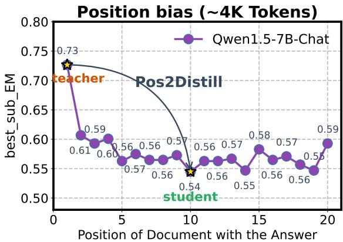  
Figure 1: Motivation for Pos2Distill. Marked performance decline from the 1st to 10th position in multidocument QA underscores severe PB. From an alternative viewpoint, superior responses at advantageous positions provide effective supervisory signals for less optimal positions.

2023) and length extrapolation techniques (He et al., 2024; Chi et al., 2023b; Press et al., 2021). These breakthroughs enable LLMs to tackle complex question answering over substantially larger context windows (Agarwal et al., 2024), marking a crucial step towards more capable and versatile natural language systems.

Nevertheless, recent studies point out a critical limitation: LLMs do not uniformly extract and utilize information across long context, consistently favoring information located at the context edges while neglecting that in the middle. This phenomenon, commonly termed the lost in the middle problem (Liu et al., 2024), underscores a pervasive and intrinsic PB inherent in long-context handling.

PB poses significant obstacles in informationrich settings, such as retrieval-augmented generation (Fang et al., 2025; Dong et al., 2025b), longcontext reasoning (Li et al., 2024a; Kuratov et al., 2024), and LLM-as-a-judge (Wang et al., 2024b; Li et al., 2024c). When critical information is distributed arbitrarily throughout the input, LLMs fail to identify and integrate gold content (Baker et al., 2024a; Peng et al., 2025), culminating in unexpected model failures across various applications.

To alleviate PB, prior research has delved into its underlying causes, seeking to modify key architectural components or internal representations linked to uneven contextual sensitivity (Zhang et al., 2024c; Chen et al., 2024). Despite recent progress in narrowing the performance gap, a substantial disparity in information utilization between advantageous and disadvantaged positions still persists. Another line resorts to intensive contextual awareness training (An et al., 2024; Zhang et al., 2024a) by synthesizing training data with fine-grained information awareness (Zhang et al., 2024b). However, such data-driven approaches typically incur substantial costs in both data synthesis and computational resources. Consequently, there remains a critical need for effective and efficient strategies to mitigate PB that overcome these limitations.

Inspired by the proverb 1, we contend that PB not only imposes challenges but also implicitly reveals gold signals, which can be exploited to mitigate position-induced disparity (Fig. 1). Our analysis further reveals that PB exhibits distinct behavior under retrieval and reasoning paradigms. In retrieval tasks, PB predominantly manifests as tokenshifting, whereas in reasoning tasks, PB interacts with Chain-of-Thought (CoT) processes (Wei et al., 2022), leading to thought-shifting, characterized by deviations in the reasoning trajectory.

To this end, we introduce Pos2Distill, a novel position to position knowledge distillation framework, transferring knowledge from advantageous positions to rectify responses at unfavorable ones. Customarily, we develop two systems: Pos2Distill-R1 and Pos2Distill-R2. Pos2distill-R1 mitigates tokenshifting in retrieval by incorporating Kullback-Leibler (KL) divergence loss (Kullback and Leibler, 1951), providing fine-grained corrective signals. Pos2Distill-R2 addresses thought-shifting in reasoning tasks by distilling high-quality CoT responses from advantageously positioned inputs to guide and rectify reasoning trajectories at less favorable positions.

Extensive experiments demonstrate that Pos2Distill leads to more uniform and substantially improved performance both for in-context retrieval and reasoning tasks. Furthermore, data efficiency is a notable property of our method: with only 250 training instances, Pos2Distill increases the performance of Mistral-7B-v0.3 on the NQ dataset by 6.7%, as indicated in Fig. 5.

Our contributions can be summarized as follows:

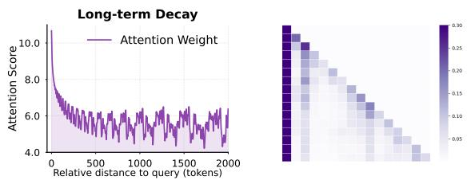  
Figure 2: Left: long-term decay effect property of RoPE; Right: Attention sink (causal attention matrix).

• We uncover distinct manifestations of PB under retrieval and reasoning paradigms, namely tokenshifting and thought-shifting, offering deeper insights into the nature of PB.

• We propose Pos2Distill, a novel position to position KD framework to mitigate PB. Given the different behavior of PB, we design two systems tailored to address the PB in both scenarios.

• Extensive experiments and ablation studies thoroughly demonstrate the efficacy in terms of performance, data efficiency, and superior generalization.

## 2 Related Work

Causes of Position Bias. Most LLMs adopt relative positional encodings (Peysakhovich and Lerer, 2023), such as RoPE (Su et al., 2024) and ALiBi (Press et al., 2021), integrating token relative distances into attention score computation. This design induces a long-range decay effect in Fig. 2 (left), whereby LLMs preferentially attend to recent tokens. Concurrently, LLMs exhibit a notable bias towards the initial tokens, which can be largely attributed to the universal phenomenon, attention sink (Xiao et al., 2024; Gu et al., 2025), where disproportionate attention is allocated to early tokens in Fig. 2 (right), regardless of semantic significance. In addition, causal mask enforces a unidirectional flow of information, implicitly encoding positional information (Haviv et al., 2022; Chi et al., 2023a; Wang et al., 2024a). The interplay of these factors collectively contributes to the emergence of PB, as further elaborated in Appendix A.

Mechanistic Approaches. Current approaches predominantly focus on aforementioned underlying causes of PB. A broad spectrum of interventions has been investigated, ranging from modifications to position encodings (Zhang et al., 2024c; Chen et al., 2024; Lin et al., 2024) and alterations to causal masks (Wang et al., 2025b), to the manipulation of internal states, including attention reweighting (Hsieh et al., 2024; Tan et al., 2025) and hidden state manipulation (Yu et al., 2024). Despite these efforts, the substantial performance gap across token positions remains largely unmitigated.

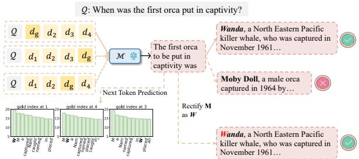

(a) Natural PB for Retrieval.  
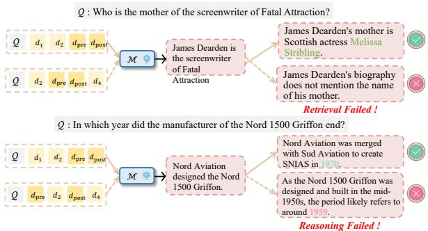  
(b) Compound PB for Reasoning.  
Figure 3: Different Behavior of Position Bias.

Training Approaches. Standard next-token prediction pretraining often yields LLMs with inadequate contextual awareness (Shi et al., 2024). A research direction therefore explores specialized datasets designed to foster fine-grained information awareness (Zhang et al., 2024b), training LLMs to identify pertinent information within their full context. Nevertheless, the considerable data and computational overhead limit their scalability and practical viability.

## 3 Behavior of Position Bias

Natural PB for Retrieval. Given documents with identical constituent elements arranged in varying orders, our empirical observations indicate that the model’s output variability is not uniform across the entire response, but rather highly concentrated at a few decisive turning positions1. This heterogeneous sensitivity leads to token shifting: the model produced erroneous tokens at these critical positions, consequently retrieval failed. Specifically, as illustrated in Fig. 3a, even with consistent prefix output, an erroneous generation of "M" instead of the correct "W" triggers retrieval failure. Moreover, we observe that manual correction of this misaligned token (e.g., changing "M" to "W") enables the model to successfully resume generation and complete the retrieval task. This finding uncovers a token recovery mechanism: once a misaligned token resulting from shifting is rectified, the model can realign its subsequent output. (More supported analysis experiments are provided in Appendix B .)

Compound PB for Reasoning. In-context reasoning fundamentally incorporates two processes: retrieval and reasoning. The two processes are deeply intertwined, creating a virtuous cycle and producing numerous outputs (Ren et al., 2025, 2024). Chain-of-Thought (CoT) reasoning guides the model to formulate more targeted queries, thereby enhancing the precision of the retrieval process (Wang et al., 2024c). Conversely, access to accurate, retrieved information provides the factual grounding needed to steer and validate the reasoning steps, thus ensuring the logical integrity of the reasoning chain. At the same time, the selection of reasoning path is very sensitive to irrelevant contexts (Yang et al., 2025b). Within this setting, PB is reflected both in variations during retrieval and in alterations that occur during reasoning. Examples of these two types of failures are presented in Fig. 3b. Therefore, it is crucial to reshape the overall response trajectory by integrating genuinely relevant information and reasoning chain.

## 4 Methodology

PB behaves differently in retrieval and reasoning; thus, a unified approach fails to capture their inherent distinctions. Therefore, we propose two tailored position-aware distillation strategies: (1) For Retrieval (Pos2Distill-R1), we directly calibrate token shifting. (2) For Reasoning (Pos2Distill-R2), we transfer high-quality reasoning patterns from advantageous to suboptimal positions, thereby effectively mitigating the compounded bias.

## 4.1 Preliminary

Task Definition. Following Wang et al. (2025b), we formally define a long-context task as follows. Given the task-specific instruction , a set of n retrieved documents $\mathcal { D } { : = \{ d _ { i } \} } _ { i = 1 } ^ { n }$ , and a contextdependent question , a specific LLM  parameterized by $P _ { \Theta }$ , generates a response conditioned on the corresponding prompt $\mathcal { P } { : = \{ \mathcal { I } | \gamma ( \mathcal { D } ) | \mathcal { Q } \} }$ }, where the function γ determines the specific ordering of documents in .

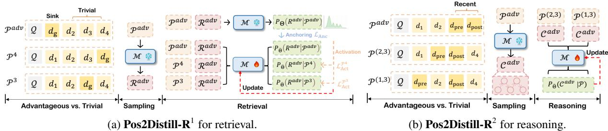  
Figure 4: The design of our Pos2Distill. The left subfigure illustrates Pos2Distill-R1, highlighting its two key strategies: Activation of Trivial Positions and Anchoring of Advantageous Positions. The right subfigure depicts $\mathbf { P o s 2 D i s t i l l - R } ^ { 2 }$ , designed to reshape reasoning trajectories.

Retrieval vs. Reasoning. Retrieval tasks involve identifying an answer directly present in a single document $d _ { \mathrm { g o l d } } \in \mathcal { D }$ (Dong et al., 2025a; Liu et al., 2025). When $d _ { \mathrm { g o l d } }$ is located at index i within $\mathcal { D } .$ the associated prompt is denoted as ${ \mathcal { P } } ^ { i }$ , and the response to this prompt is $\mathcal { R } ^ { * } \sim \mathcal { M } ( \mathcal { P } ^ { * } )$ . In contrast, reasoning tasks require to integrate information from multiple documents. For formulation brevity, we focus on the two-hop reasoning setting, which involves a first-hop document $d _ { \mathrm { p r e } }$ at index i and a second-hop document $d _ { \mathrm { p o s t } }$ at index j in . The reasoning prompt is denoted as $\mathcal { P } ^ { ( i , j ) }$ , and the corresponding response is $\mathcal { C } ^ { * } \sim \mathcal { M } ( \mathcal { P } ^ { * } )$ .

Objective. The primary objective of Pos2Distill is to enable a model  such that, for any input ${ \mathcal { P } } ^ { i }$ during generation, emulates a scenario in which a gold document or a pair of sequentially relevant documents are placed at the most advantageous positions within the input context. Specifically, the advantageous position is designated as the “sink position” $( \mathcal { P } ^ { 1 } )$ for Retrieval and as the “recent position” $( \mathcal { P } ^ { ( n - 1 , n ) } )$ for Reasoning (shown in Fig. 4).

## 4.2 Pos2Distill-R1 for Retrieval

Overall Framework. This section presents $\mathbf { P o s } 2 \mathbf { D i s t i l l - R } ^ { 1 }$ , engineered to calibrate tokenshifting behavior and hence mitigate PB for retrieval tasks. The framework consists of two core modules: Activation ofTrivial Positions and Anchoring of Advantageous Positions in Fig. 4a. The former facilitates the transfer of effective processing capabilities from high-performing advantageous positions to underutilized trivial positions, while the latter ensures the preservation of established performance at advantageous positions, thereby narrowing the gap between trivial and advantageous positions.

Trivial vs. Advantageous Positions. For retrieval tasks, we formally define the advantageous position as the first position (sink position), with the remaining positions $\{ 2 , \ldots , n \}$ designated as trivial ones. For $d _ { g o l d }$ occupies the sink position, the attention sink region overlaps with $d _ { g o l d } .$ , thereby generating high-quality outputs that inherently imply optimal and robust attention patterns (discussed in 2) 2.

Activation of Trivial Positions. To rectify tokenshifting behavior, we leverage KL divergence as a fine-grained alignment signal at each generation step. Concretely, we first sample responses $\mathcal { R } ^ { \mathrm { a d v } } \sim \mathcal { M } ( \mathcal { P } ^ { \mathrm { a d v } } )$ from advantageous positions. We then construct  prompts, each corresponding to a distinct trivial position, denoted as $\{ \mathcal { P } ^ { n _ { k } } \} _ { k = 1 } ^ { K }$ with $n _ { i } \in \{ 2 , \ldots , n \}$ . Our objective is to align the ’s predicted probability distribution over $\mathcal { R } ^ { \mathrm { a d v } }$ conditioned on each trivial prompt ${ \mathcal { P } } ^ { i }$ , with the native distribution over ${ \mathcal { R } } ^ { \mathrm { a d v } }$ conditioned on ${ \mathcal { P } } ^ { \mathrm { a d v } }$ Formally, for a given position $n _ { i } .$ , knowledge distillation at $n _ { i }$ is defined as:

$$
\mathcal { L } _ { \mathrm { A c t } } ^ { \mathcal { P } ^ { n } } { = } \mathbb { E } \left[ \mathrm { K L } \left( P _ { \Theta } ( \mathcal { R } ^ { \mathrm { a d v } } | \mathcal { P } ^ { \mathrm { a d v } } ) \parallel P _ { \widehat { \Theta } } ( \mathcal { R } ^ { \mathrm { a d v } } | \mathcal { P } ^ { n _ { i } } ) \right) \right]
$$

where $P _ { \Theta } ( \mathcal { R } ^ { \mathrm { a d v } } | \mathcal { P } )$ denotes the probability distribution over outputs ${ \mathcal { R } } ^ { \mathrm { a d v } }$ conditioned on input $\mathcal { P }$ Here, $\widehat { \Theta }$ represents the updated parameters at the bcurrent step. Notably, throughout training, we consistently treat $P _ { \Theta } ( \mathcal { R } ^ { \mathrm { a d v } } | \mathcal { P } )$ as the teacher distribution rather than $P _ { \widehat { \Theta } }$ , avoiding the loss of advantages bat the sink position during model updates.

Position-Aware Alignment. However, due to the impact on different trivial positions induced by PB varies, the alignment difficulty between $P _ { \Theta } ( \mathcal { R } ^ { \mathrm { a d v } } ) | \mathcal { P } ^ { \mathrm { a d v } } )$ and $P _ { \widehat { \Theta } } ( \mathcal { R } ^ { \mathrm { a d v } } | \mathcal { P } ^ { n _ { i } } )$ is positionbdependent. Intuitively, positions with higher alignment difficulty should be prioritized with gradient updates to better domain adaptation. Motivated by this intuition, we introduce Position-Aware Alignment, a dynamic learning strategy that adaptively adjusts learning based on alignment difficulty, ensuring balanced and effective training. Technically, given a batch of examples $\{ \mathcal { Q } _ { b } \} _ { b = 1 } ^ { | B | }$ and their corresponding trivial prompts $\{ \bar { \mathcal { P } } _ { j } ^ { n _ { k } } \} _ { k = 1 } ^ { K }$ for each $\mathcal { Q } _ { j } , \mathcal { K } \cdot B$ prompts are divided into $n - 1$ distinct trivial bins based on their trivial positions. Each bin is represented as $\widehat { B } _ { i } = \{ { \mathcal P } _ { j } ^ { i } \ \mid \ { \mathcal P } _ { j } ^ { i } \in \ B , j \ \in$ $\{ 1 , \ldots , | B | \} \}$ b. To model alignment difficulty for each trivial position, we introduce an inter-position weighting scheme for position variations induced by PB while introducing an intra-position weight for differentiating instance variations in the same trivial bin $\widehat { B _ { i } }$ . Therefore, a dynamic weight $\alpha _ { i j }$ for beach instance is defined as follows:

$$
\alpha _ { i j } = \underbrace { \frac { \exp { \left( \frac { 1 } { | \widehat { \mathcal { B } } _ { i } | } \sum _ { j = 1 } ^ { | \widehat { \mathcal { B } } _ { i } | } \mathcal { L } _ { \mathrm { A c t } } ^ { \mathcal { P } _ { j } ^ { i } } \right) } } { \displaystyle \sum _ { i = 2 } ^ { n } \exp { \left( \frac { 1 } { | \widehat { \mathcal { B } } _ { i } | } \sum _ { j = 1 } ^ { | \widehat { \mathcal { B } } _ { i } | } \mathcal { L } _ { \mathrm { A c t } } ^ { \mathcal { P } _ { j } ^ { i } } \right) } } } _ { i n t e r - p o s } \cdot \underbrace { \frac { \mathcal { L } _ { \mathrm { A c t } } ^ { \mathcal { P } _ { j } ^ { i } } } { \displaystyle \operatorname* { m a x } { \left\{ \mathcal { L } _ { \mathrm { A c t } } ^ { \mathcal { P } _ { k } ^ { i } } \right\} } } } _ { i n t r a - p o s } .
$$

The activation loss of  can be formulated as:

$$
\mathcal { L } _ { \mathrm { A c t } } = \sum _ { i } ^ { n } \sum _ { j } ^ { | \widehat { B } _ { i } | } \alpha _ { i j } \mathcal { L } _ { \mathrm { A c t } } ^ { \mathcal { P } _ { j } ^ { i } } .
$$

Anchoring of Advantageous Positions. During the distillation process, $\mathcal { M }$ becomes aware that the gold information possibly appear at any location within the context window, which can dilute significant attention to the sink position, potentially impairing the overall capability on diverse downstream tasks To prevent this, we introduce an anchoring loss to preserve the effectiveness of the advantageous position:

$$
\mathcal { L } _ { \mathrm { A n c } } = \mathbb { E } \left[ \mathrm { K L } \left( P _ { \Theta } ( \mathcal { R } ^ { \mathrm { a d v } } | \mathcal { P } ^ { \mathrm { a d v } } ) | | P _ { \widehat { \Theta } } ( \mathcal { R } ^ { \mathrm { a d v } } | \mathcal { P } ^ { \mathrm { a d v } } ) \right) \right] .
$$

Training Objective. Our approach optimizes a composite loss function that integrates activation loss and anchoring loss, formally:

$$
\begin{array} { r } { \mathcal { L } = \mathcal { L } _ { \mathrm { A c t } } + \lambda \mathcal { L } _ { \mathrm { A n c } } , } \end{array}
$$

where λ is a hyperparameter controlling the intensity of the anchoring loss in joint learning.

## 4.3 Pos2Distill-R2 for In-context Reasoning

This section introduces the $\mathbf { P o s } 2 \mathbf { D i s t i l l - R } ^ { 2 }$ to reshape reasoning trajectories. The core principle underlying this method is to ensure that the correct reasoning process is consistently activated, irrespective of the positions of relevant documents.

Trivial vs. Advantageous Positions. Although PB in multi-hop reasoning scenario is sophisticated, insights from (Baker et al., 2024b) allow us to summarize several key patterns: PB is closely associated with the absolute position within the context window, the distance between relevant documents, and their relative order.3 Empirically, placing $d _ { \mathrm { p r e } }$ and $d _ { \mathrm { p o s t } }$ at indices $n - 1$ and n is expected to yield optimal performance. Consequently, we formally define the ${ \mathcal { P } } ^ { \mathrm { a d v } }$ for reasoning tasks as ${ \mathcal { P } } ^ { ( n - 1 , n ) }$

Reshaping Reasoning Trajectories. We begin by sampling CoT reasoning trajectories from the advantageous positions ${ \mathcal { P } } ^ { \mathrm { a d v } }$ , denoted as $\mathcal { C } ^ { \mathrm { { a d v } } } \sim$ ${ \mathcal { M } } ( { \mathcal { P } } ^ { \mathrm { a d v } } )$ Similar to the procedure for $R e \mathrm { - }$ trieval tasks, we construct  distinct prompts for each position set $\{ n _ { k } ^ { p r e } , n _ { k } ^ { p o s t } \}$ , denoted as $\{ \mathcal { P } ^ { \left( n _ { k } ^ { \mathrm { p r e } } , n _ { k } ^ { \mathrm { p o s t } } \right) } \} _ { k = 1 } ^ { K }$ , where $n _ { k } ^ { \mathrm { p r e } }$ and $n _ { k } ^ { \mathrm { p o s t } }$ are selected from the set $\{ 1 , \ldots , n \}$ subject to $n _ { k } ^ { \mathrm { p r e } } \neq n _ { k } ^ { \mathrm { p o s t } }$ The prompts $\mathcal { P } ^ { \left( n _ { k } ^ { \mathrm { p r e } } , n _ { k } ^ { \mathrm { p o s t } } \right) }$ and their corresponding reasoning trajectory ${ \mathcal { C } } ^ { \mathrm { a d v } }$ are subsequently optimized using the cross-entropy (CE) loss function to effectively capture the reasoning patterns. Formally,

$$
\mathcal { L } = - \sum _ { k = 1 } ^ { \mathcal { K } } \log \mathcal { M } \left( \mathcal { C } ^ { \mathrm { a d v } } \mid \mathcal { P } ^ { \left( n _ { k } ^ { \mathrm { p r e } } , n _ { k } ^ { \mathrm { p o s t } } \right) } \right) .
$$

## 5 Experiments

## 5.1 Experimental Setup

Setup for Pos2Distill-R1. We apply Pos2Distill-${ \tt R } ^ { 1 }$ to three LLMs, including Mistral-7B-Instructv0.3 (Jiang et al., 2023), Qwen1.5-7B-Chat (Bai et al., 2023), and Llama-3-8B-Instruct (Touvron et al., 2023), all of which exhibit severe PB in retrieval tasks. The evaluation leverages three datasets: NaturalQuestions (NQ) (Kwiatkowski et al., 2019), TriviaQA (TQA) (Joshi et al., 2017) and WebQA (WebQ) (Berant et al., 2013), and a specilized task KV Retrieval (Liu et al., 2024). These datasets are setting as retrieval-augmented QA, with each question accompanied by 20 documents.

• Baselines: We compare our approach with base model, Ms-PoE (Zhang et al., 2024c), vanilla SFT and SeqKD (Kim and Rush, 2016).

• Evaluation: We assess PB by measuring task performance as $d _ { \mathrm { g o l d } }$ is systematically placed at various positions.

<table><tr><td rowspan="2">Methods</td><td rowspan="2">NQ 1st 5th 10th 15th</td><td colspan="4">KV Retrieval</td><td rowspan="2">TQA</td><td colspan="2"></td><td rowspan="2">WebQ 20th</td></tr><tr><td>20th Avg. 0%</td><td>25% 50% 75%</td><td>100% Avg.</td><td>1st 5th</td><td>10th 15th 20th Avg.</td><td>1st 5th 10th 15th</td></tr><tr><td rowspan="4">MISTRAL-7B +Ms-PoE +SFT</td><td>|72.5 62.3 60.7 63.9 64.9</td><td>99.8 97.6</td><td>62.0 35.6</td><td>78.0</td><td>85.2</td><td></td><td>82.2 82.7 |82.7</td><td></td><td></td><td>Avg.</td></tr><tr><td>67.3 58.7 56.7 60.1 61.5</td><td>64.8 60.9 99.8 97.7</td><td>78.4 75.2</td><td></td><td>74.6 89.3 81.3</td><td>81.8 81.8 82.6</td><td></td><td>69.7 64.5</td><td>62.4 62.5 63.5</td><td>68.4</td></tr><tr><td>68.3 64.5 66.5 66.7 62.7</td><td>65.7 100.0 89.0</td><td>89.2 75.6</td><td>95.3 81.8</td><td>87.1</td><td>79.3 76.7 79.2</td><td>83.4 80.0 76.7</td><td>64.1 62.3</td><td>59.3</td><td>65.2</td></tr><tr><td>63.3 59.1 59.3 60.5 57.5</td><td>59.9 100.0 86.4</td><td>93.0 87.0</td><td></td><td>78.2 77.4</td><td>78.0 76.8 77.2 76.2</td><td>77.3 52.7</td><td>51.1 52.3</td><td>50.7 53.9</td><td>52.1</td></tr><tr><td rowspan="3">+Pos2Distill QWEN1.5-7B +Ms-PoE</td><td>70.5 70.7 71.3 71.9 73.3</td><td>99.0 95.4</td><td>92.6 90.0</td><td>93.0</td><td>91.8</td><td>77.6 76.4 77.6</td><td>75.8 77.0</td><td>57.7 58.9</td><td>55.7 56.9 56.1</td><td>57.0</td></tr><tr><td></td><td>71.1</td><td></td><td>96.8</td><td>94.8</td><td>85.3 82.4 84.6</td><td>83.4 81.8 83.5</td><td>70.3 67.9</td><td>68.3 70.5 67.5</td><td>68.9</td></tr><tr><td>57.3 56.9 57.3 60.9 61.2</td><td>100.0 83.8 38.7</td><td>23.3 30.3</td><td>55.2</td><td>82.4 74.7</td><td>75.4 76.4</td><td>76.6</td><td>51.5</td><td>50.3 55.2</td><td>54.4</td></tr><tr><td rowspan="3">+SFT +SeqKD</td><td>73.6 67.4 54.8 54.2 57.4 61.3</td><td>59.0 97.4 76.5</td><td>4.7 6.3</td><td>3.2</td><td>37.6</td><td>73.9 76.4 75.2 69.4</td><td>67.4 75.1 72.7</td><td>|64.3 50.9 65.2</td><td></td><td>55.7</td></tr><tr><td>63.5 59.7 62.5 62.5 63.9</td><td>62.9 62.2 100.0</td><td>97.0 95.8 88.8</td><td>91.2</td><td>94.6</td><td>77.6 77.0 78.4</td><td>77.4 77.4 77.6</td><td>5..5 54.9</td><td>5.55 49.7 55.6 52.3 52.5</td><td>52.8</td></tr><tr><td>58.5 62.5 61.1 57.7 60.7 100.0</td><td>91.6 66.9</td><td>50.5 54.5</td><td>72.7</td><td>80.2 77.0</td><td>80.2 78.8 75.6</td><td>78.4</td><td></td><td>54.9</td><td></td></tr><tr><td rowspan="3">+Pos2Distill LLAMA-3-8B</td><td>69.9 67.3 68.1 69.1 67.5 68.4</td><td>99.8 97.3</td><td>96.5 97.5</td><td>93.2</td><td>96.9</td><td>79.8 79.0</td><td>80.6 78.1 80.0</td><td>56.1 54.5</td><td>55.3 54.5</td><td>55.1</td></tr><tr><td>67.9 56.7 53.7</td><td>57.9 60.8 59.4 98.0</td><td>70.3</td><td></td><td></td><td>82.6</td><td></td><td>64.9 61.5</td><td>61.5 61.3 61.8</td><td>62.2</td></tr><tr><td>60.4</td><td>78.3</td><td>83.2 81.2</td><td>68.5</td><td>85.6</td><td>83.4 84.0 83.2</td><td>83.7 57.9 51.8</td><td>50.7</td><td>50.7 52..3</td><td>52.8</td></tr><tr><td rowspan="2">+Ms-PoE +SFT +SeqKD</td><td>65.7 58.5 57.3 58.2 62.5</td><td>85.3 97.5 98.6 93.0</td><td></td><td>73.4</td><td>81.15</td><td>82.2 86.4 84.2</td><td>81.5 82.7 83333</td><td>56.2 52.3</td><td>52.1 49.8</td><td>52.5</td></tr><tr><td>65.1 60.7 62.1 65.3 66.7 61.7 58.7 58.9 59.9 61.9</td><td>63.9 60.2 100.0</td><td>97.0 95.6 95.2 98.2</td><td>98.0 96.8 97.6</td><td>96.7 97.3</td><td>82.8 83.4 84.8 82.4 84.6 83.6</td><td>83.2 83.2 84.2 82.6 83.5</td><td>56.8 54.7 54.5 53.7</td><td>55.1 55.3 54.5 52.9 51.9 52.5</td><td>55.3 53.1</td></tr></table>

Table 1: Main results of Pos2Distill-R1 on both Retrieval-Augmented QA datasets and KV retrieval (140 KV pairs).

<table><tr><td colspan="2">Retrieval-Augmented QA</td><td colspan="3"></td></tr><tr><td>Num. Meth.</td><td>0% 63.3</td><td>25% 50% 75% 100% 61.2 63.5 65.1</td><td>Avg.↑ GAP.↓ LEN. 65.1</td><td>11.1</td></tr><tr><td>20</td><td>BASE. 72.3 ours 72.3 BASE. 73.7</td><td>69.5 67.5 68.5 69.7</td><td>69.5 4.8 63.8 14.2</td><td>3.3k</td></tr><tr><td>30</td><td>759.5 ours. 70.3 67.9</td><td>60.5 61.3 64.1 69.3 67.3 70.9</td><td>69.1 3.6 12.6</td><td>4k</td></tr><tr><td>40</td><td>BASE. 72.7 760.1 ours. 67.1 66.7</td><td>61.3 61.7 65.7 68.3 66.5 68.3</td><td>64.3 67.4 1.8</td><td>6k</td></tr><tr><td>50</td><td>BASE. 74.7 56.9 ours. 69.1 66.1</td><td>58. 59.5 66.3 66.7 66.1 67.9</td><td>63.1 17.8 67.2 3.0</td><td>8k</td></tr></table>

Table 2: Generalization of Pos2Distill-R1 on longer context. (Mistral-7B-v0.3 trained on 20 docs).

Setup for Pos2Distill-R2. For in-context reasoning, we utilize two capable LLMs: Llama-3.1-8B-Instruct and Qwen2.5-7B-Instruct. The evaluation is performed on three long-context multi-hop reasoning datasets: Hotpot QA (Yang et al., 2018), MusiQue (Trivedi et al., 2022) and 2WikiMulti-HopQA (Ho et al., 2020). (All details in Appx. C)

• Baselines: We compare two self-training baselines utilizing CoT data: SEALONG (Li et al., 2024a) and LONGFAITH-SFT and LONGFAITH-DPO (Yang et al., 2025a)4.

• Evaluation: We evaluate from two aspects: (1) performance gains in long-context reasoning, and (2) performance gap induced by the positions.

## 5.2 Main Results for Pos2Distill-R1

Pos2Distill-R1 obviously mitigates PB. Tab. 1 summarizes the performance of various methods across different benchmarks. Our analysis yields two key findings: First, Pos2Distill-R1 demonstrates robust and uniform performance irrespective of the position of $d _ { \mathrm { g o l d } } .$ markedly reducing positioninduced performance disparities. For example, on WebQ dataset, Pos2Distill-R1 enables Llama-3-8B to achieve an average accuracy of 56.7% across 20 positions. This performance, comparable to

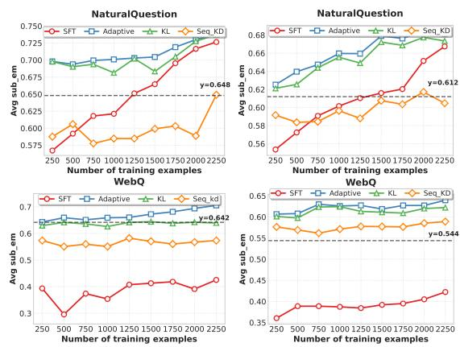  
(a) Mistral-7B  
(b) Qwen1.5-7B  
Figure 5: Ablation for Pos2Distill-R1. Each point shows mean accuracy, averaged across gold document positions 1,5,10,15,20. The x-axis represents the total size of training data, which increases with the number of questions, while is fixed. "KL" refers to word-level KD; adaptive refers to our approach.

57.9% attained when $d _ { \mathrm { g o l d } }$ is situated at an optimal sink position, illustrates successful knowledge transfer from advantageous to unfavorable positions, the core principle of Pos2Distill-R1. Notably, our method significantly outperforms standard SFT, which suggests that the closer distributions of adv and trivial allows LLMs to adapt more readily than when learning from markedly different distributions, leading to the high data efficiency detailed in Sec. 5.2.2. Furthermore, Pos2Distill-R1 effectively generalizes to longer contexts. When evaluated with contexts containing 20 to 50 documents, Mistral-7B-v0.3 trained on 20-document contexts maintains both high overall accuracy and positional uniformity in Tab. 2. Crucially, it exhibits significantly narrowed performance gaps across positions.

## 5.2.1 Ablation for Pos2Distill-R1

To verify the effectiveness of our design, we conducted comprehensive ablation studies in Tab. 3. Our findings yield several important insights:

<table><tr><td>Method</td><td>1</td><td>5</td><td>10</td><td>15</td><td>20</td><td>AVG.</td></tr><tr><td>Base</td><td>73.6</td><td>57.3</td><td>56.9</td><td>57.3</td><td>60.9</td><td>61.2</td></tr><tr><td>SeqKD</td><td>61.7</td><td>58.7</td><td>58.9</td><td>59.9</td><td>61.9</td><td>60.2</td></tr><tr><td>KL</td><td>61.7</td><td>64.3</td><td>65.6</td><td>66.4</td><td>67.6</td><td>65.1</td></tr><tr><td>KL+Align</td><td>64.5</td><td>66.5</td><td>67.8</td><td>67.3</td><td>67.4</td><td>66.7</td></tr><tr><td>KL+Align+Anc.</td><td>69.9</td><td>67.3</td><td>68.1</td><td>69.1</td><td>67.5</td><td>68.4</td></tr></table>

Table 3: Ablation study of two core modules for Qwen1.5-7B-Chat: the adaptive strategy targeting trivial positions and the anchoring strategy for advantageous positions. The hyperparameter λ is set to 1.

KL is effective for token-shifting correction. When trained on identical data compositions, the inferior performance of SeqKD highlights the shortcomings of hard-label supervision in scenarios involving token-shifting. In contrast, KL offer a superior mechanism for correcting such shifts compared to the rigid guidance This property makes KL loss particularly well-suited for token-recovery.

Position-aware alignment ensures balance and better learning. Integrating our Position-Aware Alignment strategy with KL divergence leads to significantly more balanced and robust performance, increasing the average score to 66.7.

Anchoring strategy reinforces robustness via key position focus. Incorporating anchoring not only addresses attention dilution at sink positions, but also yields performance gains across other positions. With an average score of 68.4, the strategy is particularly effective at position 1 while maintaining strong performance at trivial positions.

## 5.2.2 Analysis Results

We investigate the property of Pos2Distill- $- \mathbf { R } ^ { 1 }$ , presenting comprehensive results in Fig. 5. High Data Efficiency. As shown in Fig. 5, our positional awareness metrics achieve superior performance with minimal training data (e.g., Mistral-7B achieves 70.2% accuracy with just 250 examples) and consistently outperform other strategies as the dataset grows. This highlights the data efficiency of our approach. As discussed before, this efficiency stems from the distribution similarity in responses, enabling rapid adaptation to in-domain data, avoiding reliance on entirely out-of-domain samples.

The Impact of . We conduct studies on by varying its value from 1 to 10 while keeping other settings fixed. Increasing  from 0 to 6 improves LLM performance by 4.6% improvement in LLM performance, but further increase to 10 shows marginal gains with performance saturation. To balance effectiveness and computational efficiency, we select $\mathcal { K } = 4 \sim 6$ as the optimal configuration.

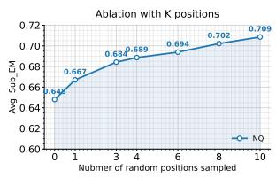

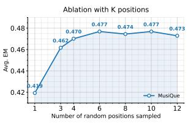  
Figure 6: Ablation for the number of sampled positions for Pos2Distill- $- \mathbf { R } ^ { 1 }$ (left) and Pos2Distill- $\cdot \mathbf { R } ^ { 2 }$ (right).

Mechanistic Insights. Since PB emerges from the architectures and parameters of LLMs, we seek to uncover the internal model dynamics following $\mathrm { P o s } 2 \mathrm { D i s t i l l - R } ^ { 1 }$ and provide an interpretable explanation. We record the attention distribution over 20 documents as $d _ { \mathrm { g o l d } }$ moves from 1 to 20 in Fig. 7. Pos2Distill- $- \mathbf { R } ^ { 1 }$ strengthens contextual fidelity by dynamically shifting the focus of attention to consistently align with the relevant document, thereby facilitating more accurate retrieval.

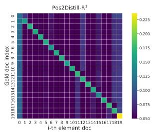

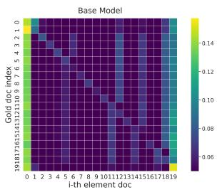  
Figure 7: Attention distribution of each doc across total 20 docs, as the position of $d _ { g o l d }$ varies from 1 to 20.

## 5.3 Main Results for Pos2Distill- $\mathbf { \nabla } \cdot \mathbf { R } ^ { 2 }$

Pos2Distill-R2 strengthens in-context reasoning. $\mathbf { P o s } 2 \mathbf { D i s t i l l - R } ^ { 2 }$ surpasses existing self-training approaches in both in-domain performance and outof-domain generalization. As detailed in Tab. 4, when trained on the MusiQue dataset, Pos2Distill-$\mathbf { R } ^ { 2 }$ achieves an Exact Match (EM) score of 42.8, outperforming all leading baselines. Furthermore, our method exhibits robust cross-domain generalization; for instance, on the HotpotQA dataset, it attains an EM score of 58.3, compared to 50.9 from the strongest baseline. Our findings suggest that training LLMs to reason across diverse, scattered gold positions potentially enhances their longcontext reasoning more effectively than conventional instance-by-instance training. This insight offers a new perspective for improving reasoning capabilities in complex, long-context tasks.

To assess PB within the reasoning paradigm, we evaluate performance on two-hop data from

<table><tr><td></td><td colspan="3">MuSiQue</td><td colspan="3">2WikiMultiHopQA</td><td colspan="3">HotpotQA</td></tr><tr><td>LLAMA-3.1-8B</td><td>Overall</td><td>2-Hop</td><td>3-Hop</td><td>4-Hop</td><td>Overall</td><td>2-Hop</td><td>4-Hop Overall</td><td>Bridge</td><td>Comparison</td></tr><tr><td>+CoT</td><td>11.8</td><td>11.9</td><td>11.9</td><td>7.7</td><td>27.4</td><td>23.4</td><td>40.8</td><td>19.4 19.3</td><td>23.7</td></tr><tr><td>+CoC</td><td>13.2</td><td>13.3</td><td>14.7</td><td>11.1</td><td>33.8</td><td>38.0</td><td>50.5</td><td>23.2 21.8</td><td>29.5</td></tr><tr><td>+SEALONG</td><td>25.5</td><td>31.6</td><td>24.5</td><td>15.3</td><td>52.6</td><td>48.6 66.3</td><td>49.6</td><td>47.7</td><td>56.7</td></tr><tr><td>+LONGFAITH-SFT (CoT)</td><td>39.9</td><td>43.5</td><td>37.5</td><td>29.1</td><td>55.0</td><td>49.6 72.9</td><td>49.8</td><td>50.5</td><td>46.7</td></tr><tr><td>+LONGFAITH-SFT (CoC)</td><td>39.6</td><td>44.4</td><td>38.3</td><td>29.9</td><td>56.6</td><td>50.9</td><td>75.1</td><td>50.9 51.3</td><td>50.7</td></tr><tr><td>+LONGFAITH-DPO</td><td>34.2</td><td>38.8</td><td>32.9</td><td>25.8</td><td>51.2</td><td>48.8</td><td>59.8</td><td>49.7 49.8</td><td>42.2</td></tr><tr><td>+POS2DISTILL</td><td>42.8+2.9</td><td>47.4+3.0</td><td>38.4+0.1</td><td>31.6+1.7</td><td>61.8+5.2</td><td>57.0+6.1</td><td>78.0+2.9</td><td>58.3+7.4 56.5+5.2</td><td>65.8+9.1</td></tr><tr><td>QWEN2.5-7B</td><td>Overall</td><td>2-Hop</td><td>3-Hop</td><td>4-Hop</td><td>Overall</td><td>2-Hop</td><td>4-Hop</td><td>Overall Bridge</td><td>Comparison</td></tr><tr><td>+CoT</td><td>28.7</td><td>30.4</td><td>29.1</td><td></td><td>49.5 41.9</td><td></td><td></td><td></td><td></td></tr><tr><td>+CoC</td><td>25.9</td><td>26.3</td><td>28.6</td><td>25.2 23.7</td><td>45.9 38.0</td><td>76.6 74.3</td><td>52.1 47.3</td><td>49.1 43.7</td><td>62.5</td></tr><tr><td>+SEALONG</td><td>33.0</td><td>34.5</td><td>31.1</td><td>28.6</td><td>47.6</td><td>42.3 68.0</td><td>48.6</td><td>48.6</td><td>60.6 42.1</td></tr><tr><td>+LONGFAITH-SFT(CoT)</td><td>43.3</td><td>45.9</td><td>41.1</td><td>37.0</td><td>51.1 46.2</td><td>71.2</td><td>53.6</td><td>55.7</td><td>46.0</td></tr><tr><td>+LONGFAITH-SFT(CoC)</td><td>42.5</td><td>43.3</td><td>41.1</td><td>38.0</td><td>51.1</td><td>46.6 68.9</td><td>53.6</td><td>55.4</td><td>47.5</td></tr><tr><td>+LONGFAITH-DPO</td><td>38.4</td><td>39.9</td><td>35.7</td><td>31.9</td><td>59.6</td><td>52.5</td><td>85.0</td><td>56.5 54.2</td><td>67.4</td></tr><tr><td>+POS2DISTILL</td><td>46.2+2.9 47.6+1.7 43.5+2.4 39.2+1.2 63.4+3.8 56.7+4.2</td><td></td><td></td><td></td><td></td><td></td><td>76.5</td><td>58.7+5.5 61.2+7.0</td><td>67.2</td></tr></table>

Table 4: Main experiment results on long-context multi-hop reasoning datasets using the EM metric. The training set has 2K samples. The dataset of PosDistill consists 500 questions, setting as 4. CoC refers an effective prompting strategy named Chain-of-Citation (Li et al., 2024b).
<table><tr><td></td><td colspan="4">Connected</td><td colspan="4"></td><td colspan="6"></td><td></td></tr><tr><td>POSITIONS</td><td>[0,1] [5,6] [12,13] [17,18]</td><td></td><td></td><td></td><td>Avg.↑|</td><td></td><td>[0,8] [5,13] [6,14]</td><td></td><td>[8,16]</td><td>] Avg.↑|[8,0]</td><td></td><td>][13,5] [14,6] [16,8] </td><td></td><td>Avg.</td><td>|GAP. ↓</td></tr><tr><td>QWEN2.5-7B</td><td>37.4 33.2</td><td></td><td>32.9</td><td>38.4</td><td>35.5</td><td>34.8</td><td>26.8 28.2</td><td>27.7</td><td></td><td>29.4 33.3</td><td>30.2</td><td>29.6</td><td>29.8</td><td>30.7</td><td>11.6</td></tr><tr><td>+LONGFAITH-SFT</td><td>51.046.6</td><td></td><td>46.7</td><td>50.1</td><td>48.6</td><td>47.1</td><td>44.3 44.2</td><td>43.8</td><td>44.9</td><td>45.4</td><td>42.6</td><td>41.7</td><td>43.0</td><td>43.2</td><td> $9 . 3 _ { - 2 . 3 }$ </td></tr><tr><td>+LONGFAITH-DPO</td><td>39.0 31.1</td><td></td><td>35.5</td><td>40.5</td><td>36.5</td><td>37.3</td><td>32.6 31.5</td><td>30.4</td><td>33.0</td><td>39.0</td><td>31.1</td><td>35.5</td><td>40.5</td><td>36.5</td><td>10.1-1.5</td></tr><tr><td>+POS2DISTILL</td><td>50.6 49.8</td><td></td><td>49.1</td><td>51.3</td><td>50.3</td><td>48.5</td><td>48.1 47.3</td><td>46.7</td><td>47.4</td><td>47.7</td><td>46.5</td><td>47.1</td><td>47.3</td><td>47.2</td><td>4.8.6.8</td></tr><tr><td>LLAMA3.1-8B</td><td>14.3</td><td>13.4</td><td>15.4</td><td>16.0</td><td>14.8</td><td>15.8</td><td>15.5 13.7</td><td>14.5</td><td></td><td>14.9 14.3</td><td>11.6</td><td>12.9</td><td>12.3</td><td>12.8</td><td>4.4</td></tr><tr><td>+LONGFAITH-SFT</td><td>45.4 44.4</td><td></td><td>44.9</td><td>47.4</td><td>45.5</td><td>44.3 45.2</td><td>43.5</td><td>42.7</td><td>43.9</td><td>42.9</td><td>42.7</td><td>42.9</td><td>41.5</td><td>42.5</td><td>5.9+1.5</td></tr><tr><td>+LONGFAITH-DPO</td><td>37.4 38.4</td><td></td><td>40.7</td><td>40.1</td><td>39.2</td><td>37.7 37.4</td><td>36.6</td><td>36.2</td><td>37.0</td><td>34.8</td><td>34.2</td><td>36.4</td><td>36.0</td><td>35.4</td><td>6.5+2.1</td></tr><tr><td>+POS2DISTILL</td><td>47.2 48.4</td><td></td><td>47.8</td><td>49.4</td><td>48.2</td><td>47.5 49.0</td><td>47.2</td><td>46.6</td><td>47.6</td><td>45.6</td><td>46.0</td><td>46.1</td><td>47.0</td><td>46.2</td><td>3.4-1.0</td></tr></table>

Table 5: PB assessment for Pos2Distill-R2 on two-hop data from MusiQue.

MusiQue, considering three relative position configurations for the two gold documents: (i) connected (hops are adjacent), (ii) disconnected (distracting content separates the hops), and (iii) reversed (hops are logically inverted and disconnected). Illustratively, the accuracy of Qwen2.5-7B peaks at 38.4% in the connected mode (hops at positions 17 and 18) but declines to 26.8% in the disconnected mode (hops at positions 5 and 13), exhibiting a obvious performance gap 11.6%. As detailed in Tab. 5, our method not only effectively mitigates the performance gaps to 4.1% across these three modes but also enhances overall reasoning performance irrespective of hop configuration. Conversely, conventional self-training methods, which typically rely on instance-by-instance learning, struggle to eliminate these inter-mode disparities and may even exacerbate this trend, which underscores a fundamental limitation of their training paradigm in handling such PB.

## 5.3.1 Analysis for Pos2Distill-R2

The Impact of on Pos2Distill-R2. In Fig. 6 (right), a similar trend to Pos2Distill-R1 is observed: initially increasing leads to a notable improvement in EM scores, but subsequently, but further increases result in diminishing returns, with performance eventually reaching a saturation point. Therefore, an optimal range for  exists, beyond which further increases yield marginal benefits.

## 5.4 In-depth Exploration

<table><tr><td rowspan="2">Task</td><td colspan="2">Retrival Reasoning</td></tr><tr><td>NQ</td><td>WebQ MusiQue HotpotQA</td></tr><tr><td>BASE 62.5</td><td>63.9 41.8</td><td>66.7</td></tr><tr><td>Pos2Distill-R1 74.3+11.8 68.1+4.2 Pos2Distill-R2 64.1+1.6 66.7+2.8</td><td>45.1+3.3  $4 8 . 9 _ { + 7 . 1 }$ </td><td>69.2+2.5 72.3+5.6</td></tr></table>

Table 6: Performance of Qwen1.5-7B fine-tuned with Pos2Distill-R1 versus with Pos2Distill-R2 on retrieval and reasoning tasks, utilizing the same size of data.

Discussion on Two Systems. As presented in Tab. 6, both systems exhibit notable generalization to their mutual tasks. Specifically, Pos2Distill-R1, primarily optimized for retrieval, demonstrates that its enhanced contextual retrieval capabilities also improve reasoning over long contexts, yielding a

<table><tr><td rowspan="2">Model</td><td colspan="8">NQ</td><td colspan="7"></td><td colspan="7"></td></tr><tr><td>0</td><td colspan="2">5</td><td>10</td><td>15</td><td>20</td><td>25</td><td></td><td>30</td><td>Gap. ↓|</td><td>0</td><td>5</td><td></td><td>10</td><td>15</td><td>20</td><td></td><td>25</td><td>30</td><td></td><td>Gap. ↓</td></tr><tr><td>Qwen2.5-14B</td><td>72.8</td><td>68.9</td><td></td><td>64.7</td><td>67.5</td><td></td><td>66.5</td><td>64.7</td><td>69.7</td><td></td><td>8.1</td><td>|64.2 59.6 59.2</td><td></td><td></td><td></td><td>60.8</td><td></td><td>59.2</td><td></td><td></td><td>57.0 59.1</td><td>7.2</td></tr><tr><td>+Pos2Distill-R</td><td>71.5 68.9 70.5 71.1 71.6 72.1 72.3</td><td></td><td></td><td></td><td></td><td></td><td></td><td></td><td></td><td>3.4</td><td></td><td>62.0 64.4 62.2 62.4 62.6 63.8 63.2</td><td></td><td></td><td></td><td></td><td></td><td></td><td></td><td></td><td></td><td>2.4</td></tr><tr><td>Qwen2.5 32B</td><td>70.3 65.1 65.5 65.9 64.3 66.1 71.3</td><td></td><td></td><td></td><td></td><td></td><td></td><td></td><td></td><td></td><td>7.0</td><td>64.2 59.6 59.2 60.8 59.2 57.0 59.0</td><td></td><td></td><td></td><td></td><td></td><td></td><td></td><td></td><td></td><td>7.2</td></tr><tr><td>+Pos2Distill-R71.5 67.7 70.3 70.1 70.9 70.7 70.7</td><td></td><td></td><td></td><td></td><td></td><td></td><td></td><td></td><td></td><td></td><td>3.8</td><td>63.2 63.2 61.6 60.6 61.2 62.2 62.8</td><td></td><td></td><td></td><td></td><td></td><td></td><td></td><td></td><td></td><td>2.6</td></tr></table>

Table 7: Generalization results on model size for Pos2Distill-R1.
<table><tr><td rowspan="2">Musique</td><td colspan="4">Connected</td><td colspan="4">Disconnected</td><td colspan="4">Reversed</td><td rowspan="2">Gap ↓</td></tr><tr><td>[0,1] [5,6] </td><td></td><td> [12,13]</td><td>] [17,18]</td><td></td><td>|[0,8] [5,13] [6,14]</td><td></td><td>[8,16]</td><td>[8,0] [13,5]</td><td></td><td>[14,6]</td><td>[16,8]</td></tr><tr><td>Qwen2.5 14B</td><td>56.6</td><td>54.1</td><td>54.7</td><td>59.5</td><td>55.0</td><td>49.5</td><td>50.0</td><td>51.8</td><td>57.7</td><td>51.4</td><td>52.0</td><td>51.9</td><td>10.0</td></tr><tr><td>+PosDistill R²</td><td></td><td>60.1 58.4</td><td>60.9</td><td>63.2</td><td>59.5</td><td>56.7</td><td>57.7</td><td>58.1</td><td>59.0</td><td>58.6</td><td>56.7</td><td>56.5</td><td>6.7</td></tr><tr><td>Qwen2.5 32B</td><td>61.7 59.8</td><td></td><td>59.1</td><td>63.2</td><td>59.4</td><td>54.7</td><td>54.2</td><td>54.7</td><td>60.3</td><td>56.6</td><td>55.4</td><td>57.8</td><td>9.0</td></tr><tr><td>+PosDistill R²</td><td></td><td>64.2 65.2</td><td>63.1</td><td>65.7</td><td>63.4</td><td>61.8</td><td>60.8</td><td>61.0</td><td>62.8</td><td>62.9</td><td>61.8</td><td>62.4</td><td>4.9</td></tr></table>

Table 8: Generalization results on model size for Pos2Distill-R2.

3.3% increase on the MusiQue task. Conversely, Pos2Distill-R2, optimized for reasoning, shows that its acquired proficiency in reasoning over long context also bolsters contextual awareness, thereby benefiting retrieval performance. Despite this crosstask generalization, each system excels in its primary domain: Pos2Distill-R2 achieves superior performance on complex long-context reasoning tasks where Pos2Distill-R1 lags, and vice versa for retrieval. This suggests distinct underlying dynamics for mitigating PB, potentially influenced by the presence or absence of CoT. Consequently, the development of these two specialized Pos2Distill designs proves both necessary and effective.

Generalization to Larger LLMs To further ascertain the robustness and broad applicability of our findings, we extended our investigations to larger-scale LLMs. The comprehensive evaluations presented in Tab. 7 and 8, conducted across 30 docs, consistently reveal that even significantly larger models exhibit a pronounced prevalence of PB. This critical observation underscores the universal nature and persistence of PB across model scales. Notably, our proposed method, Pos2Distill-R1 and -R2, proved remarkable effectiveness in mitigating PB within both 14 and 32B. Specifically, for the Qwen2.5-32B, Pos2Distill-R1 significantly reduced the performance gap: decreasing it from 7.2% to 2.6% in retrieval tasks and from 9% to 4.9% in reasoning tasks. These compelling quantitative results affirm the scalability and efficacy of our method when applied to larger LLMs.

## 6 Conclusion

This work introduces a novel paradigm to mitigate PB by leveraging the performance disparity it creates. Specifically, our method distills knowledge from privileged positions to unfavored ones, thereby reducing the disparty induced by PB. PB manifests as token-shifting in retrieval and as thought-shifting in reasoning. To address distinct facets of PB dynamics, we develop two specialized frameworks: Pos2Distill-R1 and Pos2Distill-R2. Extensive experiments validate the efficacy of our approach in reducing PB and robust generalization in both in-context retrieval and reasoning tasks.

## Limitations

While our proposed methods demonstrate substantial improvements in performance and data efficiency, we acknowledge certain limitations exist. Specifically, for Pos2Distill-R2, there is scope for further refinement. The current design, while effective, could benefit from more granular mechanisms to precisely calibrate the mitigation of PB. For instance, future work could explore adaptive strategies that adjust the positional distillation process based on the complexity of the reasoning chain or the specific configuration of supporting documents. Such enhancements might lead to even more nuanced control over positional influences in complex reasoning scenarios.

## Potential Social Impacts

Enhancing positional robustness in large language models (LLMs) fosters more reliable, fair, and consistent information processing, especially in scenarios requiring long-context retrieval and reasoning. By mitigating PB, our approach encourages equitable model behavior and reduces spurious disparities in output quality that could disadvantage critical content occurring in less prominent positions. These improvements are especially significant for real-world applications where fair and accurate comprehension of lengthy documents is essential, such as in education, law, healthcare, and scientific research. In these settings, a focus on understanding and reasoning supports the development of more inclusive and trustworthy AI systems, enabling better information access and more dependable, model-assisted decision making. Ultimately, our work advances large language models as robust and ethical tools for the benefit of society.

## Acknowledgement

This work was supported in part by the Strategic Priority Research Program of Chinese Academy of Sciences under Grant XDA0480301.

## References

Rishabh Agarwal, Avi Singh, Lei M Zhang, Bernd Bohnet, Luis Rosias, Stephanie C.Y. Chan, Biao Zhang, Aleksandra Faust, and Hugo Larochelle. 2024. Many-shot in-context learning. In ICML 2024 Workshop on In-Context Learning.

Joshua Ainslie, James Lee-Thorp, Michiel de Jong, Yury Zemlyanskiy, Federico Lebron, and Sumit Sanghai.

2023. GQA: Training generalized multi-query transformer models from multi-head checkpoints. In The 2023 Conference on Empirical Methods in Natural Language Processing.

Shengnan An, Zexiong Ma, Zeqi Lin, Nanning Zheng, Jian-Guang Lou, and Weizhu Chen. 2024. Make your LLM fully utilize the context. In The Thirtyeighth Annual Conference on Neural Information Processing Systems.

Jinze Bai, Shuai Bai, Yunfei Chu, Zeyu Cui, Kai Dang, Xiaodong Deng, Yang Fan, Wenbin Ge, Yu Han, Fei Huang, et al. 2023. Qwen technical report. arXiv preprint arXiv:2309.16609.

George Arthur Baker, Ankush Raut, Sagi Shaier, Lawrence E Hunter, and Katharina von der Wense. 2024a. Lost in the middle, and in-between: Enhancing language models’ ability to reason over long contexts in multi-hop qa. arXiv preprint arXiv:2412.10079.

George Arthur Baker, Ankush Raut, Sagi Shaier, Lawrence E Hunter, and Katharina von der Wense. 2024b. Lost in the middle, and in-between: Enhancing language models’ ability to reason over long contexts in multi-hop qa.

Jonathan Berant, Andrew Chou, Roy Frostig, and Percy Liang. 2013. Semantic parsing on freebase from question-answer pairs. In Proceedings of the 2013 conference on empirical methods in natural language processing, pages 1533–1544.

Yuhan Chen, Ang Lv, Ting-En Lin, Changyu Chen, Yuchuan Wu, Fei Huang, Yongbin Li, and Rui Yan. 2024. Fortify the shortest stave in attention: Enhancing context awareness of large language models for effective tool use. In Proceedings of the 62nd Annual Meeting ofthe Associationfor Computational Linguistics (Volume 1: Long Papers), pages 11160– 11174, Bangkok, Thailand. Association for Computational Linguistics.

Ta-Chung Chi, Ting-Han Fan, Li-Wei Chen, Alexander Rudnicky, and Peter Ramadge. 2023a. Latent positional information is in the self-attention variance of transformer language models without positional embeddings. In Proceedings ofthe 61st Annual Meeting ofthe Associationfor Computational Linguistics (Volume 2: Short Papers), pages 1183–1193, Toronto, Canada. Association for Computational Linguistics.

Ta-Chung Chi, Ting-Han Fan, Alexander Rudnicky, and Peter Ramadge. 2023b. Dissecting transformer length extrapolation via the lens of receptive field analysis. In Proceedings of the 61st Annual Meeting of the Association for Computational Linguistics (Volume 1: Long Papers), pages 13522–13537, Toronto, Canada. Association for Computational Linguistics.

Tri Dao, Daniel Y Fu, Stefano Ermon, Atri Rudra, and Christopher Re. 2022. Flashattention: Fast and memory-efficient exact attention with IO-awareness. In Advances in Neural Information Processing Systems.

Kuicai Dong, Yujing Chang, Xin Deik Goh, Dexun Li, Ruiming Tang, and Yong Liu. 2025a. Mmdocir: Benchmarking multi-modal retrieval for long documents. arXiv preprint arXiv:2501.08828.

Kuicai Dong, Yujing Chang, Shijie Huang, Yasheng Wang, Ruiming Tang, and Yong Liu. 2025b. Benchmarking retrieval-augmented multimomal generation for document question answering. arXiv preprint arXiv:2505.16470.

Yixiong Fang, Tianran Sun, Yuling Shi, and Xiaodong Gu. 2025. Attentionrag: Attention-guided context pruning in retrieval-augmented generation. arXiv preprint arXiv:2503.10720.

Xiangming Gu, Tianyu Pang, Chao Du, Qian Liu, Fengzhuo Zhang, Cunxiao Du, Ye Wang, and Min Lin. 2025. When attention sink emerges in language models: An empirical view. In The Thirteenth International Conference on Learning Representations.

Caglar Gulcehre, Tom Le Paine, Srivatsan Srinivasan, Ksenia Konyushkova, Lotte Weerts, Abhishek Sharma, Aditya Siddhant, Alex Ahern, Miaosen Wang, Chenjie Gu, et al. 2023. Reinforced selftraining (rest) for language modeling. arXiv preprint arXiv:2308.08998.

Adi Haviv, Ori Ram, Ofir Press, Peter Izsak, and Omer Levy. 2022. Transformer language models without positional encodings still learn positional information. In Findings of the Association for Computa tional Linguistics: EMNLP 2022, pages 1382–1390, Abu Dhabi, United Arab Emirates. Association for Computational Linguistics.

Zhenyu He, Guhao Feng, Shengjie Luo, Kai Yang, Liwei Wang, Jingjing Xu, Zhi Zhang, Hongxia Yang, and Di He. 2024. Two stones hit one bird: Bilevel positional encoding for better length extrapolation. In International Conference on Machine Learning, pages 17858–17876. PMLR.

Xanh Ho, Anh-Khoa Duong Nguyen, Saku Sugawara, and Akiko Aizawa. 2020. Constructing a multihop QA dataset for comprehensive evaluation of reasoning steps. In Proceedings of the 28th International Conference on Computational Linguistics, pages 6609–6625, Barcelona, Spain (Online). International Committee on Computational Linguistics.

Cheng-Yu Hsieh, Yung-Sung Chuang, Chun-Liang Li, Zifeng Wang, Long Le, Abhishek Kumar, James Glass, Alexander Ratner, Chen-Yu Lee, Ranjay Krishna, and Tomas Pfister. 2024. Found in the middle: Calibrating positional attention bias improves long context utilization. In Findings of the Association for Computational Linguistics: ACL 2024, pages 14982–14995, Bangkok, Thailand. Association for Computational Linguistics.

Dongsheng Jiang, Yuchen Liu, Songlin Liu, Jin’e Zhao, Hao Zhang, Zhen Gao, Xiaopeng Zhang, Jin Li, and Hongkai Xiong. 2023. From clip to dino: Visual encoders shout in multi-modal large language models. arXiv preprint arXiv:2310.08825.

Mandar Joshi, Eunsol Choi, Daniel Weld, and Luke Zettlemoyer. 2017. TriviaQA: A large scale distantly supervised challenge dataset for reading comprehension. In Proceedings of the 55th Annual Meeting of the Associationfor Computational Linguistics (Volume 1: Long Papers), pages 1601–1611, Vancouver, Canada. Association for Computational Linguistics.

Yoon Kim and Alexander M. Rush. 2016. Sequencelevel knowledge distillation.

Solomon Kullback and Richard A. Leibler. 1951. On information and sufficiency. Annals ofMathematical Statistics, 22(1):79–86.

Yuri Kuratov, Aydar Bulatov, Petr Anokhin, Ivan Rodkin, Dmitry Igorevich Sorokin, Artyom Sorokin, and Mikhail Burtsev. 2024. BABILong: Testing the limits of LLMs with long context reasoning-in-ahaystack. In The Thirty-eight Conference on Neural Information Processing Systems Datasets and Benchmarks Track.

Tom Kwiatkowski, Jennimaria Palomaki, Olivia Redfield, Michael Collins, Ankur Parikh, Chris Alberti, Danielle Epstein, Illia Polosukhin, Jacob Devlin, Kenton Lee, Kristina Toutanova, Llion Jones, Matthew Kelcey, Ming-Wei Chang, Andrew M. Dai, Jakob Uszkoreit, Quoc Le, and Slav Petrov. 2019. Natural questions: A benchmark for question answering research. Transactions ofthe Associationfor Computational Linguistics, 7:452–466.

Woosuk Kwon, Zhuohan Li, Siyuan Zhuang, Ying Sheng, Lianmin Zheng, Cody Hao Yu, Joseph E. Gonzalez, Hao Zhang, and Ion Stoica. 2023. Efficient memory management for large language model serving with pagedattention. In Proceedings of the ACM SIGOPS 29th Symposium on Operating Systems Principles.

Siheng Li, Cheng Yang, Zesen Cheng, Lemao Liu, Mo Yu, Yujiu Yang, and Wai Lam. 2024a. Large language models can self-improve in long-context reasoning. arXiv preprint arXiv:2411.08147.

Yanyang Li, Shuo Liang, Michael Lyu, and Liwei Wang. 2024b. Making long-context language models better multi-hop reasoners. In Annual Meeting of the Association for Computational Linguistics (ACL).

Zongjie Li, Chaozheng Wang, Pingchuan Ma, Daoyuan Wu, Shuai Wang, Cuiyun Gao, and Yang Liu. 2024c. Split and merge: Aligning position biases in LLMbased evaluators. In Proceedings of the 2024 Conference on Empirical Methods in Natural Language Processing, pages 11084–11108, Miami, Florida, USA. Association for Computational Linguistics.

Hongzhan Lin, Ang Lv, Yang Song, Hengshu Zhu, Rui Yan, et al. 2024. Mixture of in-context experts enhance llms’ long context awareness. Advances in Neural Information Processing Systems, 37:79573– 79596.

Aofan Liu, Shiyuan SONG, haoxuan li, Cehao Yang, and Yiyan Qi. 2025. Beyond function-level search: Repository-aware dual-encoder code retrieval with adversarial verification. In Knowledgeable Foundation Models at ACL 2025.

Nelson F. Liu, Kevin Lin, John Hewitt, Ashwin Paranjape, Michele Bevilacqua, Fabio Petroni, and Percy Liang. 2024. Lost in the middle: How language models use long contexts. Transactions ofthe Association for Computational Linguistics, 12:157–173.

Han Peng, Jinhao Jiang, Zican Dong, Wayne Xin Zhao, and Lei Fang. 2025. Cafe: Retrieval headbased coarse-to-fine information seeking to enhance multi-document qa capability. arXiv preprint arXiv:2505.10063.

Alexander Peysakhovich and Adam Lerer. 2023. Attention sorting combats recency bias in long context language models. arXiv preprint arXiv:2310.01427.

Ofir Press, Noah A Smith, and Mike Lewis. 2021. Train short, test long: Attention with linear biases enables input length extrapolation. arXiv preprint arXiv:2108.12409.

Colin Raffel, Noam Shazeer, Adam Roberts, Katherine Lee, Sharan Narang, Michael Matena, Yanqi Zhou, Wei Li, and Peter J Liu. 2020. Exploring the limits of transfer learning with a unified text-to-text transformer. Journal ofmachine learning research, 21(140):1–67.

Xuan Ren, Qi Chen, and Lingqiao Liu. 2025. Efficient response generation strategy selection for fine-tuning large language models through self-aligned perplexity. arXiv preprint arXiv:2502.11779.

Xuan Ren, Biao Wu, and Lingqiao Liu. 2024. I learn better if you speak my language: Understanding the superior performance of fine-tuning large language models with llm-generated responses. arXiv preprint arXiv:2402.11192.

Weijia Shi, Sewon Min, Michihiro Yasunaga, Minjoon Seo, Richard James, Mike Lewis, Luke Zettlemoyer, and Wen-tau Yih. 2024. REPLUG: Retrievalaugmented black-box language models. In Proceedings of the 2024 Conference of the North American Chapter of the Association for Computational Linguistics: Human Language Technologies (Volume 1: Long Papers), pages 8371–8384, Mexico City, Mexico. Association for Computational Linguistics.

Jianlin Su, Murtadha Ahmed, Yu Lu, Shengfeng Pan, Wen Bo, and Yunfeng Liu. 2024. Roformer: Enhanced transformer with rotary position embedding. Neurocomputing, 568:127063.

Tao Tan, Yining Qian, Ang Lv, Hongzhan Lin, Songhao Wu, yongbo wang, Feng Wang, Jingtong Wu, xin lu, and Rui Yan. 2025. PEAR: Position-embeddingagnostic attention re-weighting enhances retrievalaugmented generation with zero inference overhead. In THE WEB CONFERENCE 2025.

Hugo Touvron, Thibaut Lavril, Gautier Izacard, Xavier Martinet, Marie-Anne Lachaux, Timothée Lacroix, Baptiste Rozière, Naman Goyal, Eric Hambro, Faisal Azhar, et al. 2023. Llama: Open and efficient foundation language models. arXiv preprint arXiv:2302.13971.

Harsh Trivedi, Niranjan Balasubramanian, Tushar Khot, and Ashish Sabharwal. 2022. MuSiQue: Multihop questions via single-hop question composition. Transactions of the Association for Computational Linguistics, 10:539–554.

Jie Wang, Tao Ji, Yuanbin Wu, Hang Yan, Tao Gui, Qi Zhang, Xuanjing Huang, and Xiaoling Wang. 2024a. Length generalization of causal transformers without position encoding. In Findings of the Association for Computational Linguistics: ACL 2024, pages 14024–14040, Bangkok, Thailand. Association for Computational Linguistics.

Peiyi Wang, Lei Li, Liang Chen, Zefan Cai, Dawei Zhu, Binghuai Lin, Yunbo Cao, Lingpeng Kong, Qi Liu, Tianyu Liu, and Zhifang Sui. 2024b. Large language models are not fair evaluators. In Proceedings of the 62nd Annual Meeting of the Association for Computational Linguistics (Volume 1: Long Papers), pages 9440–9450, Bangkok, Thailand. Association for Computational Linguistics.

Shenzhi Wang, Le Yu, Chang Gao, Chujie Zheng, Shixuan Liu, Rui Lu, Kai Dang, Xionghui Chen, Jianxin Yang, Zhenru Zhang, et al. 2025a. Beyond the 80/20 rule: High-entropy minority tokens drive effective reinforcement learning for llm reasoning. arXiv preprint arXiv:2506.01939.

Yifei Wang, Yuheng Chen, Wanting Wen, Yu Sheng, Linjing Li, and Daniel Dajun Zeng. 2024c. Unveiling factual recall behaviors of large language models through knowledge neurons. In Proceedings of the 2024 Conference on Empirical Methods in Natural Language Processing, pages 7388–7402, Miami, Florida, USA. Association for Computational Linguistics.

Ziqi Wang, Hanlin Zhang, Xiner Li, Kuan-Hao Huang, Chi Han, Shuiwang Ji, Sham M. Kakade, Hao Peng, and Heng Ji. 2025b. Eliminating position bias of language models: A mechanistic approach. In The Thirteenth International Conference on Learning Representations.

Jason Wei, Xuezhi Wang, Dale Schuurmans, Maarten Bosma, brian ichter, Fei Xia, Ed H. Chi, Quoc V Le, and Denny Zhou. 2022. Chain of thought prompting elicits reasoning in large language models. In Advances in Neural Information Processing Systems.

Guangxuan Xiao, Yuandong Tian, Beidi Chen, Song Han, and Mike Lewis. 2024. Efficient streaming language models with attention sinks. In The Twelfth International Conference on Learning Representations.

Feng Xiong, Hongling Xu, Yifei Wang, Runxi Cheng, Yong Wang, and Xiangxiang Chu. 2025. Hs-star: Hierarchical sampling for self-taught reasoners via difficulty estimation and budget reallocation. arXiv preprint arXiv:2505.19866.

Cehao Yang, Xueyuan Lin, Chengjin Xu, Xuhui Jiang, Shengjie Ma, Aofan Liu, Hui Xiong, and Jian Guo. 2025a. Longfaith: Enhancing long-context reasoning in llms with faithful synthetic data.

Minglai Yang, Ethan Huang, Liang Zhang, Mihai Surdeanu, William Wang, and Liangming Pan. 2025b. How is llm reasoning distracted by irrelevant context? an analysis using a controlled benchmark.

Zhaohui Yang, Chenghua He, Xiaowen Shi, Linjing Li, Qiyue Yin, Shihong Deng, and Daxin Jiang. 2025c. Beyond the first error: Process reward models for reflective mathematical reasoning. arXiv preprint arXiv:2505.14391.

Zhaohui Yang, Yuxiao Ye, Shilei Jiang, Chen Hu, Linjing Li, Shihong Deng, and Daxin Jiang. 2025d. Unearthing gems from stones: Policy optimization with negative sample augmentation for llm reasoning. arXiv preprint arXiv:2505.14403.

Zhilin Yang, Peng Qi, Saizheng Zhang, Yoshua Bengio, William Cohen, Ruslan Salakhutdinov, and Christopher D. Manning. 2018. HotpotQA: A dataset for diverse, explainable multi-hop question answering. In Proceedings of the 2018 Conference on Empirical Methods in Natural Language Processing, pages 2369–2380, Brussels, Belgium. Association for Computational Linguistics.

Xiangyu Yin, Chuqiao Shi, Yimo Han, and Yi Jiang. 2024. Pear: a robust and flexible automation framework for ptychography enabled by multiple large language model agents. arXiv preprint arXiv:2410.09034.

Yijiong Yu, Huiqiang Jiang, Xufang Luo, Qianhui Wu, Chin-Yew Lin, Dongsheng Li, Yuqing Yang, Yongfeng Huang, and Lili Qiu. 2024. Mitigate position bias in large language models via scaling a single dimension. arXiv preprint arXiv:2406.02536.

Eric Zelikman, Yuhuai Wu, Jesse Mu, and Noah Goodman. 2022. Star: Bootstrapping reasoning with reasoning. Advances in Neural Information Processing Systems, 35:15476–15488.

Tianjun Zhang, Shishir G Patil, Naman Jain, Sheng Shen, Matei Zaharia, Ion Stoica, and Joseph E. Gonzalez. 2024a. RAFT: Adapting language model to domain specific RAG. In First Conference on Language Modeling.

Zheng Zhang, Fan Yang, Ziyan Jiang, Zheng Chen, Zhengyang Zhao, Chengyuan Ma, Liang Zhao, and Yang Liu. 2024b. Position-aware parameter efficient fine-tuning approach for reducing positional bias in llms.

Zhenyu Zhang, Runjin Chen, Shiwei Liu, Zhewei Yao, Olatunji Ruwase, Beidi Chen, Xiaoxia Wu, and Zhangyang Wang. 2024c. Found in the middle: How language models use long contexts better via plugand-play positional encoding. In The Thirty-eighth Annual Conference on Neural Information Processing Systems.

Jie Zhao, Wanting Ning, Yuxiao Fei, Yubo Feng, and Lishuang Li. 2025. Gdllm: A global distance-aware modeling approach based on large language models for event temporal relation extraction. arXiv preprint arXiv:2508.20828.

## A Related Work

On the Emergence of PB. This section elucidates the fundamental mechanisms governing position bias. Position bias describes the tendency to prioritize information differentially based on its position within an input. A notable example of this effect is the "lost-in-the-middle" phenomenon, characterized by a pronounced performance gap depending on the placement of crucial information. Specifically, models tend to achieve higher accuracy when key information is positioned at the sequence boundaries but experience significant performance degradation when it is located in the middle. This pattern emerges despite strong performance at both ends of the sequence, driven by a combination of primary bias, which favors early content, and recency bias, which enhances reliance on recent information.

Primary Bias. The enhanced utilization of initial context can be attributed to a universal phenomenon known as “attention sinks”. This concept refers to the inherent tendency of models to allocate substantial attention to initial tokens, regardless of their semantic relevance. Consequently, LLMs often give disproportionate emphasis to the first few tokens in a sequence. The emergence of attention sinks can be traced back to the intricate interplay of pre-training dynamics, encompassing factors such as optimization processes, data distribution, and the model’s loss function (Gu et al., 2025).

$$
\begin{array} { r l } { \mathbf { R o P E : } } & { \mathbf { q } _ { m } = \mathcal { R } ( \mathbf { q } , m ) , \quad \mathbf { k } _ { n } = \mathcal { R } ( \mathbf { k } , n ) } \\ & { \mathbf { q } _ { m } \mathbf { k } _ { n } ^ { \mathrm { T } } = \mathcal { G } ( \mathbf { q } , \mathbf { k } , m - n ) } \\ & { \mathrm { A t t e n t i o n : } \quad \mathbf { a } _ { m , n } = \mathrm { S o f t m a x } \left( \frac { \mathbf { q } _ { m } \mathbf { k } _ { n } ^ { \mathrm { T } } + \mathbf { m a s k } } { \sqrt { d } } \right) } \end{array}
$$

Recency Bias. The preferential attention allocation to terminal positions arises from two key architectural components: Causal Mask and Relative Position Encoding. First, the causal mask enforces a unidirectional flow of information $( m > n )$ , implicitly embedding positional information and producing context-dependent token embeddings that vary with sequential permutations. Simultaneously, Rotary Position Embeddings (RoPE) encode relative positional relationships (m n in equations) within attention calculations, inherently biasing the model toward recent tokens. While the intricate interplay between these components warrants further investigation, this preliminary analysis highlights the emergence of asymmetric attention patterns, providing insights that inform both the design and broader understanding of the framework.

The advent of the long-context era for Large Language Models (LLMs) has been notably advanced by progress in two pivotal directions: (1) efficient attention mechanisms such as FlashAttention (Dao et al., 2022; Ainslie et al., 2023), which drastically reduce the computational overhead of processing extended sequences, and (2) length extrapolation techniques (He et al., 2024; Chi et al., 2023b; Press et al., 2021), which enable LLMs to generalize beyond their training context length (Su et al., 2024; Raffel et al., 2020). Collectively, these breakthroughs empower LLMs to perform complex question answering over much larger context windows (Agarwal et al., 2024), representing a significant step toward more capable and flexible natural language systems (Yang et al., 2025d).

Mechanistic Approaches. For instance, to alleviate intrinsic long-range decay (Zhao et al., 2025), Zhang et al. propose Ms-PoE, which assigns distinct rescaling factors to each attention head, compressing relative distance m  n by a factor of $1 / n .$ The work Attention Buckets (Chen et al., 2024) exploits the approximate periodicity observed in the attention waveform at distal positions, shifting key information away from the waveform’s trough regions. Furthermore, MoICE (Lin et al., 2024) designs a router within each attention head to dynamically select among multiple RoPE angles, effectively avoiding trough zones during generation. Yu et al. reveals that PB is reflected in positional hidden states, and mitigates this by scaling certain dimensions of these representations. However, these component-level modifications without continual training present two limitations: (1) obtaining optimal hyperparameters requires multiple forward passes (Chen et al., 2024); and (2) such interventions disrupts the parallelism of multi-head attention (Zhang et al., 2024c).

Training Approach. Therefore, FILM (An et al., 2024) systematically synthesizes long-context QA datasets to promote fine-grained information awareness, encompassing a range of in-context retrieval and reasoning tasks over varying context lengths. Although such training allows LLMs to better utilize extended contexts, it incurs considerable computational overhead. Zhang et al. (2024b) introduce a position-aware adapter module to remove intrinsic preference bias. However, this approach is limited to single-segment retrieval and does not generalize well to more complex scenarios involving integration and reasoning over multiple segments.

## B Preliminary Results

## B.1 Token Shifting Phenomenon

Gold index 1: The first orca to be put in captivity was Wanda, a North Eastern Pacific killer whale, which was captured in November 1961 by a collecting crew from Marineland of the Pacific in Los Angeles.

Gold index 2: The first orca to be put in captivity was Wanda, a North Eastern Pacific killer whale, who was captured in November 1961 by a collecting crew from Marineland of the Pacific in Los Angeles.

Gold index 3: The first orca to be put in captivity was Wanda, a North Eastern Pacific killer whale, who was captured in November 1961 by a collecting crew from Marineland of the Pacific in Los Angeles.

Gold index 4: The first orca to be put in captivity was Wanda, a North Eastern Pacific killer whale, who was captured in November 1961 by a collecting crew from Marineland of the Pacific in Los Angeles.

Gold index 5: The first orca to be put in captivity was Moby Doll, a male orca captured in November 1961 by a collecting crew from Marineland of the Pacific in Los Angeles.

Gold index 6: The first orca to be put in captivity was Moby Doll, a male orca captured in 1964 by Ted Griffin. Moby Doll was held at the Vancouver Aquarium for three months before dying.

Gold index 7: The first orca to be put in captivity was Moby Doll, a male orca captured in 1964 by Ted Griffin. Moby Doll was held at the Vancouver Aquarium for three months before dying.

Gold index 8: The first orca to be put in captivity was Moby Doll, a male orca captured in 1964 by Ted Griffin. Moby Doll was held at the Vancouver Aquarium for three months before dying.

Gold index 9: The first orca to be put in captivity was Moby Doll, a male orca captured in 1964 by a collecting crew from Marineland of the Pacific in Los Angeles.

Gold index 10: The first orca to be put in captivity was Moby Doll, a male orca captured in 1964 by a collecting crew from Marineland of the Pacific in Los Angeles. He was placed in a tank at the aquarium.

Gold index 11: The first orca to be put in captivity

was Moby Doll, a male orca captured in 1964 by a collecting crew from Marineland of the Pacific in Los Angeles.

Gold index 12: The first orca to be put in captivity was Moby Doll, a male orca captured in 1964 by a collecting crew from Marineland of the Pacific in Los Angeles.

Gold index 13: The first orca to be put in captivity was Moby Doll, a male orca captured in 1964 and displayed at the Vancouver Aquarium for three months before dying.

Gold index 14: The first orca to be put in captivity was Moby Doll, a male orca captured in 1964 by a collecting crew from Marineland of the Pacific in Los Angeles.

Gold index 15: The first orca to be put in captivity was Moby Doll, a male orca captured in 1964 and displayed at the Vancouver Aquarium in British Columbia.

Gold index 16: The first orca to be put in captivity was Moby Doll, who was captured in 1964 and held at the Vancouver Aquarium for three months before dying.

Gold index 17: The first orca to be put in captivity was Moby Doll, who was captured in 1964 and displayed at the Vancouver Aquarium for three months.

Gold index 18: The first orca to be put in captivity was Moby Doll, a male orca captured in 1964 and displayed at the Vancouver Aquarium in British Columbia.

Gold index 19: The first orca to be put in captivity was Moby Doll, who was captured in 1964 and displayed at the Vancouver Aquarium in British Columbia.

Gold index 20: The first orca to be put in captivity was Moby Doll, who was captured in 1964 and displayed at the Vancouver Aquarium for three months.

Phenomena Related to PB To verify the phenomenon mentioned in Sec. 3, we provide more proof related to them: (1) Token shifting: We analyze token-level KL divergence between responses generated from trivial and advantageous positions to verify the existence of token-shifting via case study in Tab. 9. Our results on Mistral and Qwen demonstrate that token shifting is indeed a universal phenomenon: KL divergence values at specific token positions is extremely high compared to normal level, indicating that the severe divergence happens at this decoding step, which is named token-

shifting in our paper. According to the table, it is obvious token-shifting only take places on very few tokens; (2) Token recovery: Our Pos2Distill-R1 framework especially focus on these key tokens (those exhibiting higher KL divergence at tokenlevel) and fix them, in order to recover the optimal decoding trajectory like sink positions again, thus mitigating PB. This core concept parallels recent findings in mathematical reasoning tasks (Wang et al., 2025a), where tokens with high entropy are labeled as “forking tokens.” Interventions that specifically correct model predictions at these forking tokens have been shown to outperform even full gradient updates; (3) Compound PB: This occurs in reasoning tasks in long-context scenarios and involves the interplay of retrieval and actual thinking processes, leading to very sophisticated compound effects. Therefore, instead of just focusing retrieval or reasoning, we choose to reshape CoT process. Therefore, Pos2Distill- $\cdot \mathbf { R } ^ { 2 }$ can be seen as the form of Reinforced Self-Training (Gulcehre et al., 2023), Self-Taught Reasoner (Zelikman et al., 2022) or HS-STAR (Xiong et al., 2025).

## C Experiments Details.

Implementation Details. All experiments are with the following hyperparameters: (1) learning rate of $\alpha = 3 \times 1 0 ^ { - 6 } ;$ ; (2) a batch size of b = 32; and (3) $n = 2$ training epochs. We employ DeepSpeed ZeRO-3 optimization and FlashAttention (Dao et al., 2022) to accelerate the training process, utilizing the bfloat16 data format. Furthermore, for inference acceleration, we adopt the vLLM (Kwon et al., 2023) framework. For Retrieval, we conducted training with 300 samples at four distinct locations, each randomly selected from the range of 1 to 20. For Reasoning, we conducted training on 500 samples. These samples were distributed across four randomly selected pairs of locations, where each individual location within a pair could range from 1 to 20. For both retrieval and reasoning tasks, we only collected a greedy-search response from anchor positions. Commonly, we set the hyperparameter λ controlling the intensity of the anchoring loss as 1.0. All experiments are conducted on NVIDIA H20 GPUs.

Evaluation Metrics. For retrieval tasks, we adopt the Sub\_EM metric, while for reasoning tasks, we use the EM metric. Specifically, in reasoning tasks, we first use regular expressions to identify the tokens where the answer appears, and then perform exact match (EM) evaluation on the subsequent part. We test TQA5, WebQ 6and NQ 7under retrieval-argumented QA settings and the data sources are from Huggingface.

Baselines. For Pos2Distill-R1, we introduce vanilla SFT and SeqKD as baselines. SFT directly fine-tunes the student model on data supervised by gold responses, whereas SeqKD fine-tunes the student model on data generated by the teacher model. For Pos2Distill ${ \tt R } ^ { 1 }$ , as discussed in related work, mainstream state-of-the-art approaches addressing PB in retrieval tasks include MsPoE (Zhang et al., 2024c), Attention Buckets (Chen et al., 2024), MoICE (Lin et al., 2024), and PEAR (Yin et al., 2024). Although these methods improve performance across positions, PB still persists. All of them are based on mechanistic approaches, and following (Yu et al., 2024), we mainly compare with MsPoE in the main paper. To further demonstrate the effectiveness of our method, we also provide additional comparisons on Llama2-7B-chat-4k 10. Our approach not only better balances performance across positions but also achieves the highest average score of 68.18, which illustrates the advantage compared to previous methods. For Pos2Distill R2, which follows a self-training paradigm using CoT data distilled from advantageous positions, we consider the most recent and relevant baselines, including Longfaith-SFT (Yang et al., 2025a), longfaith-DPO (Yang et al., 2025a), and Sealong (Li et al., 2024a). These works involves how to generate high-quality and faithful Chain-of-Thought data for self-improvement and achieving good performance on long-context reasoning tasks. Therefore, we adopt these methods as baselines against to Pos2Distill $\mathbf { R } ^ { 2 }$ in our experiments.

Prompt Template The prompt template can be found in Tab. 11. The Retrieval prompt template instructs the LLM to provide a high-quantify answer (likely meaning a high-quality, precise, or well-supported answer) by exclusively using information from provided documents, explicitly noting that some documents might be irrelevant. This template emphasizes factual accuracy and direct extraction from given sources, limiting the model’s ability to introduce external knowledge. The Reasoning prompt template outlines a structured, multistep approach. It first directs the LLM to identify the relevant information from a long context. Next, it requires "step-by-step reasoning based on that information." Finally, it specifies that "The final answer must end with: ‘The answer is:’". This template promotes logical deduction, information synthesis, and a clear, conclusive output format (Yang et al., 2025c).

<table><tr><td>Response</td><td>Token1</td><td>Token2</td><td>Token3</td><td>Token4</td><td>Token5</td><td>Token6</td><td>Token7</td><td>Token8</td><td>Token9</td><td>Token10</td></tr><tr><td>Mistral+NQ</td><td>1.6e-03</td><td>1.4e-02</td><td>5.7e-06</td><td>7.7e-05</td><td>1.87e-03</td><td>1.4e-01</td><td>1.6e-03</td><td>4.8e-06</td><td>2.0e-07</td><td>2.6e-07</td></tr><tr><td>Mistral+Webq</td><td>5.7e-03</td><td>5.5e-03</td><td>5.4e-05</td><td>1.0e-05</td><td>1.4e-04</td><td>3.6e-03</td><td>3.3e-06</td><td>1.2e-04</td><td>1.7e-02</td><td>4.4e-03</td></tr><tr><td>Llama3+NQ</td><td>5.1e-03</td><td>6.6e-04</td><td>6.0e-03</td><td>2.2e-04</td><td>7.3e-04</td><td>1.0e-03</td><td>2.9e-04</td><td>1.0e-02</td><td>7.3e-06</td><td>5.3e-05</td></tr><tr><td>Llama3+Webq</td><td>9.6e-03</td><td>2.6e-04</td><td>9.1e-03</td><td>7.7e-08</td><td>2.9e-04</td><td>1.6e-04</td><td>2.1e-06</td><td>1.2e-02</td><td>1.9e-06</td><td>2.1e-06</td></tr></table>

Table 9: Phenomenon related token-shifting.

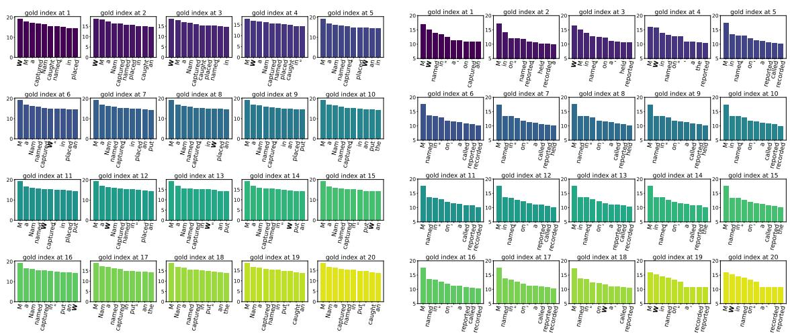  
Figure 8: Visualization of the top 10 tokens in the logit distributions at the critical divergence points for Meta-Llama-3-8B-Instruct (left) and Mistral-7B-Instruct-v0.3 (right).

<table><tr><td>Method</td><td>1</td><td>3</td><td>5 7</td><td>10</td><td>Avg. ↑GAP↓</td></tr><tr><td>base</td><td></td><td></td><td></td><td>64.14 65.95 64.97 62.67 67.5365.05</td><td>4.86</td></tr><tr><td>+ Ms-PoE</td><td></td><td></td><td></td><td>66.06 64.29 63.99 62.22 64.7564.34</td><td>3.84</td></tr><tr><td>+ AB</td><td></td><td></td><td></td><td>66.36 66.14 65.25 63.20 64.9365.18</td><td>3.16</td></tr><tr><td>+ MoICE</td><td></td><td></td><td></td><td>65.50 66.33 65.61 64.11 65.8465.48</td><td>2.22</td></tr><tr><td>+ PEAR</td><td></td><td></td><td></td><td>62.71 67.01 68.32 66.44 69.5766.81</td><td>6.86</td></tr><tr><td>+ PosDistill R1 67.27 68.46 69.06 68.66 67.47 68.18</td><td></td><td></td><td></td><td></td><td>1.79</td></tr></table>

Table 10: Comparison of mainstream state-of-the-art approaches addressing PB in retrieval tasks.

## D Behavior of PB

For retrieval tasks, we statistically compute the perplexity (PPL) of each response sampled from both the sink and recent positions, conditioned on prompts corresponding to trivial positions (see Fig. 9). Interestingly, the PPL is much lower compared to that of gold labels from SFT, which strongly indicates a high degree of similarity in the response space when conditioned on different permutations of the same set of documents. A closer examination reveals that LLMs primarily diverge at a few decisive tokens, a phenomenon we refer to as token-shifting. At these key generation steps, as shown in the logit distributions in Fig. 8, the correct token still appears among the top-10 predictions. This observation suggests that LLMs possess the potential to recover from initially incorrect decoding paths, and that responses from the sink position serve as natural gold signals for correction. In contrast, the dynamics in reasoning tasks are more complex. As shown by the PPL values in Fig. 9, perplexity increases substantially, indicating that token-shifting is not an appropriate assumption for reasoning scenarios.

## E Additional Results

LCLMs with More Documents Under longercontext settings, we conducted additional experiments with Mistral-7B-Instruct trained on 20 and 50-document contexts respectively, and evaluated them on context lengths ranging from 20 ( 4k tokens) to 80 documents ( 14k tokens), as indicated in Tab. 13. Takeaways: While training on longer contexts helps further improve the model’s retrieval performance, training with relatively shorter contexts can also yield competitive results. Trained on

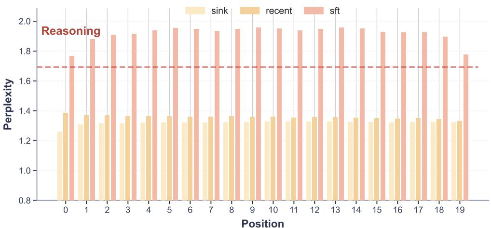  
Figure 9: Average PPL over 500 examples for responses collected from sink,recent positions and SFT labels.

<table><tr><td>Category</td><td>Prompt Template</td></tr><tr><td>Retrieval</td><td>Please write a high-quantify answer for the given question using only the provided search documents (some of which might be irrelevant).</td></tr><tr><td>Reasoning</td><td>Let&#x27;s first identify the relevant information from the long context and list it. Then, carry out step-by-step reasoning based on that information, and finally, provide the answer. The final answer must end with “The answer is:&quot;.</td></tr></table>

Table 11: Prompt Templates.
<table><tr><td></td><td colspan="4">Connected</td><td colspan="4">Disconnected</td><td colspan="6"></td><td></td></tr><tr><td>POSITIONS</td><td>[0,1] [5,6]</td><td>[12,13]</td><td></td><td>[17,18]</td><td>Avg.↑|[0,8]</td><td>[5,13]</td><td></td><td>[6,14] [8,16]</td><td></td><td>Avg.↑|[8,0]</td><td></td><td>[13,5] [14,6]</td><td>[16,8]</td><td>Avg.</td><td>|GAP. ↓</td></tr><tr><td>QWEN2.5-3B</td><td>31.2 27.5</td><td>28.1</td><td></td><td>30.2</td><td>29.3 28.7</td><td>24.3</td><td>22.2</td><td>23.4</td><td>24.7</td><td>25.5</td><td>24.9</td><td>22.6</td><td>20.9</td><td>23.5</td><td>10.3</td></tr><tr><td>QWEN2.5-14B</td><td>56.6 54.1</td><td>54.7</td><td></td><td>59.5 56.2</td><td>55.0</td><td>49.5</td><td>50.0</td><td>51.8</td><td>51.6</td><td>57.7</td><td>51.4</td><td>52.0</td><td>51.9</td><td>53.3</td><td>10.0</td></tr><tr><td>QWEN2.5-32B</td><td>61.7 59.8</td><td>59.1</td><td></td><td>63.2</td><td>61.0 59.4</td><td>54.7</td><td>54.2</td><td>54.7</td><td>55.8</td><td>60.3</td><td>56.6</td><td>55.4</td><td>57.8</td><td>57.5</td><td>9.0</td></tr></table>

Table 12: PB in reasoning tasks.

50 documents, the model not only generalizes well to fewer documents (achieving high and stable performance, e.g., 77% accuracy on 20 docs), but also generalizes effectively to more documents (maintaining 70% accuracy on 80 docs). In addition, models trained on 20 documents still achieve 67% accuracy when evaluated on 50 docs, exhibiting minimal variance across positions and no significant drop compared to the 69.5% accuracy observed when tested on 20 docs. This strong outof-domain generalization, even when trained with fewer docs (e.g., 20), further demonstrates the superiority of our approach.

## F Statement on AI Usage

In the preparation of this manuscript, ChatGPT by OpenAI was utilized solely for the purpose of language refinement and stylistic enhancement. All scientific ideas, methodologies, analyses, and conclusions presented in this work are entirely the authors’ own and were developed independently without reliance on AI-generated content.

<table><tr><td>Test.</td><td>Train.</td><td>0% 25%</td><td>50% 75%</td><td>100%</td><td>AVG. ↑</td></tr><tr><td rowspan="2">20docs 20</td><td></td><td>72.3 69.5</td><td>67.5 68.5</td><td>69.7</td><td>69.5</td></tr><tr><td>50</td><td>77.8 76.2</td><td>76.6 77.2</td><td>77.4</td><td>77.0</td></tr><tr><td rowspan="2">30docs 20</td><td></td><td>70.3 67.9</td><td>69.3</td><td>67.3 70.9</td><td>69.1</td></tr><tr><td>50</td><td>74.9 75.4</td><td>75.1 76.2</td><td>77.2</td><td>75.8</td></tr><tr><td rowspan="2">40docs 20</td><td></td><td>67.1 66.7</td><td>68.3 66.5</td><td>68.3</td><td>67.4</td></tr><tr><td>50</td><td>74.1 75.2</td><td>76.2</td><td>77.1 77.6</td><td>75.8</td></tr><tr><td rowspan="2">50docs 20</td><td></td><td>69.1 66.1</td><td>66.7</td><td>66.1 67.2</td><td>67.0</td></tr><tr><td>50</td><td>73.5 73.9</td><td>74.5</td><td>75.2 74.9</td><td>74.4</td></tr><tr><td rowspan="2">70docs 20</td><td></td><td>64.9 63.9</td><td>63.9</td><td>65.1 65.1</td><td>64.6</td></tr><tr><td>50</td><td>69.3 69.1</td><td>71.7</td><td>70.1 70.1</td><td>70.1</td></tr><tr><td rowspan="2">80docs 20</td><td></td><td>64.9 63.9</td><td>63.9 65.1</td><td>65.1</td><td>64.6</td></tr><tr><td>50</td><td>68.1 68.3</td><td>70.1</td><td>70.9 71.9</td><td>69.9</td></tr></table>

Table 13: Performance comparison on different document numbers. The column AVG. shows the average score across percentages. Bold values indicate the best result in each group.