# Permutative Preference Alignment from Listwise Ranking of Human Judgments

Yang Zhao<sup>1</sup>† Yixin Wang<sup>2</sup> Mingzhang Yin<sup>3</sup>†

<sup>1</sup>University of Texas at Austin <sup>2</sup>University of Michigan, Ann Arbor <sup>3</sup>University of Florida yangzhao25@utexas.edu yixinw@umich.edu mingzhang.yin@warrington.ufl.edu

## Abstract

Aligning Large Language Models (LLMs) with human preferences is crucial in ensuring desirable and controllable model behaviors. Current methods, such as Reinforcement Learning from Human Feedback (RLHF) and Direct Preference Optimization (DPO), rely on the Bradley-Terry (B-T) model to maximize the likelihood of pairwise choices. However, when multiple responses are available, the B-T model fails to guarantee an accurate list ranking of the responses. To address this issue, we propose Permutative Preference Alignment (PPA), a novel offline listwise approach that incorporates the Normalized Discounted Cumulative Gain (NDCG)—a widely-used ranking metric—as an alternative training objective for LLM alignment. We develop an end-to-end alignment algorithm by approximating NDCG with a differentiable surrogate loss. Experiments demonstrate that PPA outperforms existing pairwise and listwise methods on evaluation sets and general benchmarks such as AlpacaEval. Furthermore, we show that NDCG-based approaches improve ranking accuracy more effectively than B-T-based methods and provide a theoretical explanation for this improvement.

## 1 Introduction

Large Language Models (LLMs) trained on massive datasets have demonstrated impressive capabilities in natural language processing (Achiam et al., 2023; Dubey et al., 2024). Aligning these models with human preferences is essential for reliable and controllable model behaviors. Pairwise methods, such as Reinforcement Learning from Human Feedback (RLHF) and Direct Preference Optimization (DPO) (Rafailov et al., 2023), employ the Bradley-Terry (B-T) model (Bradley and Terry, 1952) to maximize the likelihood of pairwise preferences, demonstrating strong performances (Christiano et al., 2017; Ouyang et al., 2022). Various pairwisebased offline preference optimization methods have been developed, such as RRHF (Yuan et al., 2023), SLiC (Zhao et al., 2023), RPO (Yin et al., 2024), SimPO (Meng et al., 2024), and LiPO-λ (Liu et al., 2024), which depend on the human preferences elicited from pairwise comparisons. These contrastive methods essentially classify preferred and non-preferred responses as positive and negative samples, naturally suited for the binary responses in the data sets like Reddit TL;DR and AnthropicHH (Stiennon et al., 2020; Bai et al., 2022).

However, multi-response data are often available, where a single prompt corresponds to several responses with assigned rewards (Ouyang et al., 2022; Yuan et al., 2023; Dong et al., 2023; Köpf et al., 2024). For such data, DPO cannot ensure the correct ranking of individual pairs, as it infers relative quality rankings of responses by maximizing the pairwise choice probability, potentially leading to an inaccurate overall list ranking. Among LTR metrics, NDCG emerges as the ideal training objective because it handles graded relevance and incorporates position-based discounting. Unlike MAP, MRR, Precision, and Recall which suffer from binary relevance limitations and non-differentiability. NDCG (Vargas and Castells, 2011) can be effectively approximated with differentiable surrogates. This property makes it uniquely suited for gradientbased alignment optimization.

In this work, we propose Permutative Preference Alignment (PPA), a new listwise alignment approach to align human preferences by maximizing NDCG. Models can be viewed as score functions that assign reward scores to responses. The alignment is learning to rank these responses to match the permutation derived from ground truth labels. We employ the smooth surrogate loss NeuralNDCG (Pobrotyn and Białobrzeski, 2021) to approximate NDCG to overcome its non-differentiable nature.

In real-world generation tasks, we find that the proposed PPA achieves higher ranking accuracy than B-T model-based methods, a crucial metric in evaluating policy performance. Existing literature shows that B-T-based RLHF and DPO struggle to improve ranking accuracy because they maximize the reward margin between preferred and non-preferred responses (Chen et al., 2024). In contrast, maximizing NDCG only requires the preferred responses to have higher reward scores than the non-preferred ones. Based on this distinction, we provide a theoretical explanation for the improvement of PPA in ranking accuracy.

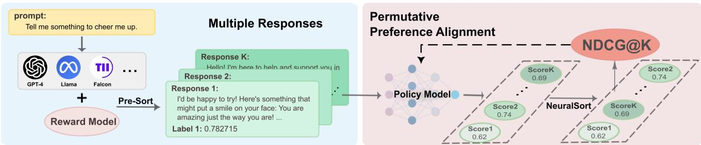  
Figure 1: An illustration of Permutative Preference Alignment (PPA) workflow. Each response is assigned a ground truth label by the reward model and pre-sorted in descending order. Reward scores are then derived from the policy and re-sorted to a new permutation. PPA calculates NDCG@K from the difference between two permutations and then optimizes the policy model.

In empirical studies, we comprehensively evaluate model performance with various pairwise and listwise baselines. In addition, we construct a multiple response dataset assigned with rewards based on UltraFeedback (Cui et al., 2023) and SimPO. The proposed PPA consistently achieves the best performance on both evaluation datasets and general benchmarks like AlpacaEval (Li et al., 2023).

Our contributions are summarized as follows:

• We identify potential limitations of DPO in list ranking and introduce NDCG as a training objective to improve ranking performance.

• We propose PPA as a new listwise alignment method that leverages multiple responses, which demonstrates superior performance over existing pairwise and listwise approaches across various model scales.

• We illustrate that NDCG-based method is more effective than Bradley-Terry-based methods in improving ranking accuracy and propose a theoretical explanation.

## 2 Related Work

Recent approaches for aligning language models with human preferences typically fall into three categories. Pairwise preference methods like DPO (Rafailov et al., 2023) use the Bradley-Terry model to optimize binary preferences without explicit reward models. But in multiple-response scenarios, they focus on average contrastive probability rather than ensuring all individual pairs align with ground truth labels. Multiple response alignment methods like RRHF, LiPO-λ, DPO-PL, PRO, and LIRE (Yuan et al., 2023; Liu et al., 2024; Rafailov et al., 2023; Song et al., 2024; Zhu et al., 2024) expand candidate responses from various LLMs and optimize the model with Bradley-Terry-based or listwise algorithms. Pairwise methods encounter similar limitations as in binary-response conditions, while listwise methods fail to optimize the established evaluation metrics prevalent in the LTR literature, like NDCG. Learning to Rank (LTR) techniques offer promising directions, particularly listwise approaches (Xia et al., 2008a) that consider entire ranking lists as training instances, better capturing response relationships compared to pointwise and pairwise methods. Despite their potential, current listwise techniques have not achieved state-of-the-art performance in LTR, highlighting opportunities for improvement. The further related work details are provided in Appendix A.

## 3 Preliminaries

Our approach adopts the Learning to Rank (LTR) framework and the list permutations.

## 3.1 Problem Setting

Following the setup in LiPO (Liu et al., 2024), we assume access to an offline static dataset = $\{ \boldsymbol { x } ^ { ( i ) } , \mathbf { Y } ^ { ( i ) } , \boldsymbol { \Psi } ^ { ( i ) } \} _ { i = 1 } ^ { N }$ , where $\mathbf { Y } = \left( y _ { 1 } , . . . , y _ { K } \right)$ is a list of responses from various generative models of size K given the prompt x. Each response is associated with a label from $\pmb { \Psi } = ( \psi _ { 1 } , . . . , \psi _ { K } )$ also known as the ground truth labels in the LTR literature. The label $\psi$ measures the quality of responses, which can be generated from human feedback or a pre-trained reward model. We obtain the score Ψ from a reward model:

$$
\psi _ { k } = R M ( x , y _ { k } ) ,\tag{1}
$$

where $\psi _ { k } \in [ 0 , 1 ]$ . The label is fixed for a response, representing the degree of human preference.

For each prompt-response pair, we also compute a reward score representing the likelihood of the generating probability of the response:

$$
s _ { \theta } ( x , y ) = \beta \log \frac { \pi _ { \theta } ( y | x ) } { \pi _ { \mathrm { r e f } } ( y | x ) } .\tag{2}
$$

Here, $\pi _ { \mathrm { r e f } }$ is a reference model which we set as the SFT model. $\pi _ { \boldsymbol { \theta } } ( y | \boldsymbol { x } )$ and $\pi _ { \mathrm { r e f } } ( y | x )$ means the probability of the response y given the prompt x under the policy model and the reference model. Similar to DPO (Rafailov et al., 2023), the partition function is omitted due to the symmetry in the choice model of multiple responses. Unlike the fixed labels $\psi _ { k }$ , the reward scores $\begin{array} { r l } { \mathbf { s } } & { { } = } \end{array}$ $\{ s _ { \theta } ( x , y _ { 1 } ) , . . . , s _ { \theta } ( x , y _ { K } ) \}$ depend on the model $\pi _ { \theta }$ and are updated during the model training.

## 3.2 NDCG Metric

NDCG is widely used for evaluating the ranking model performance (Järvelin and Kekäläinen, 2002), which directly assesses the quality of a permutation from the listwise data. Assume the list of responses $\mathbf { Y } = \left( y _ { 1 } , . . . , y _ { K } \right)$ have been preranked in the descending order based on labels $\pmb { \Psi } = ( \psi _ { 1 } , . . . , \psi _ { K } )$ from Eq 1, where $\psi _ { i } \geq \psi _ { j }$ if $i \geq j$ . The Discounted Cumulative Gain at k-th position $( k \leq K )$ is defined as:

$$
\mathrm { D C G } @ k = \sum _ { j = 1 } ^ { k } G ( \psi _ { j } ) D ( \tau ( j ) ) ,\tag{3}
$$

where $\psi _ { j }$ denotes the ground truth labels of the response $y _ { j }$ , and $\tau ( j )$ is the descending rank position of $y _ { j }$ based on the reward scores s computed by the current model $\pi _ { \theta }$ . Typically, the discount function and the gain function are set as $\begin{array} { r } { D ( \tau ( j ) ) = \frac { 1 } { \log _ { 2 } ( \tau ( j ) + 1 ) } } \end{array}$ and $G ( \psi _ { j } ) = 2 ^ { \psi _ { j } } - 1$ . An illustration is provided in Appendix D.2.

The NDCG at k is defined as

$$
\mathrm { N D C G @ \it { \Psi } k } = \frac { 1 } { \operatorname* { m a x D C G @ \it { k } } } \mathrm { D C G } \ @ k ,\tag{4}
$$

where maxDCG@k is the maximum value of DCG@k, computed by ordering the responses Y by their ground truth labels Ψ. The normalization ensures that NDCG is within the range (0, 1).

The value k of NDCG@k $( k \le K )$ indicates that we focus on the ranking of the top k elements while ignoring those beyond k. For example, when $k = 2 .$ , we only need to correctly order the first 2 elements, regardless of the order of the remaining $K - 2$ elements in the list.

## 4 Permutative Preference Alignment

In LLM alignment, the reward scores s in Equation (2) are key to connecting the loss to the model parameters $\theta .$ However, there is a gap between using NDCG as an evaluation metric and as a training objective. Since NDCG is non-differentiable with respect to reward scores s, gradient descent cannot be directly applied for optimization.

To overcome this limitation, surrogate losses (Valizadegan et al., 2009) have been developed. These losses approximate the NDCG value by converting its discrete and non-differentiable characteristics into a continuous and score-differentiable form, suitable for backpropagation. The original NDCG is computed by iterating over each list element’s gain value and multiplying it by its corresponding position discount, a process known as the pairing between gains and discounts. Thus, surrogate losses can be interpreted in two parts: pairing gains and discounts to approximate the NDCG value, and ensuring these functions are differentiable to enable gradient descent optimization. We will leverage NeuralNDCG (Pobrotyn and Białobrzeski, 2021) as such a surrogate loss.

## 4.1 PPA Objective

Our PPA incorporates a score-differentiable sorting algorithm-NeuralSort (Grover et al., 2019)-to align gain values $G ( \cdot )$ with position discounts $D ( \cdot )$ . This sorting operation is achieved by left-multiplying a permutation matrix $P _ { \mathrm { s o r t } ( \mathbf { s } ) }$ in Eq 19 with the score vector s to obtain a list of scores sorted in descending order. The element $P _ { \mathrm { s o r t } ( \mathbf { s } ) } [ i , j ]$ denotes the probability that response $y _ { j }$ is ranked in the i-th position after re-sorting based on s. Applying this matrix to the gains $G ( \cdot )$ results in the sorted gains vector $\widehat { G ( \cdot ) }$ , which is aligned with discounts. Dedtails about NeuralSort are shown in the Appendix D. For simplicity, we denote $\widehat { P } _ { \mathrm { s o r t } ( \mathbf { s } ) }$ as $\widehat { P }$

b bSimilar to the original NDCG, but with the gain function $G ( \cdot )$ replaced by ${ \widehat { G ( \cdot ) } } = { \widehat { P } } { \cdot } G ( \cdot )$ to ensure d bproper alignment between gains and discounts. The estimated gain at rank $j$ can be interpreted as a weighted sum of all gains, where the weights are given by the entries in the $j \mathrm { - t h }$ row of ${ \widehat { P } } .$ Since $\widehat { P }$ b bis a row-stochastic matrix, each row sums to one, though the columns may not. This can cause $\widehat { G }$ bto disproportionately influence the NDCG value at certain positions. To address this issue, we use the Sinkhorn scaling (Sinkhorn, 1964) on $\widehat { P }$ to ensure beach column sums to one. Then we get:

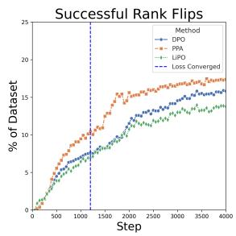  
(a) Successful rank flip ratio.

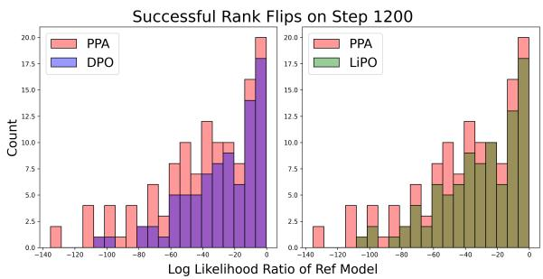  
(b) Successful rank flip histogram.

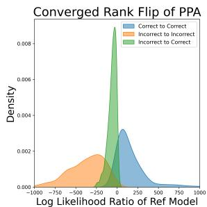  
(c) Rank flip distribution.  
Figure 2: Comparisions among PPA, DPO, and LiPO on rank flips. (a) PPA demonstrates a higher efficiency in successful rank flips. The dashed line refers to the steps in which the loss objective is converged for all three methods. (b) PPA demonstrates more successful rank flips in loss-converged steps compared to DPO and LiPO. (c) The successful flip (Incorrect to Correct) distribution is highly constrained to reference ranking accuracy $y _ { w }$ and y .

$$
\begin{array} { r } { \mathrm { N e u r a l N D C G @ \it { k } } \left( \tau ; \mathbf { s } , \boldsymbol { \Psi } \right) = \qquad } \\ { N _ { k } ^ { - 1 } \displaystyle \sum _ { j = 1 } ^ { k } ( \mathrm { s c a l e } ( \widehat { P } ) \cdot G ( \boldsymbol { \Psi } ) ) _ { j } \cdot D ( j ) \smallskip } \end{array}\tag{5}
$$

where $N _ { k } ^ { - 1 }$ represents the maxDCG@k (for $k \leq$ $K )$ as defined in Eq 4. The function scale( ) denotes Sinkhorn scaling, and $G ( \cdot )$ and $D ( \cdot )$ are the gain and discount functions, respectively, as in Eq 3. The proposed PPA is illustrated in Figure 1. Intuitively, the gain function should be proportional to the label, effectively capturing the relative ranking of different responses. The discount function penalizes responses appearing later in the sequence, as in many generation or recommendation tasks, the focus is on the top-ranked elements. Thus, higherranked responses have a more significant impact on the overall loss in NeuralNDCG. Further illustrations are provided in Appendix D.2.

Finally, we derive the PPA objective:

$$
\begin{array} { r l } & { \mathcal L _ { \mathrm { P P A } } ( \pi _ { \theta } , k ; \pi _ { \mathrm { r e f } } ) = } \\ & { - \mathbb E _ { ( x , \mathbf Y , \Psi ) \sim \mathcal D } \big [ \sum _ { j = 1 } ^ { k } ( \mathrm { s c a l e } ( \widehat P ) \cdot G ( \Psi ) ) _ { j } \cdot D ( j ) / N _ { k } \big ] . } \end{array}\tag{6}
$$

## 4.2 Other Approximation of NDCG

In addition to aligning gains and discounts, we can modify the discount function to be differentiable.

ApproxNDCG (Qin et al., 2010) is proposed as an approximation to the rank position in the NDCG equation (Eq 3) using the sigmoid function:

$$
\begin{array} { c } { { \widehat { \tau ( j ) } = 1 + \displaystyle \sum _ { i \neq j } \displaystyle \frac { \exp { \left( - \alpha ( s _ { j } - s _ { i } ) \right) } } { 1 + \exp { \left( - \alpha ( s _ { j } - s _ { i } ) \right) } } } } \\ { { = 1 + \displaystyle \sum _ { i \neq j } \sigma ( \alpha ( s _ { i } - s _ { j } ) ) } } \end{array}\tag{7}
$$

As observed, if $s _ { i } \gg s _ { j }$ , the descending rank position of $y _ { j }$ will increase by 1. Note that the hyperparameter α controls the precision of the approximation. We then obtain the estimated $\widehat { \tau ( j ) }$ and subsequently the ApproxNDCG objective:

$$
\begin{array} { r l } & { \displaystyle \mathcal { L } _ { \mathrm { A p p r o x N D C G @ K } } \big ( \pi _ { \theta } ; \pi _ { \mathrm { r e f } } \big ) = } \\ & { \displaystyle - \mathbb { E } _ { ( x , \mathbf { Y } , \Psi ) \sim \mathcal { D } } \big [ \sum _ { j = 1 } ^ { k } G ( \psi _ { j } ) \cdot D ( \widehat { \tau ( j ) } ) / N _ { k } \big ] . } \end{array}\tag{8}
$$

## 5 Theoretical Analysis

## 5.1 Optimal Property

Property 5.1. (Optimal property) When Equation (6) reaches the optimal value, the policy $\pi _ { \theta , N D C G } ^ { * }$ is aligned with the reward model in terms ofthe response ranking permutations.

The proof is shown in Appendix B.1. NDCG achieves its maximum value if and only if the list permutation matches the ground-truth permutation. The distance between NDCG and its maximum value of 1 reflects the current alignment gap between the policy and the reward model.

Proposition 5.1. For DPO, in pairwise setting, correct ranking $s _ { w } \ \geq \ s _ { l }$ is achieved if and only if $\begin{array} { r } { \mathcal { L } _ { D P O } \ \leq \ \log 2 . } \end{array}$ . But in listwise scenarios where list size $> 2$ , this condition on <sub>DPO</sub> no longer guarantees the correct overall ranking.

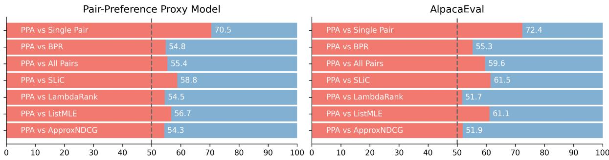  
Figure 3: PPA outperforms other approaches on direct comparisons with Mistral-7B. The win rates are derived from comparisons between PPA and other methods on their optimal settings. We employ the Pair-Preference Proxy model on evaluation sets and GPT-4 on AlpacaEval as the judge models.

The proof is provided in Appendix B.2. This proposition indicates the limitations of DPO in handling multi-response scenarios. However, the NDCG-based method monitors the current alignment state and guarantees the correct list ranking.

## 5.2 Ranking Accuracy

Definition 5.1. (Ranking Accuracy (Chen et al., 2024)) The ranking accuracy  of a model π<sub>θ</sub> on a pairwise preference datapoint $( x , y _ { w } , y _ { l } )$ is

$$
\mathcal { R } ( x , y _ { w } , y _ { l } ; \pi _ { \theta } ) = \left\{ \begin{array} { r l } { 1 } & { { } \pi _ { \theta } ( y _ { w } \mid x ) \ge \pi _ { \theta } ( y _ { l } \mid x ) , } \\ { 0 } & { { } o t h e r w i s e . } \end{array} \right.
$$

Definition 5.2. (Successful rankflip) A successful rank flip is referred to as the model’s ranking of responses shifts to favor the preferred over the nonpreferred option:

$$
\pi _ { r e f } ( y _ { w } | x ) \leq \pi _ { r e f } ( y _ { l } | x )  \pi _ { \theta } ( y _ { w } | x ) \geq \pi _ { \theta } ( y _ { l } | x )
$$

Proposition 5.2. Assume log-likelihood ratio on reference model $\begin{array} { r } { X = \log \frac { \pi _ { r e f } ( y _ { w } | x ) } { \pi _ { r e f } ( y _ { l } | x ) } \sim N ( 0 , \sigma ^ { 2 } ) } \end{array}$ and after alignment training $\begin{array} { r } { Y = \log { \frac { \pi _ { \theta } ( y _ { w } | x ) } { \pi _ { \theta } ( y _ { l } | x ) } } \sim } \end{array}$ $N ( \mu _ { Y } , \sigma _ { Y } ^ { 2 } )$ , we can get that the probability ofsuccessful rank flip of NDCG-based method is greater than DPO, which is $P _ { N D C G } ( Y ~ > ~ 0 | X ~ < ~ 0 ) ~ \geq$ $P _ { D P O } ( Y > 0 | X < 0 )$

The proof is provided in Appendix B.3, which is also illustrated in Figure 2. In alignment training, the objective is to increase the probability of the preferred response over the non-preferred one. A higher successful rank flip ratio indicates greater efficiency in achieving alignment.

## 6 Experiments

Baselines. We employ various pairwise and listwise alignment baselines to explore the connection between LLM alignment and ranking tasks. Their optimization objectives are detailed in Table 5 of the appendix. We introduce three paradigms of positive-negative pairs for DPO on multiple responses. LiPO-λ (Liu et al., 2024) incorporates LambdaRank from the LTR literature, acting as a weighted version of DPO. SLiC and RRHF employ a similar hinge contrastive loss. ListMLE utilizes the Plackett-Luce Model (Plackett, 1975) to represent the likelihood of list permutations. For further information, please see Appendix C.

Datasets. We construct a multi-response dataset named ListUltraFeedback\*. This dataset combines four responses from UltraFeedback and five generated responses from the fine-tuned Llama3-8B model<sup>†</sup> in SimPO (Cui et al., 2023; Meng et al., 2024), all based on the same prompts. All responses are assigned ground truth labels using the Reward Model ArmoRM (Wang et al., 2024). This model is the leading open-source reward model, outperforming both GPT-4 Turbo and GPT-4o in RewardBench (Lambert et al., 2024) at the time of our experiments. To ensure clear distinction between positive and negative samples, while maintaining diversity, we select two responses with the highest scores and two with the lowest. Additionally, we randomly draw four responses from the remaining pool. Details of the dataset are presented in Table 7 of the appendix.

Training Details. We use Qwen2-0.5B, Mistral-7B, and Llama3.1-8B (qwe, 2024; Jiang et al., 2023; Dubey et al., 2024) as our foundation models, representing different parameter scales. Following the training pipeline in DPO, Zephyr, and SimPO, we start with supervised fine-tuning (SFT) on UltraChat-200k (Ding et al., 2023). We then apply various pairwise and listwise approaches to align preferences on our multiple response dataset, ListUltraFeedback. Adhering to the settings in HuggingFace Alignment Handbook (Tunstall et al., 2023), we use a learning rate of $5 \times 1 0 ^ { - 7 }$ and a total batch size of 128 for all training processes. The models are trained using the AdamW optimizer (Kingma and Ba, 2014) on 4 Nvidia V100-32G GPUs for Qwen2-0.5B models and 16 Nvidia V100-32G GPUs for Mistral-7B. Unless noted otherwise, we fix α = 25 for ApproxNDCG and τ = 1 for PPA to achieve optimal performance, as determined by ablation studies presented in Section 6.2. Both models and datasets are open-sourced, ensuring high transparency and ease of reproduction. Further training details can be found in Appendix E.

<table><tr><td rowspan="2">Method</td><td rowspan="2">Type</td><td colspan="2">Proxy Model</td><td colspan="2">General Benchmark</td><td rowspan="2">Avg.</td></tr><tr><td>Pair-Preference</td><td>Scoring</td><td>AlpacaEval</td><td>MT-Bench</td></tr><tr><td>Single Pair</td><td>Pairwise</td><td>60.75</td><td>56.86</td><td>57.95</td><td>52.81</td><td>57.09</td></tr><tr><td>BPR</td><td>Pairwise</td><td>60.32</td><td>58.33</td><td>58.74</td><td>55.00</td><td>58.10</td></tr><tr><td>All Pairs</td><td>Pairwise</td><td>63.82</td><td>60.54</td><td>57.23</td><td>53.13</td><td>58.68</td></tr><tr><td>RankNet</td><td>Pairwise</td><td>62.27</td><td>59.04</td><td>58.94</td><td>54.26</td><td>58.63</td></tr><tr><td>SLiC</td><td>Pairwise</td><td>63.31</td><td>60.70</td><td>61.00</td><td>53.75</td><td>59.69</td></tr><tr><td>LambdaRank</td><td>Listwise</td><td>62.30</td><td>59.04</td><td>58.72</td><td>55.31</td><td>58.84</td></tr><tr><td>ListMLE</td><td>Listwise</td><td>63.03</td><td>59.76</td><td>57.05</td><td>53.13</td><td>58.24</td></tr><tr><td>ApproxNDCG</td><td>Listwise</td><td>61.46</td><td>58.59</td><td>58.16</td><td>55.94</td><td>59.33</td></tr><tr><td>PPA</td><td>Listwise</td><td>64.25</td><td>61.36</td><td>61.64</td><td>53.44</td><td>60.17</td></tr></table>

Table 1: The proposed PPA and ApproxNDCG outperform existing baselines across various evaluation benchmarks. The win rates are derived from comparisons between the preference-aligned Qwen2-0.5B and its SFT model. We set $\beta = 0 . 1$ in Eq 2 for all methods except $\beta = 0 . 0 5$ for SLiC to achieve the optimal performance.

Evaluation. The KL-divergence in the original RLHF pipeline is designed to prevent the Policy model from diverging excessively from the SFT model, thus avoiding potential manipulation of the Reward Model. As we employ ArmoRM in the construction of the training dataset, we incorporate various judging models and evaluation benchmarks, such as different Reward models and AlpacaEval (Li et al., 2023) with GPT-4, to reduce the impact of overfitting on ArmoRM. We design 2 pipelines to thoroughly analyze the performance of PPA, using the Win Rate of policy models against SFT models as our primary metric. Details of evaluation datasets are presented in Table 7 of the appendix.

In the Proxy Model pipeline, we deploy the Scoring Reward Model ArmoRM<sup>‡</sup> (Wang et al., 2024) and the Pair-Preference Reward Model<sup>§</sup> (Dong et al., 2024) as Proxy Models to calculate the win rate on ListUltraFeedback. Both Proxy models surpass GPT-4 Turbo and GPT-4o in rewarding tasks on RewardBench (Lambert et al., 2024). The Scoring model provides a score in the range (0, 1) for a given prompt and response, while the Pair-Preference model outputs the winner when given a prompt and two responses, offering a more intuitive approach for pairwise comparisons.

In the General Benchmark pipeline, we evaluate our models using two widely recognized benchmarks: AlpacaEval (Li et al., 2023) and MT-Bench (Zheng et al., 2023), which assess the model’s comprehensive conversational abilities across various questions. Consistent with the original setup, we employ GPT-4 Turbo (Achiam et al., 2023) as the standard judge model to determine which of the two responses exhibits higher quality.

## 6.1 Main Results

PPA significantly outperforms existing preference optimization baselines. We list win rates of various alignment approaches across diverse evaluation benchmarks in Figure 3, Table 1, and Table 3. Many approaches achieve their best performance with a list size of 8. As shown in Figure 4, PPA consistently outperforms other approaches when $K \ > \ 4 .$ with performance improving as the list size increases. This trend is also evident across different values of β in Table 10 of the appendix. PPA’s advantage over pairwise and ListMLE methods lies in its efficiency in improving permutation performance. Traditional contrastive pairwise approaches maximize the likelihood of $y _ { w }$ over $y _ { l } .$ , which adversely affects the generation quality of LLMs when high-quality responses are treated as negative samples. In contrast, PPA provides a more holistic approach to handling the relationships between responses.

PPA achieves higher ranking accuracy than DPO and LiPO. As illustrated in Figure 2, PPA demonstrates a higher efficiency on successful rank flips. The difference in model performance is attributed to the distinction between the optimization objectives of the Bradley-Terry-based methods and NDCG-based methods. Furthermore, Figure 2c reveals a significant correlation between the type of rank flip and the log-likelihood ratio of the reference model. Based on this observation, we hypothesize that the log-likelihood ratio of the policy model encodes the conditional probability of the log-likelihood ratio of the reference model. Proposition 5.2 provides a potential theoretical explanation for this improvement.

List Size matters more than the number of pairwise comparisons. To assess the effect of varying response quantities and comparison methods, we conduct empirical studies across different list sizes (i.e., the number of responses the model can access) and comparison methods. Specifically, we test four pairwise comparison methods: Single Pair, BPR, OvW (i.e., Others vs Worst), and All Pairs in Table 5 of the appendix, which differ in the number of comparisons (1 comparison for Single Pair, K 1 for BPR and OvW, and $\binom { K } { 2 }$ for All Pairs). Table 1 illustrates that both BPR and All Pairs methods outperform Single Pair, with no significant difference observed when List ${ \mathrm { S i z e ~ } } = ~ 8 .$ This trend is particularly pronounced with the Mistral-7B model in Table 11 of the appendix. These findings suggest that the list size plays a more critical role than the specific number of pairwise comparisons.

## 6.2 Ablation Study

Score Function Scale. The parameter $\beta$ controls the scaling of the score function (Eq 2) and the deviation from the base reference policy $\pi _ { \mathrm { r e f } } ,$ which significantly influences model performance. Following the existing work setting (Rafailov et al.,

2023; Meng et al., 2024; Liu et al., 2024), we search $\beta$ among [0.01, 0.05, 0.1, 0.5] and conduct sensitivity analysis. Figure 4 shows that all methods achieve their best performance at $\beta = 0 . 1$ except SLiC. PPA consistently achieves the best performance on both $\beta ~ = ~ 0 . 0 5$ and $\beta ~ = ~ 0 . 1$ Detailed results are in Table 9 of the appendix.

Approximation Tradeoff. The temperature parameter τ controls the approximation accuracy and gradient variance of NeuralNDCG (Pobrotyn and Białobrzeski, 2021). We visualize the values of NDCG and NeuralNDCG on specific data and assess model performance with various τ. The results in Figure 5 reveal that as NeuralNDCG more closely approximates true NDCG, model performance tends to decline. This may occur because training involves multiple high-quality responses with similar ground truth labels. Enforcing responses to conform to NDCG’s step-wise structure can reduce the likelihood of good responses.

Additionally, as the approximation accuracy of NeuralNDCG increases, more plateaus appear due to NDCG’s inherent step-wise nature. On these plateaus, gradients become zero, preventing model optimization. We visualize the loss landscape in Figure 6 in the Appendix and find that with low τ , the gradients become highly spiky and discontinuous, making optimization challenging and potentially unstable. In contrast, higher τ values yield smoother and more navigable gradients. Further discussion is provided in Appendix D.3. A similar observation is confirmed on ApproxNDCG in Appendix G.

PPA Setup. We perform an ablation study on key components of PPA. As shown in Table 2, we find that (i) when evaluating NDCG@4 for multiple responses with a list size of $^ { 8 , }$ the performance is comparable to PPA with a list size of 4. This suggests that PPA’s effectiveness is more influenced by the list size rather than the k value in NDCG@k. (ii) The choice of gain function: $G _ { i } = 2 ^ { \psi _ { i } } - 1$ or $G _ { i } ~ = ~ \psi _ { i }$ , does not significantly impact model performance. The critical factor is that the gain provides the correct order of responses. (iii) Omitting Sinkhorn scaling (Sinkhorn, 1964) on $\widehat { P }$ significantly degrades bperformance. Without scaling, $\widehat { P } _ { \mathrm { s o r t } }$ may not be bcolumn-stochastic, meaning each column may not sum to one. Then the weighted sum of $G ( \cdot )$ could disproportionately contribute to the estimated gain

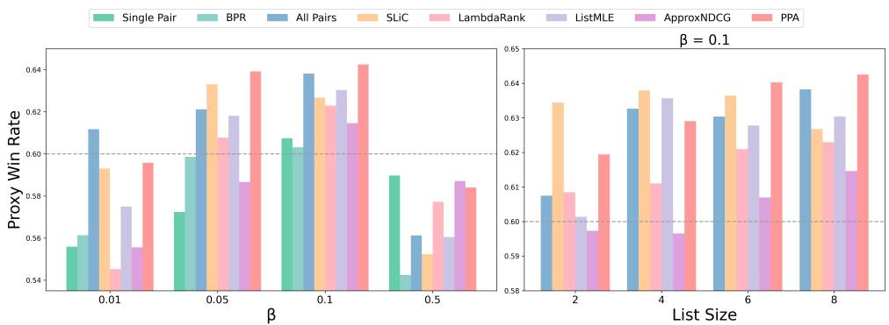  
Figure 4: PPA outperforms other methods across different β and list sizes. The Proxy win rates are calculated by Pair-Preference Proxy model by comparing preference-aligned Qwen2-0.5B against its SFT model.

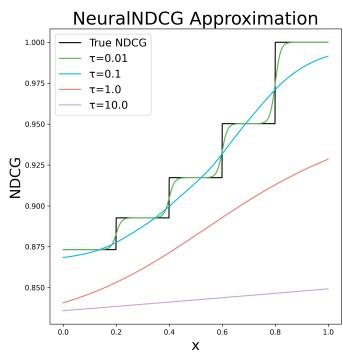

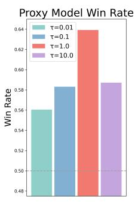  
Figure 5: Higher NDCG approximation accuracy does not always lead to better performance. Given ground truth label $\psi = [ 1 . 0 , 0 . 8 , 0 . 6 , 0 . 4 , 0 . 2 ]$ and scores s = $[ x , 0 . 8 , 0 . 6 , 0 . 4 , 0 . 2 ]$ , an illustration of NeuralNDCG Approximation Accuracy with different τ and Pair-Preference Proxy win rates against SFT.

function $\widehat { G ( \cdot ) }$ and adversely affect performance.
<table><tr><td>Method</td><td>Pair-Preference</td><td>Scoring</td></tr><tr><td>All Pairs</td><td>63.82</td><td>60.54</td></tr><tr><td>PPA</td><td>64.25</td><td>61.36</td></tr><tr><td>Top-4</td><td>61.92</td><td>59.35</td></tr><tr><td>w/o Power</td><td>63.49</td><td>61.28</td></tr><tr><td>w/o Scale</td><td>57.32</td><td>56.20</td></tr><tr><td> $1 / \tau$ </td><td>62.78</td><td>59.76</td></tr><tr><td> $\dot { 1 / \sqrt { \tau } }$ </td><td>63.16</td><td>60.19</td></tr><tr><td> $1 { \dot { / } } \dot { \tau ^ { 2 } }$ </td><td>62.47</td><td>60.19</td></tr></table>

Table 2: Ablation results for PPA Setup on Qwen2-0.5B: (Top) original setup; (Middle) ablation study on key components: k-value, gain function, and the Sinkorn Scale function; (Bottom) different discount settings.

Model Scale Up To thoroughly assess the performance of PPA, we employ the Llama3.1-8B and Mistral-7B model as the LLM. Following the SimPO pipeline, we use their Instruct version as the SFT model. They are then aligned with multiple preferences on ListUltraFeedback, and the performance is validated across several benchmarks, as shown in Table 3, Table 11, and Table 13 of the appendix. Hyperparameter details and additional results are provided in Appendix E and F.2.

PPA demonstrates competitive performance on win rates against the SFT model. To clearly illustrate PPA’s advantages over other methods, we compare their generated responses and present PPA’s win rates in Figures 3 and 8 of the appendix.

<table><tr><td>Method</td><td>Pair-Preference</td><td>Scoring</td><td>AlpacaEval</td></tr><tr><td>All Pairs</td><td>72.96</td><td>74.39</td><td>59.64</td></tr><tr><td>SLiC</td><td>72.84</td><td>75.04</td><td>60.20</td></tr><tr><td>ListMLE</td><td>72.46</td><td>74.77</td><td>59.83</td></tr><tr><td>LambdaRank</td><td>71.80</td><td>72.74</td><td>60.38</td></tr><tr><td>PPA</td><td>74.34</td><td>75.58</td><td>61.32</td></tr></table>

Table 3: Model Scale Up: Our method PPA outperforms other approaches on Llama3.1-8B.

Human Evaluation Human assessments provide crucial validation beyond proxy metrics. To address it, we conducted a comprehensive human evaluation involving 20 raters on the Prolific platform. Each rater compared 15 pairs of model outputs, with a total of 300 pairs evaluated across three matchups (PPA vs SFT, PPA vs DPO, PPA vs LiPO). The pairs were randomly selected to ensure an unbiased assessment.

The results in Table 4 demonstrate that PPA achieves consistent improvements over baselines like SFT, DPO, and LiPO, as confirmed by both human raters and automatic metrics. They also validate the consistency between the reward models and human judgments.

<table><tr><td>Comparison</td><td>PPA vs SFT 1</td><td>PPA vs DPO</td><td>PPA vs LiPO</td></tr><tr><td>Pair-Preference</td><td>70.5</td><td>55.4</td><td>54.5</td></tr><tr><td>Scoring</td><td>68.9</td><td>55.2</td><td>57.0</td></tr><tr><td>AlpacaEval</td><td>72.4</td><td>59.6</td><td>51.7</td></tr><tr><td>HumanEval</td><td>68.0</td><td>55.0</td><td>54.0</td></tr></table>

Table 4: Human Evaluation result for comparisons. It shows PPA outperforms other baselines, which aligns with other automatic metrics.

## 7 Conclusion

We propose Permutative Preference Alignment (PPA) to align listwise human judgments by optimizing the ranking metric NDCG. Empirical studies show that PPA consistently outperforms existing pairwise and listwise baselines across various setups. We identify the potential limitation of Bradley-Terry-based methods like DPO. PPA also demonstrates a higher efficiency in improving ranking accuracy and we propose a theoretical explanation for this improvement.

## Limitations

Our study has several limitations and suggests promising directions for future research. In constructing multiple responses, a pre-trained Reward Model serves as the judge model, which might not fully align with real-world human preferences. Future studies can develop more robust data construction methods to ensure responses remain harmless. Additionally, the extensive LTR literature remains underexplored, indicating potential for further research and applications in alignment fields.

## Acknowledgements

YW was supported in part by the Office of Naval Research under grant N00014-23-1-2590, the National Science Foundation under grant No. 2231174, No. 2310831, No. 2428059, No. 2435696, No. 2440954, and a Michigan Institute for Data Science Propelling Original Data Science (PODS) grant. MY was supported in part by a Marketing Science Institute fund.

## References

2024. Qwen2 technical report.

Josh Achiam, Steven Adler, Sandhini Agarwal, Lama Ahmad, Ilge Akkaya, Florencia Leoni Aleman, Diogo Almeida, Janko Altenschmidt, Sam Altman,

Shyamal Anadkat, et al. 2023. Gpt-4 technical report. arXiv preprint arXiv:2303.08774.

Mohammad Gheshlaghi Azar, Zhaohan Daniel Guo, Bilal Piot, Remi Munos, Mark Rowland, Michal Valko, and Daniele Calandriello. 2024. A general theoretical paradigm to understand learning from human preferences. In International Conference on Artificial Intelligence and Statistics, pages 4447–4455. PMLR.

Yuntao Bai, Andy Jones, Kamal Ndousse, Amanda Askell, Anna Chen, Nova DasSarma, Dawn Drain, Stanislav Fort, Deep Ganguli, Tom Henighan, et al. 2022. Training a helpful and harmless assistant with reinforcement learning from human feedback. arXiv preprint arXiv:2204.05862.

Ralph Allan Bradley and Milton E Terry. 1952. Rank analysis of incomplete block designs: I. the method of paired comparisons. Biometrika, 39(3/4):324– 345.

Angelica Chen, Sadhika Malladi, Lily H. Zhang, Xinyi Chen, Qiuyi Zhang, Rajesh Ranganath, and Kyunghyun Cho. 2024. Preference learning algorithms do not learn preference rankings. Preprint, arXiv:2405.19534.

Paul F Christiano, Jan Leike, Tom Brown, Miljan Martic, Shane Legg, and Dario Amodei. 2017. Deep reinforcement learning from human preferences. Advances in neural information processing systems, 30.

Ganqu Cui, Lifan Yuan, Ning Ding, Guanming Yao, Wei Zhu, Yuan Ni, Guotong Xie, Zhiyuan Liu, and Maosong Sun. 2023. UltraFeedback: Boosting language models with high-quality feedback. arXiv preprint arXiv:2310.01377.

Ning Ding, Yulin Chen, Bokai Xu, Yujia Qin, Zhi Zheng, Shengding Hu, Zhiyuan Liu, Maosong Sun, and Bowen Zhou. 2023. Enhancing chat language models by scaling high-quality instructional conversations. Preprint, arXiv:2305.14233.

Hanze Dong, Wei Xiong, Deepanshu Goyal, Yihan Zhang, Winnie Chow, Rui Pan, Shizhe Diao, Jipeng Zhang, Kashun Shum, and Tong Zhang. 2023. Raft: Reward ranked finetuning for generative foundation model alignment. arXiv preprint arXiv:2304.06767.

Hanze Dong, Wei Xiong, Bo Pang, Haoxiang Wang, Han Zhao, Yingbo Zhou, Nan Jiang, Doyen Sahoo, Caiming Xiong, and Tong Zhang. 2024. Rlhf workflow: From reward modeling to online rlhf. Preprint, arXiv:2405.07863.

Pinar Donmez, Krysta M Svore, and Christopher JC Burges. 2009. On the local optimality of lambdarank. In Proceedings of the 32nd international ACM SIGIR conference on Research and development in information retrieval, pages 460–467.

Abhimanyu Dubey, Abhinav Jauhri, Abhinav Pandey, Abhishek Kadian, Ahmad Al-Dahle, Aiesha Letman, Akhil Mathur, Alan Schelten, Amy Yang, Angela Fan, et al. 2024. The llama 3 herd of models. arXiv preprint arXiv:2407.21783.

Kawin Ethayarajh, Winnie Xu, Niklas Muennighoff, Dan Jurafsky, and Douwe Kiela. 2024. Kto: Model alignment as prospect theoretic optimization. arXiv preprint arXiv:2402.01306.

Aditya Grover, Eric Wang, Aaron Zweig, and Stefano Ermon. 2019. Stochastic optimization of sorting networks via continuous relaxations. arXiv preprint arXiv:1903.08850.

Balázs Hidasi, Alexandros Karatzoglou, Linas Baltrunas, and Domonkos Tikk. 2016. Session-based recommendations with recurrent neural networks. Preprint, arXiv:1511.06939.

Jiwoo Hong, Noah Lee, and James Thorne. 2024. Orpo: Monolithic preference optimization without reference model. Preprint, arXiv:2403.07691.

Kalervo Järvelin and Jaana Kekäläinen. 2002. Cumulated gain-based evaluation of ir techniques. ACM Trans. Inf. Syst., 20(4):422–446.

Albert Q. Jiang, Alexandre Sablayrolles, Arthur Mensch, Chris Bamford, Devendra Singh Chaplot, Diego de las Casas, Florian Bressand, Gianna Lengyel, Guillaume Lample, Lucile Saulnier, Lélio Renard Lavaud, Marie-Anne Lachaux, Pierre Stock, Teven Le Scao, Thibaut Lavril, Thomas Wang, Timothée Lacroix, and William El Sayed. 2023. Mistral 7b. Preprint, arXiv:2310.06825.

Alexandros Karatzoglou, Linas Baltrunas, and Yue Shi. 2013. Learning to rank for recommender systems. In Proceedings of the 7th ACM Conference on Recommender Systems, pages 493–494.

Dahyun Kim, Yungi Kim, Wonho Song, Hyeonwoo Kim, Yunsu Kim, Sanghoon Kim, and Chanjun Park. 2024. sdpo: Don’t use your data all at once. arXiv preprint arXiv:2403.19270.

Diederik P Kingma and Jimmy Ba. 2014. Adam: A method for stochastic optimization. arXiv preprint arXiv:1412.6980.

Andreas Köpf, Yannic Kilcher, Dimitri von Rütte, Sotiris Anagnostidis, Zhi Rui Tam, Keith Stevens, Abdullah Barhoum, Duc Nguyen, Oliver Stanley, Richárd Nagyfi, et al. 2024. Openassistant conversations-democratizing large language model alignment. Advances in Neural Information Processing Systems, 36.

Nathan Lambert, Valentina Pyatkin, Jacob Morrison, LJ Miranda, Bill Yuchen Lin, Khyathi Chandu, Nouha Dziri, Sachin Kumar, Tom Zick, Yejin Choi, Noah A. Smith, and Hannaneh Hajishirzi. 2024. Rewardbench: Evaluating reward models for language modeling. Preprint, arXiv:2403.13787.

Xuechen Li, Tianyi Zhang, Yann Dubois, Rohan Taori, Ishaan Gulrajani, Carlos Guestrin, Percy Liang, and Tatsunori B. Hashimoto. 2023. Alpacaeval: An automatic evaluator of instruction-following models. https://github.com/tatsu-lab/alpaca\_eval.

Yongqi Li, Nan Yang, Liang Wang, Furu Wei, and Wenjie Li. 2024. Learning to rank in generative retrieval. In Proceedings of the AAAI Conference on Artificial Intelligence, volume 38, pages 8716–8723.

Tianqi Liu, Zhen Qin, Junru Wu, Jiaming Shen, Misha Khalman, Rishabh Joshi, Yao Zhao, Mohammad Saleh, Simon Baumgartner, Jialu Liu, Peter J. Liu, and Xuanhui Wang. 2024. Lipo: Listwise preference optimization through learning-to-rank. Preprint, arXiv:2402.01878.

Tianqi Liu, Yao Zhao, Rishabh Joshi, Misha Khalman, Mohammad Saleh, Peter J Liu, and Jialu Liu. 2023. Statistical rejection sampling improves preference optimization. arXiv preprint arXiv:2309.06657.

Tie-Yan Liu et al. 2009. Learning to rank for information retrieval. Foundations and Trends® in Information Retrieval, 3(3):225–331.

Tong Liu, Xiao Yu, Wenxuan Zhou, Jindong Gu, and Volker Tresp. 2025. Focalpo: Enhancing preference optimizing by focusing on correct preference rankings. arXiv preprint arXiv:2501.06645.

Yu Meng, Mengzhou Xia, and Danqi Chen. 2024. SimPO: Simple preference optimization with a reference-free reward. arXiv preprint arXiv:2405.14734.

Long Ouyang, Jeffrey Wu, Xu Jiang, Diogo Almeida, Carroll Wainwright, Pamela Mishkin, Chong Zhang, Sandhini Agarwal, Katarina Slama, Alex Ray, et al. 2022. Training language models to follow instructions with human feedback. Advances in neural information processing systems, 35:27730–27744.

Richard Yuanzhe Pang, Weizhe Yuan, Kyunghyun Cho, He He, Sainbayar Sukhbaatar, and Jason Weston. 2024. Iterative reasoning preference optimization. arXiv preprint arXiv:2404.19733.

Ryan Park, Rafael Rafailov, Stefano Ermon, and Chelsea Finn. 2024. Disentangling length from quality in direct preference optimization. arXiv preprint arXiv:2403.19159.

Robin L Plackett. 1975. The analysis of permutations. Journal ofthe Royal Statistical Society Series C: Applied Statistics, 24(2):193–202.

Przemysław Pobrotyn and Radosław Białobrzeski. 2021. Neuralndcg: Direct optimisation of a ranking metric via differentiable relaxation of sorting. Preprint, arXiv:2102.07831.

Tao Qin, Tie-Yan Liu, and Hang Li. 2010. A general approximation framework for direct optimization of information retrieval measures. Information retrieval, 13:375–397.

Rafael Rafailov, Archit Sharma, Eric Mitchell, Stefano Ermon, Christopher D. Manning, and Chelsea Finn. 2023. Direct preference optimization: Your language model is secretly a reward model. Preprint, arXiv:2305.18290.

Steffen Rendle, Christoph Freudenthaler, Zeno Gantner, and Lars Schmidt-Thieme. 2012. Bpr: Bayesian personalized ranking from implicit feedback. Preprint, arXiv:1205.2618.

Corby Rosset, Ching-An Cheng, Arindam Mitra, Michael Santacroce, Ahmed Awadallah, and Tengyang Xie. 2024. Direct nash optimization: Teaching language models to self-improve with general preferences. arXiv preprint arXiv:2404.03715.

Richard Sinkhorn. 1964. A relationship between arbitrary positive matrices and doubly stochastic matrices. The annals ofmathematical statistics, 35(2):876– 879.

Feifan Song, Bowen Yu, Minghao Li, Haiyang Yu, Fei Huang, Yongbin Li, and Houfeng Wang. 2024. Preference ranking optimization for human alignment. Preprint, arXiv:2306.17492.

Nisan Stiennon, Long Ouyang, Jeffrey Wu, Daniel Ziegler, Ryan Lowe, Chelsea Voss, Alec Radford, Dario Amodei, and Paul F Christiano. 2020. Learning to summarize with human feedback. Advances in Neural Information Processing Systems, 33:3008– 3021.

Lewis Tunstall, Edward Beeching, Nathan Lambert, Nazneen Rajani, Shengyi Huang, Kashif Rasul, Alexander M. Rush, and Thomas Wolf. 2023. The alignment handbook. https://github.com/ huggingface/alignment-handbook.

Hamed Valizadegan, Rong Jin, Ruofei Zhang, and Jianchang Mao. 2009. Learning to rank by optimizing ndcg measure. Advances in neural information processing systems, 22.

Saúl Vargas and Pablo Castells. 2011. Rank and relevance in novelty and diversity metrics for recommender systems. In Proceedings ofthefifth ACM conference on Recommender systems, pages 109–116.

Haoxiang Wang, Wei Xiong, Tengyang Xie, Han Zhao, and Tong Zhang. 2024. Interpretable preferences via multi-objective reward modeling and mixture-ofexperts. arXiv preprint arXiv:2406.12845.

Fen Xia, Tie-Yan Liu, Jue Wang, Wensheng Zhang, and Hang Li. 2008a. Listwise approach to learning to rank: theory and algorithm. In Proceedings of the 25th international conference on Machine learning, pages 1192–1199.

Fen Xia, Tie-Yan Liu, Jue Wang, Wensheng Zhang, and Hang Li. 2008b. Listwise approach to learning to rank: theory and algorithm. In Proceedings of the 25th international conference on Machine learning, pages 1192–1199.

Jing Xu, Andrew Lee, Sainbayar Sukhbaatar, and Jason Weston. 2023. Some things are more cringe than others: Preference optimization with the pairwise cringe loss. arXiv preprint arXiv:2312.16682.

Yueqin Yin, Zhendong Wang, Yi Gu, Hai Huang, Weizhu Chen, and Mingyuan Zhou. 2024. Relative preference optimization: Enhancing llm alignment through contrasting responses across identical and diverse prompts. arXiv preprint arXiv:2402.10958.

Weizhe Yuan, Richard Yuanzhe Pang, Kyunghyun Cho, Sainbayar Sukhbaatar, Jing Xu, and Jason Weston. 2024. Self-rewarding language models. arXiv preprint arXiv:2401.10020.

Zheng Yuan, Hongyi Yuan, Chuanqi Tan, Wei Wang, Songfang Huang, and Fei Huang. 2023. Rrhf: Rank responses to align language models with human feedback without tears. Preprint, arXiv:2304.05302.

Yao Zhao, Rishabh Joshi, Tianqi Liu, Misha Khalman, Mohammad Saleh, and Peter J. Liu. 2023. Slic-hf: Sequence likelihood calibration with human feedback. Preprint, arXiv:2305.10425.

Lianmin Zheng, Wei-Lin Chiang, Ying Sheng, Siyuan Zhuang, Zhanghao Wu, Yonghao Zhuang, Zi Lin, Zhuohan Li, Dacheng Li, Eric. P Xing, Hao Zhang, Joseph E. Gonzalez, and Ion Stoica. 2023. Judging llm-as-a-judge with mt-bench and chatbot arena. Preprint, arXiv:2306.05685.

Mingye Zhu, Yi Liu, Lei Zhang, Junbo Guo, and Zhendong Mao. 2024. Lire: listwise reward enhancement for preference alignment. arXiv preprint arXiv:2405.13516.

## A Related Work

Pairwise Preference Optimization Direct Preference Optimization (DPO) (Rafailov et al., 2023) removes the necessity for an explicit reward model within the RLHF framework by introducing a novel algorithm to compute reward scores for each response. Similar to RLHF, DPO uses the Bradley-Terry (BT) model (Bradley and Terry, 1952) to align binary human preferences in a contrastive manner. Subsequent research, including methods like IPO, KTO, RPO, SimPO, and others (Liu et al., 2023; Xu et al., 2023; Azar et al., 2024; Yin et al., 2024; Ethayarajh et al., 2024; Hong et al., 2024; Park et al., 2024; Meng et al., 2024), focus on refining the reward function and the BT model to enhance performance and simplify the process. Additionally, iterative methods are developed to align pairwise preferences with a dynamic reference model (Rosset et al., 2024; Pang et al., 2024; Kim et al., 2024; Yuan et al., 2024). They classify preferred responses $y _ { w }$ as positive samples and non-preferred responses y<sub>l</sub> as negative samples. They infer relative quality rankings of responses by maximizing the pairwise choice probability of $r ( x , y _ { w } )$ over $r ( x , y _ { l } )$ . However, under multiple response scenarios, they focus on maximizing the average value of pairwise contrastive probability. It fails to guarantee a hard constraint that every individual pair is correctly aligned with ground truth labels. FocalPO (Liu et al., 2025) assigns greater weights to more informative ranking pairs, which shares similar insights with the NDCG metric.

Multiple Responses Alignment Recent research has introduced simple and efficient methods to align human preferences across multiple responses. These approaches expand candidate responses from various LLMs such as ChatGPT, Alpaca, and GPT-4, assigning rewards via reward models or human feedback. RRHF(Yuan et al., 2023) employs the same hinge objective as SLiC (Zhao et al., 2023) on multiple responses through pairwise comparisons. LiPO-λ (Liu et al., 2024) incorporates LambdaRank (Donmez et al., 2009) where higher-quality responses against lower-quality ones receive greater weights, acting as a weighted version of DPO. However, when handling high-quality response pairs, incorrectly classifying one of them as the negative sample and minimizing its likelihood can adversely affect

LLM generation quality. Listwise methods offer a more nuanced approach to handling relationships between responses. DPO-PL (Rafailov et al., 2023) and PRO (Song et al., 2024) employ the same PL framework (Plackett, 1975) but differ in their reward functions. LIRE (Zhu et al., 2024) calculates softmax probabilities with a consistent denominator and multiplies them by corresponding rewards, functioning as a pointwise algorithm since permutations do not alter loss values. Despite their potential, current listwise techniques are not yet state-of-the-art in the learning-to-rank (LTR) literature, indicating a need for further research.

Learning to Rank (LTR) LTR involves a set of machine learning techniques widely applied in information retrieval, web search, and recommender systems (Liu et al., 2009; Karatzoglou et al., 2013; Hidasi et al., 2016; Li et al., 2024). The goal is to train a ranking model by learning a scoring function $s = f ( x , y )$ that assigns scores to elements for ranking purposes. The loss is computed by comparing the current permutation with the ground truth, which updates the model parameters θ. Loss functions in LTR are generally categorized into three types: pointwise, pairwise, and listwise. Pointwise and pairwise methods convert the ranking task into classification problems, often overlooking the inherent structure of ordered data. Conversely, listwise approaches (Xia et al., 2008a) directly tackle the ranking problem by considering entire ranking lists as training instances. This approach fully exploits the relative proximities within multiple responses, enhancing the understanding of the ranking relationships.

## B Proof of Theoretical Analysis

## B.1 Proof of Property 5.1

Assume access to a list of ground truth labels in descending order $\Psi = \{ \psi _ { 1 } , . . . , \psi _ { K } \}$ , where $\psi _ { i } \geq$ $\psi _ { j }$ if $i \ < \ j$ . Now we have a score vector ${ \textbf { s } } =$ $\{ s _ { 1 } , . . . , s _ { k } \}$ , the descending rank position of $s _ { i }$ is denoted by

$$
\tau ( i ) = 1 + \sum _ { j = 1 } ^ { k } \mathbb { I } _ { s _ { i } < s _ { j } } .
$$

According to the definition of NDCG Eq 4, the maximum NDCG value is achieved when $\tau ( i ) = i .$ which is equivalent to $s _ { i } ^ { * } ~ \geq ~ s _ { j } ^ { * }$ if $\textit { i } < \textit { j }$ . The permutation of $\mathbf { s } ^ { * }$ is the same as the permutation of ground truth labels $\Psi = \{ \psi _ { 1 } , . . . , \psi _ { K } \}$ , where $\psi _ { i } \geq \psi _ { j } \mathrm { ~ i f ~ } i < j$ . Then we can say the current policy model $\pi _ { \mathrm { N D C G } } ^ { * }$ is aligned with the reward model RM in terms of response permutations.

## B.2 Proof of Proposition 5.1

Under pairwise $( x , y _ { w } , y _ { l } )$ scenario,

$$
\mathcal { L } _ { \mathrm { D P O } } = - \log \sigma ( s _ { w } - s _ { l } ) .
$$

When $s _ { w } = s _ { l } , \mathcal { L } _ { \mathrm { D P O } } = \log 2 . \mathrm { A s } \ \sigma ( x )$ is an increasing function, it is easy to derive that $\mathcal { L } _ { \mathrm { D P O } } \leq$ log $2 \Leftrightarrow s _ { w } \geq s _ { l }$

But when list size $> 2 .$ the condition of $\mathcal { L } _ { \mathrm { D P O } } \leq$ log 2 no longer guarantees the correct overall ranking. Here we take a triplet datapoint $( x , y _ { 1 } , y _ { 2 } , y _ { 3 } )$ where $\psi _ { 1 } \geq \psi _ { 2 } \geq \psi _ { 3 }$ for example:

$$
\begin{array} { l } { { \displaystyle { \mathcal L } _ { \mathrm { D P O } } ( x , y _ { 1 } , y _ { 2 } , y _ { 3 } | \pi _ { \theta } ) } } \\ { { \displaystyle = - \frac { 1 } { 3 } \times [ \log \sigma ( s _ { 1 } - s _ { 2 } ) + \log \sigma ( s _ { 1 } - s _ { 3 } ) + \log \sigma ( s _ { 2 } - s _ { 3 } ) ] } } \\ { { \displaystyle = - \frac { 1 } { 3 } \times [ \log \frac { e ^ { s _ { 1 } } } { e ^ { s _ { 1 } } + e ^ { s _ { 2 } } } + \log \frac { e ^ { s _ { 1 } } } { e ^ { s _ { 1 } } + e ^ { s _ { 3 } } } + \log \frac { e ^ { s _ { 2 } } } { e ^ { s _ { 2 } } + e ^ { s _ { 3 } } } ] } } \end{array}
$$

We assume $( s _ { 1 } , s _ { 2 } , s _ { 3 } ) = ( 0 . 7 , 0 . 5 , 0 . 6 )$ and we can calculate the DPO loss:

$$
\begin{array} { l } { { \displaystyle { \mathcal { L } } _ { \mathrm { D P O } } = - \frac { 1 } { 3 } \times [ \log \sigma ( 0 . 2 ) + \log \sigma ( 0 . 1 ) + \log \sigma ( - 0 . 1 ) ] } } \\ { { \displaystyle \qquad = 0 . 6 6 2 < \log 2 } } \end{array}
$$

But obviously $s _ { 1 } > s _ { 3 } > s _ { 2 }$ is not a correct list ranking. In this case, even if the DPO loss falls below a certain threshold, it does not guarantee an accurate list ranking. This limitation arises because the optimization process focuses on adjusting the scores $s _ { i }$ and $s _ { j }$ to increase the overall expected value but does not enforce hard constraints like $s _ { i } > s _ { j }$ for each individual pair. The DPO objective adjusts $s _ { i } - s _ { j }$ in a soft, overall sense but may not result in all differences being positive.

## B.3 Proof of Proposition 5.2

We assume the log-likelihood ratios of all models follow normal distributions. Before alignment training, it is rational to hypothesize that the reference model cannot always distinguish and prioritize the preferred response $y _ { w }$ , so we set 0 to its mean:

$$
X = \log \frac { \pi _ { \mathrm { r e f } } ( y _ { w } | x ) } { \pi _ { \mathrm { r e f } } ( y _ { l } | x ) } \sim N ( 0 , \sigma _ { X } ^ { 2 } )
$$

Then after training, the distribution of loglikelihood ratio shifts on the policy model:

$$
Y = \log \frac { \pi _ { \theta } ( y _ { w } | x ) } { \pi _ { \theta } ( y _ { l } | x ) } \sim N ( \mu _ { Y } , \sigma _ { Y } ^ { 2 } ) ,
$$

As X and $Y$ both follow normal distributions, we can use an independent variable c from normal distributions to represent the training effect. Since the parameters of independent normal distributions are additive, it is easier to write as follows

$$
Y = X + c , c \sim N ( \mu _ { c } , \tau _ { c } ^ { 2 } ) ,
$$

where $\mu _ { c } = \mu _ { Y } , \tau _ { c } ^ { 2 } = \sigma _ { Y } ^ { 2 } - \sigma _ { X } ^ { 2 }$

As $\begin{array} { r } { s _ { w } = \beta \log { \frac { \pi _ { \theta } ( y _ { w } | x ) } { \pi _ { \mathrm { r e f } } ( y _ { w } | x ) } } } \end{array}$ , we have

$$
\begin{array} { r } { c = Y - X = \log \frac { \pi _ { \theta } ( y _ { w } | x ) } { \pi _ { \theta } ( y _ { l } | x ) } - \log \frac { \pi _ { \mathrm { r e f } } ( y _ { w } | x ) } { \pi _ { \mathrm { r e f } } ( y _ { l } | x ) } } \\ { = \log \frac { \pi _ { \theta } ( y _ { w } | x ) } { \pi _ { \mathrm { r e f } } ( y _ { w } | x ) } - \log \frac { \pi _ { \theta } ( y _ { l } | x ) } { \pi _ { \mathrm { r e f } } ( y _ { l } | x ) } = \frac { s _ { w } - s _ { l } } { \beta } } \end{array}
$$

Under pairwise scenarios, DPO-PL is equivalent to DPO-BT. The training objectives of DPO and NDCG are as follows:

DPO :

$$
\operatorname* { m a x } \mathbb { E } _ { x , \mathbf { y } , \psi \sim \mathcal { D } } ( s _ { w } - s _ { l } ) \equiv \operatorname* { m a x } E ( c )
$$

NDCG :

$$
\operatorname* { m a x } \mathbb { E } _ { x , \mathbf { y } , \psi \sim \mathcal { D } } ( \mathbb { I } _ { s _ { w } > s _ { l } } ) \equiv \operatorname* { m a x } E ( P ( c > 0 ) )\tag{9}
$$

Based on the different training objectives of DPO and NDCG, we make the following assumptions. For NDCG method, the training objective is maximizing the number of cases where $s _ { w } > s _ { l }$ we assume a small mean $\mu _ { \mathrm { { N D C G } } }$ that is just enough to make $s _ { w }$ likely to be greater than $s _ { l }$ . The variance $\tau _ { \mathrm { N D C G } } ^ { 2 }$ is also small, leading to a distribution concentrated around its mean. The assumptions above can result in a high probability of $P ( c > 0 )$ which is aligned with NDCG’s objective. During training, the algorithm adjust $s _ { w }$ and $s _ { l }$ to reduce the variability $\overline { { \tau _ { \mathrm { N D C G } } ^ { 2 } } }$ of $^ { c , }$ keeping differences small but positive.

Regarding DPO (same for LiPO and other pairwise contrastive methods), we assume a larger positive mean $\mu _ { \mathrm { D P O } }$ which increases the overall score margin. $c$ of DPO has a large variance $\tau _ { \mathrm { D P O } } ^ { 2 }$ as well, allowing for more variability in the differences. During training, the distributions of $s _ { w }$ and $s _ { l }$ are more spread out, leading to larger differences in $s _ { w } - s _ { l }$ . The algorithm accepts higher variability and occasional negative differences to achieve a higher overall sum of $s _ { w } \mathrm { ~ - ~ } s _ { l }$

Figure 2c indicates that log-likelihood ratio of the policy model is conditional on that of the reference model then we have

$$
\begin{array} { r l } & { \displaystyle \mathrm { N D C G : } \log \frac { \pi _ { \theta } \left( y _ { w } | x \right) } { \pi _ { \theta } \left( y _ { l } | x \right) } | \log \frac { \pi _ { \mathrm { r e f } } \left( y _ { w } | x \right) } { \pi _ { \mathrm { r e f } } \left( y _ { l } | x \right) } } \\ & { \displaystyle \sim N ( \log \frac { \pi _ { \mathrm { r e f } } \left( y _ { w } | x \right) } { \pi _ { \mathrm { r e f } } \left( y _ { l } | x \right) } + \mu _ { \mathrm { N D C G } } , \sigma ^ { 2 } + \tau _ { \mathrm { N D C G } } ^ { 2 } ) } \end{array}
$$

$$
\begin{array} { r l } & { \mathrm { D P O : } \log \frac { \pi _ { \theta } \left( y _ { w } | x \right) } { \pi _ { \theta } \left( y _ { l } | x \right) } | \log \frac { \pi _ { \mathrm { r e f } } \left( y _ { w } | x \right) } { \pi _ { \mathrm { r e f } } \left( y _ { l } | x \right) } } \\ & { \qquad \sim N ( \log \frac { \pi _ { \mathrm { r e f } } \left( y _ { w } | x \right) } { \pi _ { \mathrm { r e f } } \left( y _ { l } | x \right) } + \mu _ { \mathrm { D P O } } , \sigma ^ { 2 } + \tau _ { \mathrm { D P O } } ^ { 2 } ) } \end{array}
$$

where µ<sub>NDCG</sub> $\leq$ <sup>µ</sup>DPO<sup>,</sup> <sup>τ2</sup>NDCG ≤ <sup>τ2</sup>DPO<sup>,</sup> $P ( c _ { \mathrm { N D C G } } > 0 ) \ge P ( c _ { \mathrm { D P O } } > 0 )$

As $c \sim N ( \mu _ { c } , \tau _ { c } ^ { 2 } )$ , we have $z = ( c - \mu _ { c } ) / \tau _ { c } \sim$ $N ( 0 , 1 )$ , then we can derive

$$
P ( c > 0 ) = P ( z > - \frac { \mu _ { c } } { \tau _ { c } } ) = P ( z < \frac { \mu _ { c } } { \tau _ { c } } ) = \Phi ( \frac { \mu _ { c } } { \tau _ { c } } ) ,
$$

where $\Phi ( \cdot )$ is the standard normal cumulative distribution function (CDF), which is an increasing function. Under assumptions above $P ( c _ { \mathrm { N D C G } } >$ $0 ) \geq P ( c _ { \mathrm { D P O } } > 0 )$ , we have

$$
\frac { \mu _ { \mathrm { N D C G } } } { \pi _ { \mathrm { N D C G } } } \geq \frac { \mu _ { \mathrm { D P O } } } { \pi _ { \mathrm { D P O } } }\tag{10}
$$

By definition, we refer to turning an incorrect pair from the reference model $\begin{array} { r } { \mathrm { ( i . e . , } \frac { \pi _ { \mathrm { r e f } } \left( y _ { w } | x \right) } { \pi _ { \mathrm { r e f } } \left( y _ { l } | x \right) } < 1 ) } \end{array}$ into a correct pair in the policy model $\begin{array} { r } { ( \mathrm { i . e . , } \frac { \pi _ { \theta } \left( y _ { w } | x \right) } { \pi _ { \theta } \left( y _ { l } | x \right) } > 1 ) } \end{array}$ as a successful rank flip. Then we can represent the probability of it via the annotations above:

$$
\begin{array} { r l } & { P ( \log \frac { \pi _ { \theta } ( y _ { w } | x ) } { \pi _ { \theta } ( y _ { l } | x ) } > 0 | \log \frac { \pi _ { \mathrm { r e f } } ( y _ { w } | x ) } { \pi _ { \mathrm { r e f } } ( y _ { l } | x ) } < 0 ) : = } \\ & { P ( Y > 0 | X < 0 ) = \frac { P ( Y > 0 , X < 0 ) } { P ( X < 0 ) } . } \end{array}
$$

Since $X \sim N ( 0 , \sigma ^ { 2 } ) , P ( X < 0 ) = 0 . 5 , \mathrm { s o } \colon$

$$
\begin{array} { l } { { \displaystyle P ( Y > 0 | X < 0 ) = 2 P ( Y > 0 , X < 0 ) } } \\ { { \displaystyle \phantom { \sum } \phantom { \sum } \phantom { \sum } \phantom { \sum } } = 2 \int _ { x = - \infty } ^ { 0 } P ( Y > 0 | X = x ) f _ { X } ( x ) d x . } \end{array}
$$

Given X = x, Y = x + c,

$$
\begin{array} { l } { { \displaystyle P ( Y > 0 | X = x ) = P ( c > - x ) } } \\ { { \displaystyle ~ = P ( z > \frac { - x - \mu _ { c } } { \tau _ { c } } ) = \Phi ( \frac { x + \mu _ { c } } { \tau _ { c } } ) . } } \end{array}
$$

As $X \sim N ( 0 , \sigma ^ { 2 } )$ , we replace x with parameter $s = x / \sigma \sim N ( 0 , 1 )$ , then we have:

$$
P ( Y > 0 | X < 0 ) = 2 \int _ { s = - \infty } ^ { 0 } \Phi ( \frac { \sigma s + \mu _ { c } } { \tau _ { c } } ) \phi ( s ) d s ,\tag{11}
$$

where $\phi ( s )$ is the PDF of the standard normal distribution and $\Phi ( \cdot )$ is the standard normal’s CDF. Since $\Phi ( \cdot )$ is an increasing function and in Eq 10 we have $\mu _ { \mathrm { N D C G } } / \tau _ { \mathrm { N D C G } } \geq \mu _ { \mathrm { D P O } } / \tau _ { \mathrm { D P O } }$ and τ<sub>NDCG</sub> $\leq \pi \mathrm { { p p o } }$ , we have

$$
\Phi ( \frac { \sigma s + \mu _ { \mathrm { N D C G } } } { \tau _ { \mathrm { N D C G } } } ) \geq \Phi ( \frac { \sigma s + \mu _ { \mathrm { D P O } } } { \tau _ { \mathrm { D P O } } } ) ,
$$

Finally we can derive:

$$
P _ { \mathrm { N D C G } } ( Y > 0 | X < 0 ) \ge P _ { \mathrm { D P O } } ( Y > 0 | X < 0 )
$$

## C Details of Baselines

Table 5 shows the types and objectives of the baselines we consider in the empirical study.

To ensure variable consistency and comparability of experiments, we choose the original DPO algorithm as our reward score function Eq 2 and pairwise baseline method and assess its performance in both binary-response and multi-response scenarios.

DPO-BT In detail, we implement four variants of the original sigmoid-based pairwise DPO based on the Bradley-Terry (BT) methods while aligning multiple responses. The first one is Single Pair paradigm, where we compare only the highestscoring and lowest-scoring responses, which is equivalent to the original DPO in the pairwise dataset scenario.

$$
\begin{array} { r l } & { \mathcal { L } _ { \mathrm { S i n g l e } \mathrm { P a i r } } ( \pi _ { \boldsymbol { \theta } } ; \pi _ { \mathrm { r e f } } ) = } \\ & { \phantom { \mathcal { L } _ { \mathrm { S i n g l e } \mathrm { P a i r } } \mathrm { P a i r } } - \mathbb { E } _ { ( \boldsymbol { x } , \mathbf { Y } , \boldsymbol { \Psi } ) \sim \mathcal { D } } \left[ \log \sigma \left( s _ { 1 } - s _ { K } \right) \right] , } \end{array}\tag{12}
$$

Then we introduce the Bayesian Personalized Ranking (BPR) (Rendle et al., 2012) algorithm that computes the response with the highest score against all other negative responses based on Bayes theorem<sup>¶</sup>, which is widely used in recommender system (Hidasi et al., 2016).

$$
\begin{array} { l } { \displaystyle \mathcal { L } _ { \mathrm { B P R } } ( \boldsymbol { \pi } _ { \boldsymbol { \theta } } ; \boldsymbol { \pi } _ { \mathrm { r e f } } ) = } \\ { \displaystyle - \mathbb { E } _ { ( \boldsymbol { x } , \mathbf { Y } , \boldsymbol { \Psi } ) \sim \mathcal { D } } \left[ \frac { 1 } { K - 1 } \sum _ { j \neq 1 } ^ { K } \log \sigma \left( s _ { 1 } - s _ { j } \right) \right] , } \end{array}\tag{13}
$$

<table><tr><td>Method</td><td>Type</td><td>Objective</td></tr><tr><td>DPO - Single Pair (12)</td><td>Pairwise</td><td> $- \log \sigma \left( s _ { 1 } - s _ { K } \right)$ </td></tr><tr><td>DPO - BPR (13)</td><td>Pairwise</td><td> $\begin{array} { r } { - \frac { 1 } { K - 1 } \sum _ { j \neq 1 } ^ { K } \log \sigma \left( s _ { 1 } - s _ { j } \right) } \end{array}$ </td></tr><tr><td>DPO - Others vs Worst (14)</td><td>Pairwise</td><td> $\begin{array} { r } { - \frac { 1 } { K - 1 } \sum _ { j \neq K } ^ { K } \log \sigma \left( s _ { j } - s _ { K } \right) } \end{array}$ </td></tr><tr><td>DPO - All Pairs (15)</td><td>Pairwise</td><td> $\begin{array} { r } { - \binom { K } { 2 } ^ { - 1 } \sum _ { \psi _ { i } > \psi _ { j } } \log \sigma \left( s _ { i } - s _ { j } \right) } \end{array}$ </td></tr><tr><td>SLiC (17)</td><td>Pairwise</td><td> $\begin{array} { r } { \cdot \binom { K } { 2 } ^ { - 1 } \sum _ { \psi _ { i } > \psi _ { j } } \operatorname* { m a x } ( 0 , 1 - \left( s _ { i } - s _ { j } \right) ) } \end{array}$  一</td></tr><tr><td>LambdaRank (16)</td><td>Listwise</td><td> $\begin{array} { r } { - \binom { K } { 2 } ^ { - 1 } \sum _ { \psi _ { i } > \psi _ { i } } \Delta _ { i , j } \log \sigma \left( s _ { i } - s _ { j } \right) } \end{array}$  where  $\Delta _ { i , j } = | \dot { G _ { i } } - G _ { j } | \cdot | D ( \tau ( i ) ) - D ( \tau ( j ) ) |$ </td></tr><tr><td>ListMLE (18)</td><td>Listwise</td><td> $\begin{array} { r } { - \log \prod _ { k = 1 } ^ { K } \frac { e x p ( s _ { k } ) } { \sum _ { j = k } ^ { K } e x p ( s _ { j } ) } } \end{array}$ </td></tr><tr><td>ApproxNDCG (8)</td><td>Listwise</td><td> $\begin{array} { r } { - N _ { k } ^ { - 1 } \sum _ { j = 1 } ^ { k } G ( \psi _ { j } ) \cdot D ( \widehat { \tau ( j ) } ) } \end{array}$ </td></tr><tr><td>PPA (6)</td><td>Listwise</td><td> $\begin{array} { r } { - N _ { k } ^ { - 1 } \sum _ { j = 1 } ^ { k } ( \mathrm { s c a l e } ( \widehat { P } ) \cdot G ( \Psi ) ) _ { j } \cdot D ( j ) \ } \end{array}$ </td></tr></table>

Table 5: Pairwise and listwise baselines given multiple-response data ${ \mathcal { D } } = ( x , \mathbf { Y } , \Psi )$

The third one is Others vs Worst, which calculates other responses against the worst one:

$$
\begin{array} { l } { \displaystyle \mathcal { L } _ { \mathrm { O v W } } ( \boldsymbol { \pi } _ { \boldsymbol { \theta } } ; \boldsymbol { \pi } _ { \mathrm { r e f } } ) = } \\ { \displaystyle - \mathbb { E } _ { \boldsymbol { ( x , \mathbf { Y } , \boldsymbol { \Psi } ) } \sim \mathcal { D } } \left[ \frac { 1 } { K - 1 } \sum _ { j \neq K } ^ { K } \log \sigma \left( s _ { j } - s _ { K } \right) \right] , } \end{array}\tag{14}
$$

In the last BT variant, we consider all pairs that can be formed from K responses, which is similar to PRO (Song et al., 2024). This approach allows the model to gain more comprehensive information than the aforementioned methods, including preference differences among intermediate responses, which is referred to as All Pairs:

$$
\begin{array} { l } { \displaystyle \mathcal { L } _ { \mathrm { A l l } \mathrm { P a i r s } } ( \pi _ { \boldsymbol { \theta } } ; \pi _ { \mathrm { r e f } } ) = } \\ { \displaystyle - \mathbb { E } _ { ( \boldsymbol { x } , \mathbf { Y } , \boldsymbol { \Psi } ) \sim \mathcal { D } } \left[ \frac { 1 } { { \binom { K } { 2 } } } \sum _ { \psi _ { i } > \psi _ { j } } \log \sigma ( s _ { i } - s _ { j } ) \right] , } \end{array}\tag{15}
$$

where $\binom { K } { 2 }$ denotes the number of combinations choosing 2 out of K elements.

LiPO-λ Deriving from the LambdaRank (Donmez et al., 2009), the objective of LiPO-λ (Liu et al., 2024) can be written as follows:

$$
\begin{array} { r l } & { \mathcal { L } _ { \mathrm { L a m b d a R a n k } } ( \pi _ { \theta } ; \pi _ { \mathrm { r e f } } , \beta ) = } \\ & { - \mathbb { E } _ { ( x , \mathbf { Y } , \Psi ) \sim \mathcal { D } } \left[ \cfrac { 1 } { \binom { K } { 2 } } \displaystyle \sum _ { \psi _ { i } > \psi _ { j } } \Delta _ { i , j } \log \sigma \left( s _ { i } - s _ { j } \right) \right] , } \\ & { \mathrm { w h e r e } \quad \Delta _ { i , j } = \vert G _ { i } - G _ { j } \vert \cdot \left. \cfrac { 1 } { D ( \tau ( i ) ) } - \frac { 1 } { D ( \tau ( j ) ) } \right. } \end{array}
$$

$\Delta _ { i , j }$ is referred to as the Lambda weight. G is known as a gain function, with $G _ { i } ~ = ~ 2 ^ { \psi _ { i } } - 1$ being a commonly used example. The function D serves as a discount function, with $D ( \tau ( i ) ) = \log _ { 2 } ( 1 + \tau ( i ) )$ , where $\tau ( i )$ is the same as in Eq 3.

SLiC Following the analogous objectives proposed in RRHF (Yuan et al., 2023) and SLiC (Zhao et al., 2023), we integrate the pairwise ReLU-based loss as one of our baselines:

$$
\begin{array} { l } { \displaystyle \mathcal { L } _ { \mathrm { S L i C } } ( \pi _ { \theta } ; \pi _ { \mathrm { r e f } } ) = } \\ { \displaystyle \mathbb { E } _ { ( x , \mathbf { Y } , \varPsi ) \sim \mathcal { D } } \left[ \frac { 1 } { \binom { K } { 2 } } \sum _ { \psi _ { i } > \psi _ { j } } \mathrm { m a x } ( 0 , 1 - ( s _ { i } - s _ { j } ) ) \right] , } \end{array}\tag{17}
$$

DPO-PL The DPO objective can also be derived under the Plackett-Luce Model (Plackett, 1975; ?) in a listwise manner, which is equivalent to the ListMLE (Xia et al., 2008b) method:

$$
\begin{array} { r l } & { \mathcal { L } _ { \mathrm { L i s t M L E } } ( \pi _ { \boldsymbol { \theta } } ; \pi _ { \mathrm { r e f } } ) = } \\ & { \quad - \mathbb { E } _ { ( \boldsymbol { x } , \mathbf { Y } , \boldsymbol { \Psi } ) \sim \mathcal { D } } \left[ \log \prod _ { k = 1 } ^ { K } \frac { e x p ( s _ { k } ) } { \sum _ { j = k } ^ { K } e x p ( s _ { j } ) } \right] , } \end{array}\tag{18}
$$

## D NeuralSort Details

## D.1 NeuralSort relaxation

To approximate the sorting operator, we need to approximate this permutation matrix. In Neural-Sort (Grover et al., 2019), the permutation matrix is approximated using a unimodal row stochastic matrix $\widehat { P } _ { \mathrm { s o r t } ( \mathbf { s } ) } ( \tau )$ , defined as:

$$
\widehat { P } _ { \mathrm { s o r t } ( \mathbf { s } ) } [ i , : ] ( \tau ) = \operatorname { s o f t m a x } \left[ \frac { ( ( n + 1 - 2 i ) \mathbf { s } - A _ { \mathbf { s } } \mathbf { 1 } ) } { \tau } \right.\tag{19}
$$

Here, $A _ { \mathrm { s } }$ is the matrix of absolute pairwise differences of elements in s, where $A _ { \mathbf { s } } [ i , j ] = | s _ { i } - s _ { j } |$ and 1 is a column vector of ones. The row of $\widehat { P } _ { \mathrm { s o r t ( } \mathbf { s } ) }$ always sums to one. The temperature pabrameter $\tau > 0$ controls the accuracy of the approximation. Lower values of τ yield better approximations but increase gradient variance:

$$
\operatorname* { l i m } _ { \tau  0 } \widehat { P } _ { \mathrm { s o r t ( s ) } } ( \tau ) = P _ { \mathrm { s o r t ( s ) } } .\tag{20}
$$

A specific simulation is shown in Table 6 of the appendix. For simplicity, we denote $\widehat { P } _ { \mathrm { s o r t ( } \mathbf { s } ) }$ as ${ \widehat { P } } .$

## D.2 NDCG Approximation

Given the input ground truth labels $\begin{array} { r l } { \Psi } & { { } = } \end{array}$ $[ 5 , 4 , 3 , 2 ] ^ { T }$ and scores $\mathbf { s } ~ = ~ [ 9 , 1 , 5 , 2 ] ^ { T }$ , the descending order of Ψ based on the current reward scores s is $\tau = [ 1 , 4 , 2 , 3 ] ^ { T }$ . According to the formula introduced in Eq 3:

$$
\begin{array} { l } { \displaystyle \operatorname { D C G @ 4 } = \displaystyle \sum _ { j = 1 } ^ { k } G ( \psi _ { j } ) \cdot D ( \tau ( j ) ) = } \\ { \displaystyle \frac { G ( 5 ) } { \log _ { 2 } ( 1 + 1 ) } + \frac { G ( 4 ) } { \log _ { 2 } ( 1 + 4 ) } + \frac { G ( 3 ) } { \log _ { 2 } ( 1 + 2 ) } + \frac { G ( 2 ) } { \log _ { 2 } ( 1 + 3 ) } } \end{array}
$$

Building upon the preliminaries defined in (Grover et al., 2019), consider an n-dimensional permutation $\mathbf { z } ~ = ~ [ z _ { 1 } , z _ { 2 } , \ldots , z _ { n } ] ^ { T }$ , which is a list of unique indices from the set $1 , 2 , \ldots , n$ . Each permutation z has a corresponding permutation matrix $P _ { \mathbf { z } } \in 0 , 1 ^ { n \times n }$ , with entries defined as follows:

$$
P _ { \mathbf { z } } [ i , j ] = { \left\{ \begin{array} { l l } { 1 } & { { \mathrm { i f ~ } } j = z _ { i } } \\ { 0 } & { { \mathrm { o t h e r w i s e . } } } \end{array} \right. }\tag{21}
$$

Let $\mathbb { Z } _ { n }$ denote the set containing all n! possible permutations within the symmetric group. We define the sort $: \mathbb { R } ^ { n }  \mathbb { Z } _ { n }$ operator as a function that maps n real-valued inputs to a permutation representing these inputs in descending order.

The sort $( \mathbf { s } ) = [ 1 , 3 , 4 , 2 ] ^ { T }$ since the largest element is at the first index, the second largest element is at the third index, and so on. We can obtain the sorted vector simply via $P _ { \mathrm { s o r t } ( \mathbf { s } ) } \cdot \mathbf { s } \colon$

$$
P _ { \mathrm { s o r t } ( \mathbf { s } ) } \cdot \mathbf { s } = { \left( \begin{array} { l l l l } { 1 } & { 0 } & { 0 } & { 0 } \\ { 0 } & { 0 } & { 1 } & { 0 } \\ { 0 } & { 0 } & { 0 } & { 1 } \\ { 0 } & { 1 } & { 0 } & { 0 } \end{array} \right) } { \left( \begin{array} { l } { 9 } \\ { 1 } \\ { 5 } \\ { 2 } \end{array} \right) } = { \left( \begin{array} { l } { 9 } \\ { 5 } \\ { 2 } \\ { 1 } \end{array} \right) }\tag{22}
$$

Here we demonstrate the results by conducting NeuralSort Relaxation Eq 19 with different $\tau .$ When we integrate the NeuralNDCG formula in Eq

<table><tr><td colspan="4"> $\widehat { P _ { \mathrm { s o r t } ( \mathbf { s } ) } } \cdot \mathbf { s }$ </td></tr><tr><td> $\mathrm { l i m } _ { \tau  0 }$ </td><td>9</td><td>5</td><td>2</td><td>1</td></tr><tr><td> $\tau = 0 . 0 1$ </td><td>9.0000</td><td>5.0000</td><td>2.0000</td><td>1.0000</td></tr><tr><td> $\tau = 0 . 1$ </td><td>9.0000</td><td>5.0000</td><td>2.0000</td><td>1.0000</td></tr><tr><td> $\tau = 1 . 0$ </td><td>8.9282</td><td>4.9420</td><td>1.8604</td><td>1.2643</td></tr><tr><td> $\tau = 1 0 . 0$ </td><td>6.6862</td><td>4.8452</td><td>3.2129</td><td>2.2557</td></tr></table>

Table 6: Illustration of Sorting Operation of ground truth labels $\Psi = [ 5 , 4 , 3 , 2 ] ^ { T }$ and scores $\mathbf { s } = [ 9 , \overset { \vartriangle } { 1 } , 5 , 2 ] ^ { T }$ via NeuralSort (Grover et al., 2019) with different τ.

$^ { 5 , }$ ideally, lim<sub>τ 0</sub> $\widehat { P } _ { \mathrm { s o r t } ( \mathbf { s } ) } ( \tau ) = P _ { \mathrm { s o r t } ( \mathbf { s } ) }$ , yielding the following result:

$$
\begin{array} { r l } & { \hat { G } = P _ { \mathrm { s o r t } ( \mathbf { s } ) } \cdot \mathbf { G } ( \Psi ) = } \\ & { \quad \quad \left( \begin{array} { l l l l } { 1 } & { 0 } & { 0 } & { 0 } \\ { 0 } & { 0 } & { 1 } & { 0 } \\ { 0 } & { 0 } & { 0 } & { 1 } \\ { 0 } & { 1 } & { 0 } & { 0 } \end{array} \right) \left( \begin{array} { l } { \mathbf { G } ( 5 ) } \\ { \mathbf { G } ( 4 ) } \\ { \mathbf { G } ( 3 ) } \\ { \mathbf { G } ( 2 ) } \end{array} \right) = \left( \begin{array} { l } { \mathbf { G } ( 5 ) } \\ { \mathbf { G } ( 3 ) } \\ { \mathbf { G } ( 2 ) } \\ { \mathbf { G } ( 4 ) } \end{array} \right) } \end{array}
$$

Then,

$$
\begin{array} { l } { { \displaystyle \mathrm { N e u r a l D C G @ 4 } = \sum _ { j = 1 } ^ { k } ( \widehat { G } ) _ { j } \cdot D ( j ) = } } \\ { { \displaystyle G ( 5 ) } } \\ { { \displaystyle \frac { G ( 1 + 1 ) } { \log _ { 2 } ( 1 + 1 ) } + \frac { G ( 3 ) } { \log _ { 2 } ( 1 + 2 ) } + \frac { G ( 2 ) } { \log _ { 2 } ( 1 + 3 ) } + \frac { G ( 4 ) } { \log _ { 2 } ( 1 + 4 ) } } } \end{array}
$$

which can be easily seen to be the same as DCG@4.

## D.3 Approximation Tradeoff Analysis

We visualize the loss landscape of NeuralNDCG in Figure 6 and ApproxNDCG in Figure 7. We find that with low τ and α, the gradients become highly spiky and discontinuous, making optimization challenging and potentially unstable. In contrast, higher τ and α values yield smoother and more navigable gradients. However, when $\tau$ is too high $( { \bf e . g . } , \tau = 1 0 . 0 )$ , the gradient curve becomes overly flat and the approximation error increases significantly, which can also hinder model performance. We observe this phenomenon consistently in both NDCG-based methods, NeuralNDCG and ApproxNDCG.

## D.4 Pseudo Code of Neural Sort

The code for NeuralSort Eq 19 is provided below.

import torch.nn.functional as F

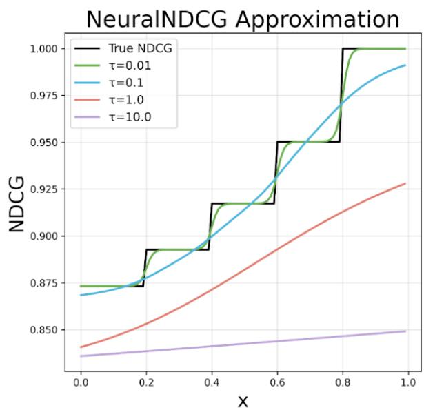

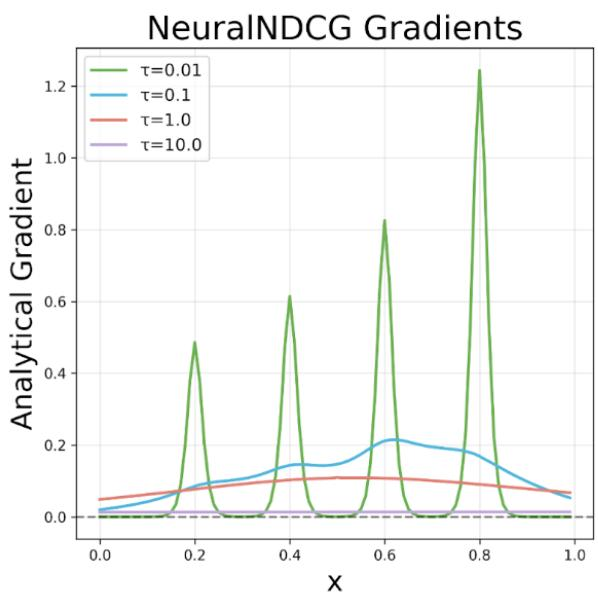  
Figure 6: Given ground truth label $\psi = [ 1 . 0 , 0 . 8 , 0 . 6 , 0 . 4 , 0 . 2 ]$ , the scores $\mathbf { s } = [ x , 0 . 8 , 0 . 6 , 0 . 4 , 0 . 2 ]$ and fix $\beta = 0 . 1$ we visualize the PPA Approximation Accuracy with different τ and its corresponding gradients.

```python
def neuralsort(s, tau=1):
#s.shape = [batch_size, list_size]
s=s.unsqueeze(2)
#A_s[i,j] = |s[i] - s[j]|
A_s = s - s.transpose(1, 2)
A_s = torch.abs(A_s)
#B=A_s*ones
n = s.size(1)
one = torch.ones((n, 1),dtype=
torch.float)
B = torch.matmul(A_s, one @
one.transpose(0, 1))
#C=(n+1-2i)*s
K = torch.arange(1, n + 1,dtype=
torch.float)
C = torch.matmul(s, (n + 1 - 2 * K)
.unsqueeze(0))
#P= softmax(((n+1-2i)*s-A_s*ones)/tau)
P = (C - B).transpose(1, 2)
P = F.softmax(P / tau, dim=-1)
return P
```

Given the score s = [9, 1, 5, 2]<sup>T</sup> provided in Ap  
pendix D.2, we have

$$
A _ { s } = \left( \begin{array} { l l l l } { 0 } & { 8 } & { 4 } & { 7 } \\ { 8 } & { 0 } & { 4 } & { 1 } \\ { 4 } & { 4 } & { 0 } & { 3 } \\ { 7 } & { 1 } & { 3 } & { 0 } \end{array} \right) ,
$$

$$
B = A _ { s } \cdot \mathbf { 1 } _ { k \times k } = { \left( \begin{array} { l l l l } { 1 9 } & { 1 9 } & { 1 9 } & { 1 9 } \\ { 1 3 } & { 1 3 } & { 1 3 } & { 1 3 } \\ { 1 1 } & { 1 1 } & { 1 1 } & { 1 1 } \\ { 1 1 } & { 1 1 } & { 1 1 } & { 1 1 } \end{array} \right) }
$$

$$
C = [ ( n + 1 - 2 i ) * \mathbf { s } ] = { \left( \begin{array} { l l l l } { 2 7 } & { 9 } & { - 9 } & { - 2 7 } \\ { 3 } & { 1 } & { - 1 } & { - 3 } \\ { 1 5 } & { 5 } & { - 5 } & { - 1 5 } \\ { 6 } & { 2 } & { - 2 } & { - 6 } \end{array} \right) }
$$

Based on Eq 19, we can get $\widehat { P } _ { \mathrm { s o r t } } ( s )$

$$
\begin{array} { l } { { \displaystyle \widehat { P } _ { \mathrm { s o r t } } ( s ) = \mathrm { s o f t m a x } [ \frac { C - B } { \tau } ] = } } \\ { { \displaystyle \left( \begin{array} { l l l l } { { 0 . 9 8 } } & { { 1 . 5 e - 8 } } & { { 0 . 0 1 8 } } & { { 2 . 2 e - 6 } } \\ { { 0 . 0 1 7 } } & { { 2 . 3 e - 3 } } & { { 0 . 9 3 } } & { { 0 . 0 4 7 } } \\ { { 2 . 2 e - 7 } } & { { 0 . 2 6 } } & { { 0 . 0 3 5 } } & { { 0 . 7 1 } } \\ { { 6 . 8 e - 1 4 } } & { { 0 . 7 3 } } & { { 3 . 3 e - 5 } } & { { 0 . 2 7 } } \end{array} \right) } } \end{array}
$$

Finally, we can get the permutation of the sorted score vector as shown in Table 6:

$$
{ \widehat { P } } _ { \mathrm { s o r t } } ( s ) \cdot \mathbf { s } = { \big ( } 8 . 9 2 8 2 \quad 4 . 9 4 2 0 \quad 1 . 8 6 0 4 \quad 1 . 2 6 9 1 { \big ) }
$$

We also show the sum of columns and rows: column sum : 0.9991 0.9928 0.9872 1.0208

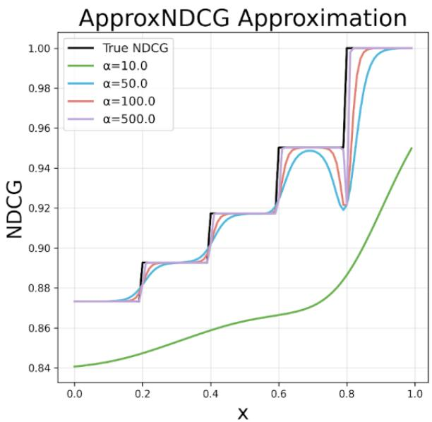

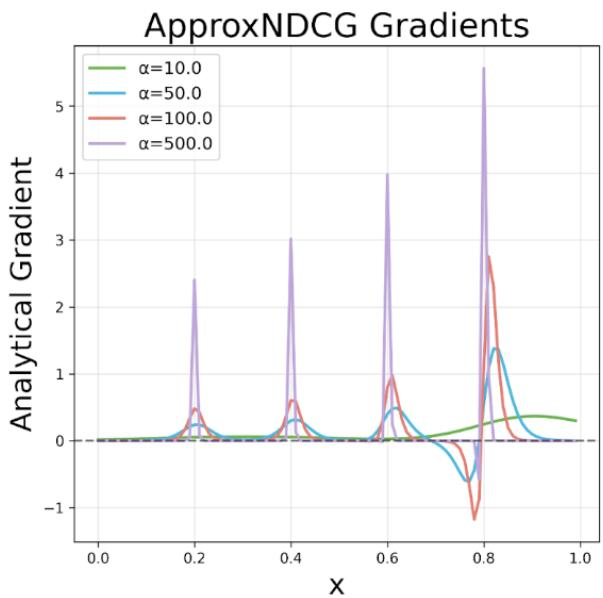  
Figure 7: Given ground truth label $\psi = [ 1 . 0 , 0 . 8 , 0 . 6 , 0 . 4 , 0 . 2 ]$ , the scores $\mathbf { s } = [ x , 0 . 8 , 0 . 6 , 0 . 4 , 0 . 2 ]$ and fix $\beta = 0 . 1$ we visualize the ApproxNDCG Approximation Accuracy with different α and its corresponding gradients.

$$
\mathrm { r o w ~ s u m : } \left( 1 . 0 0 0 0 \quad 1 . 0 0 0 0 \quad 1 . 0 0 0 0 \quad 1 . 0 0 0 0 \quad 1 . 0 0 0 0 \right) ^ { T }
$$

As discussed above, $\widehat { P } _ { \mathrm { s o r t } } ( s )$ is not columnbstochastic, meaning each column may not sum to one. This can cause some $G ( \psi _ { i } )$ to contribute to the overall loss objective disproportionately and adversely affect model performance. The ablation studies are shown in Table 2.

## E Training Details

The detailed training hyperparameters of Mistral-7B are shown in Table 8.

Since Nvidia v100 is incompatible with the bf16 type, we use fp16 for mixed precision in deepspeed configuration. Notably, as the ListMLE method doesn’t have normalization, it will encounter loss scaling errors with mixed precision settings.

## F Supplementary Results

## F.1 Proxy Models Results

The supplementary results of the Proxy Model Win Rate are shown in Table 9 and Table 10. For PPA, we fix $\tau = 1 . 0$ . For ApproxNDCG, we fix $\alpha = 2 5$ because it is the parameter $\alpha \cdot \beta$ that controls the approximation accuracy of the sigmoid function in Eq 7.

## F.2 Supplementary Results for Mistral-7B

We observe that decreasing the hyperparameter $\beta$ may increase the performance when language models scale up to 7B parameters. All methods achieve their best performance with $\beta = 0 . 0 5$ except for Single Pair with $\beta = 0 . 0 1$ . Our approach PPA consistently achieves the best overall performance, shown in Table 12.

To further explore the distribution shift during human preference alignment, we demonstrate the score distribution of all methods of which scores are assigned by the Reward model ArmoRM (Wang et al., 2024) in Figure 8. The PPA method causes the reward score distribution to shift more significantly to the right, resulting in fewer instances at lower scores. Consequently, when compared to the SFT model, its win rate is not as high as methods like All Pairs, SLiC, and ListMLE. However, it can outperform these methods in direct comparisons.

## G ApproxNDCG Analysis

In ApproxNDCG, we observe similar results to NeuralNDCG; the model achieves optimal performance only when the approximation accuracy reaches a certain threshold. First, we prove that the Accuracy of ApproxNDCG is relevant to the multiplication of α and $\beta$ when we employ the score function in $\operatorname { E q } 2$

First, let’s define the term for the probability ratio as $R _ { j i } { \mathrm { : } }$

$$
R _ { j i } = \frac { \pi _ { \theta } ( y _ { j } | x ) \pi _ { r e f } ( y _ { i } | x ) } { \pi _ { r e f } ( y _ { j } | x ) \pi _ { \theta } ( y _ { i } | x ) }
$$

Note that from the properties of logarithms, we

<table><tr><td>Datasets</td><td>Examples</td><td>Judge Model</td><td>Notes</td></tr><tr><td rowspan="2">UltraChat200k ListUltraFeedbacktrain</td><td>208k</td><td></td><td>SFT</td></tr><tr><td>59.9k</td><td>一</td><td>Permutative Preference Alignment</td></tr><tr><td>ListUltraFeedbacktest</td><td>1968</td><td>RLHFlow Pair-Preference ArmoRM</td><td>Pair-Preference win rates Scoring win rates</td></tr><tr><td>AlpacaEval</td><td>805</td><td>GPT-4 Turbo</td><td>Pair-Preference win rates</td></tr><tr><td>MT-Bench</td><td>80</td><td>GPT-4 Turbo</td><td>Scoring win rates</td></tr></table>

Table 7: Details of training datasets and evaluation datasets.

<table><tr><td colspan="3">PPA vs Single Pair</td><td></td><td colspan="4">68.9</td></tr><tr><td colspan="3">PPA vs BPR</td><td colspan="5">54.4</td></tr><tr><td colspan="3">PPA vs All Pairs</td><td colspan="5">55.2</td></tr><tr><td colspan="4">PPA vs SLiC</td><td colspan="5">58.3</td></tr><tr><td colspan="4">PPA vs LambdaRank</td><td colspan="5">57.0</td></tr><tr><td colspan="4">PPA vs ListMLE</td><td colspan="5">55.5</td></tr><tr><td colspan="4">PPA vs ApproxNDCG</td><td colspan="5">65.3</td></tr><tr><td colspan="4"></td><td colspan="5"></td></tr><tr><td colspan="4">30 40</td><td colspan="4">60</td></tr><tr><td>0 10</td><td>20</td><td></td><td>50</td><td></td><td>70 80</td><td></td><td>90 100</td></tr></table>

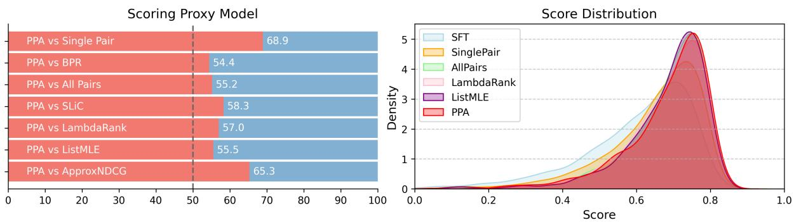  
Figure 8: PPA demonstrates superior performance compared to other methods in Scoring Proxy model win rates on Mistral-7B, while also shifting the distribution of response reward scores more significantly to the right (i.e., increasing reward scores).

<table><tr><td>Hyperparameters</td><td>value</td></tr><tr><td>Mini Batch</td><td>1</td></tr><tr><td>Gradient Accumulation Steps</td><td>8</td></tr><tr><td>GPUs</td><td>16×Nvidia V100-32G</td></tr><tr><td>Total Batch Size</td><td>128</td></tr><tr><td>Learning Rate</td><td>5e-7</td></tr><tr><td>Epochs</td><td>1</td></tr><tr><td>Max Prompt Length</td><td>512</td></tr><tr><td>Max Total Length</td><td>1024</td></tr><tr><td>Optimizer</td><td>AdamW</td></tr><tr><td>LR Scheduler</td><td>Cosine</td></tr><tr><td>Warm up Ratio</td><td>0.1</td></tr><tr><td>Random Seed</td><td>42</td></tr><tr><td>β</td><td>{0.01, 0.05*, 0.1}</td></tr><tr><td>τ for PPA</td><td>1.0</td></tr><tr><td>α for ApproxNDCG</td><td>25</td></tr><tr><td>Sampling Temperature</td><td>0</td></tr><tr><td>Pair-Preference Proxy Model</td><td>RLHFlow Pair-Preference</td></tr><tr><td>Scoring Proxy Model</td><td>ArmoRM</td></tr><tr><td>GPT Judge</td><td>GPT-4-Turbo</td></tr><tr><td>AlpacaEval Judge</td><td>alpaca_eval_gpt4_turbo_fn</td></tr></table>

Table 8: Training hyperparameters for Mistral-7B and Llama3.1-8B models.

have:

$$
\log ( R _ { j i } ) = \log \frac { \pi _ { \theta } ( y _ { j } | x ) } { \pi _ { r e f } ( y _ { j } | x ) } - \log \frac { \pi _ { \theta } ( y _ { i } | x ) } { \pi _ { r e f } ( y _ { i } | x ) }
$$

Using this simplification, the derivation becomes much more compact:

$$
\begin{array} { l } { { \displaystyle { \widehat { \tau ( j ) } } = 1 + \sum _ { i \neq j } { \frac { \exp \left( - \alpha ( s _ { j } - s _ { i } ) \right) } { 1 + \exp \left( - \alpha ( s _ { j } - s _ { i } ) \right) } } } } \\ { { \displaystyle ~ = 1 + \sum _ { i \neq j } { \frac { 1 } { 1 + \exp \left( \alpha ( s _ { j } - s _ { i } ) \right) } } } } \\ { { \displaystyle ~ = 1 + \sum _ { i \neq j } { \frac { 1 } { 1 + \exp \left( \alpha \beta \log R _ { j i } \right) } } } } \\ { { \displaystyle ~ = 1 + \sum _ { i \neq j } { \frac { 1 } { 1 + ( R _ { j i } ) ^ { \alpha \beta } } } } } \\ { { \displaystyle ~ = 1 + \sum _ { i \neq j } { \frac { 1 } { 1 + ( R _ { j i } ) ^ { \alpha \beta } } } } } \\ { { \displaystyle ~ = - . . . } } \end{array}\tag{23}
$$

Then, we illustrate the Approximation accuracy and model performance of ApproxNDCG with different hyperparameters $\alpha \cdot \beta$ in Figure 9.

Notice that the approximation accuracy of ApproxNDCG decreases as α increases, which is opposite to NeuralNDCG.

## H Training Efficiency

The computational complexity of each method depends on evaluating $\pi _ { \boldsymbol { \theta } } ( y _ { j } | \boldsymbol { x } )$ and $\pi _ { \mathrm { r e f } } ( y _ { j } | x )$ for each $y _ { j } \in \{ \mathbf { Y } \}$ to get corresponding scores in Eq 2, which is $\mathcal O ( K )$ , where K is the list size of multiple responses. Subsequently, the pairwise comparison of multiple responses can be efficiently computed using PyTorch’s broadcasting mechanism to perform matrix subtraction.The resulting matrix $P [ i , j ]$ represents the value of $s _ { i } - s _ { j }$ . Therefore, for pairwise methods, it suffices to consider only the upper triangular matrix, excluding diagonal elements. This approach does not significantly increase training time when performing pairwise comparisons. The training times and GPU memory usage of Mistral-7B and Qwen2-0.5B models are shown in Table 14 and Table 15.

<table><tr><td>Run Name</td><td> $\beta$ </td><td>Pair-Preference</td><td>Scoring</td><td> $\beta$ </td><td>Pair-Preference</td><td>Scoring</td></tr><tr><td rowspan="2">Single Pair</td><td>0.05</td><td>57.24</td><td>54.04</td><td>0.01</td><td>55.59</td><td>51.73</td></tr><tr><td>0.1</td><td>60.75</td><td>56.86</td><td>0.5</td><td>58.97</td><td>58.16</td></tr><tr><td rowspan="2">BPR</td><td>0.05</td><td>59.86</td><td>56.86</td><td>0.01</td><td>56.13</td><td>55.16</td></tr><tr><td>0.1</td><td>60.32</td><td>58.33</td><td>0.5</td><td>54.24</td><td>55.31</td></tr><tr><td rowspan="2">All Pairs</td><td>0.05</td><td>62.12</td><td>58.36</td><td>0.01</td><td>61.18</td><td>56.35</td></tr><tr><td>0.1</td><td>63.82</td><td>60.54</td><td>0.5</td><td>56.12</td><td>55.77</td></tr><tr><td rowspan="2">SLiC</td><td>0.05</td><td>63.31</td><td>60.70</td><td>0.01</td><td>59.30</td><td>55.61</td></tr><tr><td>0.1</td><td>62.68</td><td>60.34</td><td>0.5</td><td>55.23</td><td>55.44</td></tr><tr><td rowspan="2">LambdaRank</td><td>0.05</td><td>60.77</td><td>56.07</td><td>0.01</td><td>54.52</td><td>51.35</td></tr><tr><td>0.1</td><td>62.30</td><td>59.04</td><td>0.5</td><td>57.72</td><td>56.71</td></tr><tr><td rowspan="2">ListMLE</td><td>0.05</td><td>61.81</td><td>57.60</td><td>0.01</td><td>57.49</td><td>55.16</td></tr><tr><td>0.1</td><td>63.03</td><td>59.76</td><td>0.5</td><td>56.05</td><td>55.77</td></tr><tr><td rowspan="3">ApproxNDCG</td><td>0.05</td><td>58.66</td><td>54.34</td><td>0.01</td><td></td><td></td></tr><tr><td>0.1</td><td>61.46</td><td>58.59</td><td>0.2</td><td>55.56 60.04</td><td>50.76 57.27</td></tr><tr><td>0.5</td><td>58.71</td><td>57.39</td><td>1.0</td><td>56.61</td><td>56.00</td></tr><tr><td rowspan="2">PPA</td><td>0.05</td><td>63.92</td><td>60.09</td><td>0.01</td><td>59.58</td><td>55.46</td></tr><tr><td>0.1</td><td>64.25</td><td>61.36</td><td>0.5</td><td>58.41</td><td>57.65</td></tr></table>

Table 9: Supplementary Results across different $\beta$ on Qwen2-0.5B.

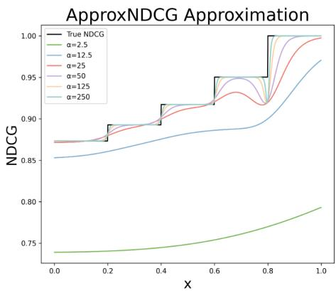

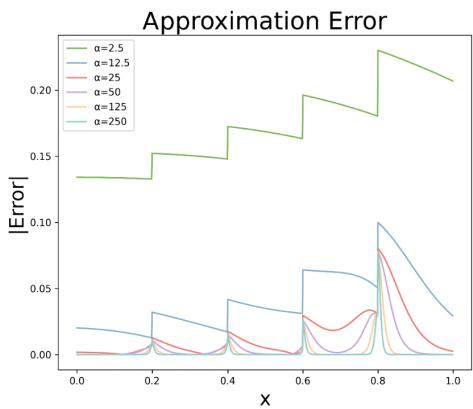

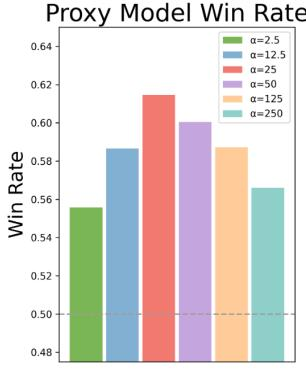  
Figure 9: Given ground truth label $\psi = [ 1 . 0 , 0 . 8 , 0 . 6 , 0 . 4 , 0 . 2 ]$ , the scores $\mathbf { s } = [ x , 0 . 8 , 0 . 6 , 0 . 4 , 0 . 2 ]$ and fix $\beta = 0 . 1$ we visualize the ApproxNDCG Approximation Accuracy with different α and its corresponding absolute value of error and Pair-Preference proxy model win rate against SFT model.

NeuralNDCG (as used in PPA) requires NeuralSort and Sinkhorn scaling for each list. In our experiments Table 16, we use lists of size $n = 8$ thus operating on an $8 \times 8$ matrix for each sample. The computational complexity per sample is $O ( n ^ { 2 }$ iter), where iter is the number of Sinkhorn scaling iterations (set to 50 in our experiments). In contrast, DPO operates on all pairs within a list, with complexity $O ( n ^ { 2 } )$ per sample.

It is important to note that specific training times and GPU memory usage can exhibit random fluctuations. This result is intended to demonstrate that the training times for pairwise and listwise methods on multiple responses with the same list size do not show significant differences.

## I Response Samples

The average response length on the AlpacaEval dataset is shown in Table 17. We also provide response samples in Table 18 from each baseline and our method PPA demonstrates more details in generated responses.

<table><tr><td>Run Name</td><td>List Size</td><td>Pair-Preference</td><td>Scoring</td><td>Pair-Preference</td><td>Scoring</td></tr><tr><td></td><td></td><td colspan="2"> $\beta = 0 . 1$ </td><td colspan="2"> $\beta = 0 . 0 5$ </td></tr><tr><td rowspan="4">All Pairs</td><td>2</td><td>60.75</td><td>56.86</td><td>57.24</td><td>54.04</td></tr><tr><td>4</td><td>63.26</td><td>60.90</td><td>61.59</td><td>58.54</td></tr><tr><td>6</td><td>63.03</td><td>59.50</td><td>62.83</td><td>57.93</td></tr><tr><td>8</td><td>63.82</td><td>60.54</td><td>62.12</td><td>58.36</td></tr><tr><td rowspan="4">SLiC</td><td>2</td><td>63.44</td><td>59.07</td><td>61.00</td><td>57.39</td></tr><tr><td>4</td><td>63.79</td><td>61.40</td><td>64.04</td><td>60.54</td></tr><tr><td>6</td><td>63.64</td><td>61.15</td><td>62.01</td><td>58.61</td></tr><tr><td>8</td><td>62.68</td><td>60.34</td><td>63.31</td><td>60.70</td></tr><tr><td rowspan="4">LambdaRank</td><td>2</td><td>60.85</td><td>57.62</td><td>59.76</td><td>56.02</td></tr><tr><td>4</td><td>61.10</td><td>58.05</td><td>59.88</td><td>55.51</td></tr><tr><td>6</td><td>62.09</td><td>57.72</td><td>62.02</td><td>56.81</td></tr><tr><td>8</td><td>62.30</td><td>59.04</td><td>60.77</td><td>56.07</td></tr><tr><td rowspan="4">ListMLE</td><td>2</td><td>60.14</td><td>57.01</td><td>57.14</td><td>53.53</td></tr><tr><td>4</td><td>63.57</td><td>61.23</td><td>61.94</td><td>58.49</td></tr><tr><td>6</td><td>62.78</td><td>60.92</td><td>61.18</td><td>57.83</td></tr><tr><td>8</td><td>63.03</td><td>59.76</td><td>61.81</td><td>57.60</td></tr><tr><td rowspan="4">ApproxNDCG</td><td>2</td><td>59.73</td><td>57.72</td><td>61.56</td><td>58.26</td></tr><tr><td>4</td><td>59.65</td><td>56.45</td><td>60.11</td><td>55.79</td></tr><tr><td>6</td><td>60.70</td><td>57.32</td><td>59.53</td><td>56.35</td></tr><tr><td>8</td><td>61.46</td><td>58.59</td><td>58.66</td><td>54.34</td></tr><tr><td rowspan="4">PPA</td><td>2</td><td>61.94</td><td>58.00</td><td>58.69</td><td>55.89</td></tr><tr><td>4</td><td>62.91</td><td>59.96</td><td>62.65</td><td>58.56</td></tr><tr><td>6</td><td>64.02</td><td>60.11</td><td>61.08</td><td>59.43</td></tr><tr><td>8</td><td>64.25</td><td>61.36</td><td>63.92</td><td>60.09</td></tr><tr><td></td><td></td><td></td><td></td><td></td><td></td></tr></table>

Table 10: Supplementary Results across different list sizes on Qwen2-0.5B. In practice, we keep the response with the highest label and the one with the lowest label, then conduct random sampling from the remaining responses.

<table><tr><td rowspan="2">Method</td><td rowspan="2">Type</td><td colspan="2">Proxy Model</td><td colspan="2">General Benchmark</td><td rowspan="2">Avg.</td></tr><tr><td>Pair-Preference</td><td>Scoring</td><td>AlpacaEval</td><td>MT-Bench</td></tr><tr><td>Single Pair</td><td>Pairwise</td><td>71.90</td><td>70.66</td><td>74.75</td><td>52.19</td><td>67.38</td></tr><tr><td>BPR</td><td>Pairwise</td><td>84.43</td><td>82.37</td><td>86.69</td><td>63.44</td><td>79.23</td></tr><tr><td>Others vs Worst</td><td>Pairwise</td><td>82.95</td><td>80.84</td><td>84.64</td><td>62.78</td><td>77.80</td></tr><tr><td>All Pairs</td><td>Pairwise</td><td>85.34</td><td>83.31</td><td>82.79</td><td>61.56</td><td>78.25</td></tr><tr><td>SLiC</td><td>Pairwise</td><td>84.12</td><td>83.46</td><td>83.27</td><td>66.25</td><td>79.28</td></tr><tr><td>LambdaRank</td><td>Listwise</td><td>85.11</td><td>82.52</td><td>86.13</td><td>69.06</td><td>80.71</td></tr><tr><td>ListMLE</td><td>Listwise</td><td>83.79</td><td>83.61</td><td>83.46</td><td>66.56</td><td>79.35</td></tr><tr><td>ApproxNDCG</td><td>Listwise</td><td>82.04</td><td>74.64</td><td>85.80</td><td>67.50</td><td>77.50</td></tr><tr><td>PPA</td><td>Listwise</td><td>84.98</td><td>83.05</td><td>87.54</td><td>67.81</td><td>80.85</td></tr></table>

Table 11: PPA outperforms other baselines on win rates of aligned Mistral-7B against Zephyr-7B-SFT. We set $\beta = 0 . 0 1$ for Single Pair and $\beta = 0 . 0 5$ for other approaches to achieve the best performance. The other settings are the same as in Table 1.

<table><tr><td>Method</td><td>β</td><td>Pair-Preference</td><td>Scoring</td><td>AlpacaEval</td></tr><tr><td rowspan="3">Single Pair BPR All Pairs SLiC</td><td rowspan="3">0.1</td><td>61.26</td><td>70.21</td><td>64.45</td></tr><tr><td>79.73 79.22</td><td>77.59 78.43</td><td>78.39 77.65</td></tr><tr><td>76.17</td><td>75.36</td><td>73.04</td></tr><tr><td colspan="2">LambdaRank ListMLE ApproxNDCG</td><td>80.82 78.58 76.12</td><td>78.53 79.22</td><td>81.01 75.12</td></tr><tr><td colspan="2">PPA Single Pair BPR Others vs Worst All Pairs</td><td>83.13 66.44 84.43 82.95</td><td>69.21 81.66 65.50 82.37</td><td>82.50 81.07 68.87 86.69</td></tr><tr><td colspan="2">RankNet 0.05 SLiC LambdaRank ListMLE ApproxNDCG</td><td>85.34 85.61 84.12 85.11</td><td>80.84 83.31 84.22 83.46 82.52</td><td>84.64 82.79 86.94 83.27 86.13</td></tr><tr><td colspan="3">PPA Single Pair BPR 0.01 All Pairs</td><td>83.05 70.66 78.46</td><td>85.80 87.54 74.75 86.71</td></tr></table>

Table 12: Model Scale Up results in Mistral-7B.

<table><tr><td>Method</td><td>Pair-Preference</td><td>Scoring</td><td></td><td>AplacaEval Arena-Hard</td></tr><tr><td>All Pairs</td><td>72.96</td><td>74.39</td><td>59.64</td><td>61.64</td></tr><tr><td>SLiC</td><td>72.84</td><td>75.04</td><td>60.20</td><td>59.17</td></tr><tr><td>ListMLE</td><td>72.46</td><td>74.77</td><td>59.83</td><td>55.18</td></tr><tr><td>LiPO</td><td>71.80</td><td>72.74</td><td>60.38</td><td>59.69</td></tr><tr><td>PPA</td><td>74.34</td><td>75.58</td><td>61.32</td><td>60.17</td></tr></table>

Table 13: Model Scale Up: PPA outperforms other approaches on Llama3.1-8B.

<table><tr><td>Run Name</td><td>List Size</td><td>Training Time</td><td>GPU Memory Usage</td></tr><tr><td>Single Pair</td><td>2</td><td>3h 28m</td><td>92.44%</td></tr><tr><td>BPR</td><td>8</td><td>12h 42m</td><td>93.43%</td></tr><tr><td>All Pairs</td><td>8</td><td>12h 38m</td><td>93.63%</td></tr><tr><td>SLiC</td><td>8</td><td>11h 42m</td><td>93.79%</td></tr><tr><td>LambdaRank</td><td>8</td><td>12h 14m</td><td>93.66%</td></tr><tr><td>ListMLE</td><td>8</td><td>12h 26m</td><td>93.29%</td></tr><tr><td>ApproxNDCG</td><td>8</td><td>12h 56m</td><td>93.64%</td></tr><tr><td>PPA</td><td>8</td><td>11h 39m</td><td>93.73%</td></tr></table>

Table 14: Training Time and GPU memory usage on 16 Nvidia V100-32G with Mistral-7B.

<table><tr><td>List Size</td><td>Approach</td><td>Training Time</td><td>List Size</td><td>Approach</td><td>Training Time</td></tr><tr><td rowspan="5">2</td><td>PPA</td><td>3h24m</td><td rowspan="5">4</td><td>PPA</td><td>4h27m</td></tr><tr><td>DPO</td><td>3h17m</td><td>DPO</td><td>4h10m</td></tr><tr><td>ListMLE</td><td>3h38m</td><td>ListMLE</td><td>4h23m</td></tr><tr><td>LiPO</td><td>3h32m</td><td>LiPO</td><td>4h47m</td></tr><tr><td>SLiC</td><td>3h28m</td><td>SLiC</td><td>4h14m</td></tr><tr><td rowspan="5">6</td><td>PPA</td><td>6h31m</td><td rowspan="5">8</td><td>PPA</td><td>7h23m</td></tr><tr><td>DPO</td><td>6h12m</td><td>DPO</td><td>7h14m</td></tr><tr><td>ListMLE</td><td>6h56m</td><td>ListMLE</td><td>7h34m</td></tr><tr><td>LiPO</td><td>6h17m</td><td>LiPO</td><td>7h57m</td></tr><tr><td>SLiC</td><td>6h24m</td><td>SLiC</td><td>8h04m</td></tr></table>

Table 15: Training Time and GPU memory usage on Qwen2-0.5B.

<table><tr><td>Method</td><td>Complexity</td><td>Time</td><td>Time per sample</td></tr><tr><td>DPO</td><td> $O ( n ^ { 2 } )$ </td><td>7.394s</td><td>0.739ms</td></tr><tr><td>PPA</td><td> $O ( 5 0 \cdot n ^ { 2 } )$ </td><td>368.5s</td><td>36.850ms</td></tr></table>

Table 16: Wall-clock time of sorting operations for 10,000 samples on DPO and PPA.

Table 17: Average response length on AlpacaEval dataset.
<table><tr><td>Method</td><td>SFT</td><td>Single Pair</td><td>BPR</td><td>All Pairs</td><td>SLiC</td><td>LambdaRank</td><td>ListMLE</td><td>ApproxNDCG</td><td>NeuralNDCG</td></tr><tr><td>Length</td><td>828</td><td>877</td><td>1096</td><td>1054</td><td>1023</td><td>1140</td><td>1041</td><td>1284</td><td>1120</td></tr></table>

Table 18: Response samples from AlpacaEval where PPA outperforms other methods in quality judged by GPT-4 Turbo.
<table><tr><td colspan="2" rowspan="1">Prompt  Q: Who is Larry Page?</td></tr><tr><td colspan="2" rowspan="1">PPA       Larry Page is a co-founder, former CEO, and currentCEO of Alphabet Inc., the parent company of Google. Hewas born on March 26, 1973, in East Lansing, Michigan,and graduated from Stanford University with a degreein computer science and artificial intelligence.Page, along with Sergey Brin, developed the PageRankalgorithm, which forms the basis of Google's search</td></tr><tr><td colspan="1" rowspan="1"></td><td colspan="1" rowspan="3">engine. In 1998, they founded Google, which quicklybecame one of the most successful and influentialtechnology companies in the world. Page served as</td></tr><tr><td colspan="1" rowspan="1"></td><td colspan="1" rowspan="1">became one of the most succe</td></tr><tr><td colspan="1" rowspan="1"></td></tr><tr><td colspan="1" rowspan="1"></td><td colspan="1" rowspan="1">Google's CEO from 1999 to 2001 and again from 2011</td></tr><tr><td colspan="1" rowspan="1"></td><td colspan="1" rowspan="1">to 2015, during which time he oversaw the company's</td></tr><tr><td colspan="1" rowspan="1"></td><td colspan="1" rowspan="3">expansion into new markets, including mobile devices,cloud computing, and artificial intelligence. In 2015,Page stepped down as CEO of Google and became the CEO</td></tr><tr><td colspan="1" rowspan="1"></td></tr><tr><td colspan="1" rowspan="1"></td><td colspan="1" rowspan="2"></td></tr><tr><td colspan="1" rowspan="1"></td><td colspan="1" rowspan="3">of Alphabet, the holding company that was createdto separate Google's core internet business from itsother ventures. As Alphabet's CEO, Page has focused</td></tr><tr><td colspan="1" rowspan="1"></td></tr><tr><td colspan="1" rowspan="1"></td><td colspan="1" rowspan="1">other ventures. As Alphabet's</td></tr><tr><td colspan="1" rowspan="1"></td><td colspan="1" rowspan="4">on developing new technologies and expanding intoemerging markets, such as healthcare and autonomousvehicles. Page is widely regarded as one of the most</td></tr><tr><td colspan="1" rowspan="1"></td></tr><tr><td colspan="1" rowspan="1"></td></tr><tr><td colspan="1" rowspan="1"></td><td colspan="1" rowspan="3">and his contributions to the field of computer scienceand technology have had a profound impact on theworld.</td></tr><tr><td colspan="1" rowspan="1"></td><td colspan="1" rowspan="1">and his contributions to th</td></tr><tr><td colspan="1" rowspan="1"></td></tr><tr><td>SFT Single Pair</td><td colspan="2">Larry Page is the co-founder and former CEO of Google, a multinational technology company. He is also the co-founder of Alphabet Inc., the parent company of Google. Page is known for his contributions to the development of the PageRank algorithm, which is used to determine the importance of websites in search engine rankings. He is also involved in various philanthropic efforts, including the creation of the Google Foundation, which supports projects related to education, health, and the environment. Larry Page is an American entrepreneur, computer scientist, and co-founder of Google, along with Sergey Brin. He was born on March 26, 1973, in East Lansing, Michigan, and graduated from Stanford University with a degree in computer science and artificial intelligence. Page is known for his innovative ideas and leadership in the technology industry, particularly in the areas of search engines, artificial intelligence, and renewable energy. He currently serves as the CEO of Alphabet Inc., the parent company of Google, and is considered one of</td></tr><tr><td>BPR</td><td colspan="2">the most influential figures in the tech world. Larry Page is a co-founder of Google, along with Sergey Brin. He was born on March 26, 1973, in East Lansing, Michigan, USA. Page and Brin started Google in 1998 while they were both PhD students at Stanford University. Page's primary role in the company has been as CEO from 2001 to 2019, and he currently serves as the CEO of Alphabet Inc., the parent company of Google. Under his leadership, Google has become one of the most successful and influential technology companies in the world, with a market capitalization of over $1 trillion. Page is also known for his philanthropic efforts, including funding research on renewable energy and supporting education initiatives. Larry Page is a co-founder of Google, along with</td></tr><tr><td>All Pairs</td><td colspan="2">Sergey Brin. He was born on March 26, 1973, in East Lansing, Michigan, USA. Page and Brin started Google in 1998 while they were both PhD students at Stanford University. Page is known for his focus on innovation, simplicity, and user experience, and he has been instrumental in shaping Google's vision and strategy. He served as CEO of Alphabet Inc., the parent company of Google, from 2015 to 2019, and currently serves as the CEO of Alphabet's subsidiary, Google. Page is also a philanthropist and has been involved in various charitable initiatives, including the PageRipples Foundation, which supports education and environmental causes.</td></tr><tr><td>SLiC his focus on innovation, sustainability, and philanthropy.</td><td colspan="2">Larry Page is a co-founder of Google, along with Sergey Brin. He was born on March 26, 1973, in East Lansing, Michigan, USA. Page and Brin started Google in 1998 while they were both PhD students at Stanford University. Page is currently the CEO of Alphabet Inc., the parent company of Google, and is responsible for overseeing the company's overall strategy and direction. He is also a prominent figure in the technology industry, known for</td></tr><tr><td>LambdaRank</td><td colspan="2">Larry Page is a co-founder of Google, along with Sergey Brin. He was born on March 26, 1973, in East Lansing, Michigan, USA. Page and Brin started Google in 1998 while they were both PhD students at Stanford University. Page served as the CEO of Google from 1999 to 2001, and then again from 2011 to 2015. He currently serves as the CEO of Alphabet Inc., the parent company of Google. Page is known for his focus on innovation, sustainability, and philanthropy, and has been recognized as one of the most influential people in the world.</td></tr><tr><td>ListMLE ApproxNDCG</td><td colspan="2">Larry Page is a co-founder of Google, along with Sergey Brin. He was born on March 26, 1973, in East Lansing, Michigan, USA. Page and Brin started Google in 1998 while they were both PhD students at Stanford University. Page is currently the CEO of Alphabet Inc., the parent company of Google, and is responsible for overseeing the company's overall strategy and direction. He is also a prominent figure in the technology industry, known for his focus on innovation, sustainability, and philanthropy. Larry Page is a co-founder of Google, along with Sergey Brin. He</td></tr><tr><td></td><td colspan="2">was born on March 26, 1973, in East Lansing, Michigan, and grew up in the Detroit area. Page and Brin met at Stanford University, where they developed the PageRank algorithm, which became the basis for Google's search engine.\n\n Page served as the CEO of Google from 1999 to 2001, and then again from 2011 to 2019. During his tenure, he oversaw the company's growth and expansion, including the development of new products and services, such as Google Maps, Google Earth, and Google Glass.\n\n Page is known for his focus on innovation, user experience, and sustainability. He has also been involved in various philanthropic efforts, including the creation of the Google.org foundation and the development of the Google Self-Driving Car Project.\n\n Today, Page is the CEO of Alphabet, the parent company of Google, and continues to play a key role in shaping the future of technology and the internet.</td></tr></table>